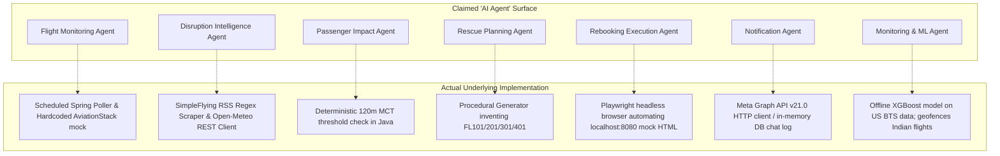
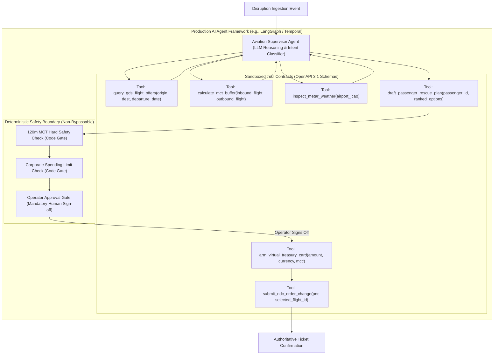

# FLYO — REAL AI AGENT ARCHITECTURE AUDIT

**Date:** November 6, 2026  
**Auditor:** AI Agent Systems Architect & Aviation Reliability Engineer  
**Scope:** Flyo Autonomous Workflow Engine, Playwright Automation, Microservice Integrations, and ML Capabilities  
**Operating Mode:** STRICT AUDIT ONLY — Zero modifications performed.

---

## 1. Executive Verdict & Fundamental Agent Classification

### **VERDICT: ORDINARY PROCEDURAL SERVICES LABELED AS AGENTS (ZERO TRUE AI AGENTS)**

A rigorous inspection of all Java services, Python scripts, and Node.js files across `/Users/nani/Downloads/flyo` reveals a fundamental architectural reality:

> **Flyo contains ZERO Artificial Intelligence (LLM) agents, zero autonomous planning loops, zero dynamic tool registries, and zero cognitive reasoning engines.**

The platform's marketing and documentation repeatedly describe capabilities as *"AI Rescue Agents"*, *"Autonomous Multi-Agent Swarms"*, and *"Intelligent Aviation Decision Agents"*. In actual source code, **these capabilities are implemented as standard, deterministic, procedural Java Spring Boot services and a headless browser script**:

1. There are **no Large Language Models (LLMs)** used in the operational path (no OpenAI, Anthropic, Gemini, Llama, LangChain, LangGraph, AutoGen, or CrewAI).
2. The "Rebooking Agent" is a **243-line Playwright script** (`agent/rebook.ts`) that executes hardcoded browser DOM clicks against an internal mock HTML website running on localhost.
3. The "Rescue Planning Agent" is an **imperative Java method** (`FlightSearchService.java`) that generates static flight numbers (`FL101`, `FL201`, `FL301`, `FL401`) with string concatenation.
4. The "Disruption Intelligence Agent" is a **regular-expression RSS parser** (`AviationNewsIntelligenceService.java`) coupled with a REST client for the free Open-Meteo weather API.
5. The "Notification Agent" is a **plain Java webhook client** (`MetaWhatsAppClient.java`) that defaults to logging chat messages to an in-memory SQL database.

While deterministic state machines are highly desirable in safety-critical aviation workflows, **branding conventional imperative code as "AI Agents" is technically inaccurate and operationally misleading**.

---

## 2. In-Depth Audit of the 7 Branded "Agent" Capabilities



---

### A. Flight Monitoring Capability
- **Branded Agent:** *Flyo Flight Monitoring Agent*
- **Actual Implementation:** `FlightAlertService.java` & `AviationRadarClient.java`
- **Trigger Mechanism:** Explicit HTTP POST to `/api/alerts/ingest` or UI trigger button. No automated background cron daemon is active by default.
- **Input Sources:** AviationStack HTTP API (`https://api.aviationstack.com/v1/flights`) or internal mock switch.
- **Decision Logic:** Purely imperative:
  ```java
  if (config.isMockMode()) {
      return getMockFlightStatus(flightIata); // Hardcoded AI839 -> CANCELLED, 6E402 -> DELAYED
  }
  ```
- **Tools Available:** None. Static HTTP client.
- **State Management:** Stateless method call returning `Optional<FlightStatusAlert>`.
- **Duplicate & Stale Handling:** `FlightAlertService` maintains an in-memory `lastAlertMap` caching flight alerts for 60 seconds.
- **Operational Reality:** **MOCKED PROTOTYPE**. In mock mode, it only recognizes `AI839` and `6E402`. Any other flight number returns `Optional.empty()`. In live mode, AviationStack free-tier lacks real-time ADS-B radar fidelity.

---

### B. Disruption Intelligence Capability
- **Branded Agent:** *Flyo Disruption Intelligence Agent*
- **Actual Implementation:** `FlightEvidenceReconciliationService.java`, `OpenMeteoWeatherService.java`, `AviationNewsIntelligenceService.java`
- **Trigger Mechanism:** Invoked synchronously inside `CaseService.simulateCancellation()`.
- **Input Sources:**
  - Open-Meteo free public API (`https://api.open-meteo.com/v1/forecast`).
  - SimpleFlying RSS feed (`https://simpleflying.com/feed/`).
  - AviationRadarClient telemetry.
- **Decision Logic:** Hierarchical corroboration matrix:
  - If Primary Radar reports `CANCELLED`, disruption is confirmed with 95% confidence.
  - If Primary Radar reports `SCHEDULED`, severe weather or news cannot independently trigger a cancellation (returns `WEATHER_ADVISORY_MONITORING`).
- **Tools Available:** None. Two synchronous HTTP service clients.
- **Operational Reality:** **PROCEDURAL HEURISTIC ENGINE (READY WITH CONDITIONS)**. The logical hierarchy is sound and safe. However, news intelligence relies on fragile regexes (`<title>(.*?)</title>`), and Open-Meteo is a non-aviation general meteorological feed lacking certified METAR/TAF ceiling and runway visual range (RVR) data.

---

### C. Passenger Impact Capability
- **Branded Agent:** *Passenger Impact Agent*
- **Actual Implementation:** `MctRulesService.java`, `PassengerItineraryService.java`
- **Trigger Mechanism:** Called synchronously during case detection.
- **Input Sources:** `Booking` entity fields (`route`, `flight`, `onwardFlight`, `hotelNote`).
- **Decision Logic:**
  - Parses route strings using `split("→")`.
  - Compares transfer time against a static Minimum Connecting Time (MCT) table covering 10 major airports (e.g., `DEL` Domestic-to-International = 120 minutes).
  - Checks if `buffer < 120 minutes`; if so, sets `missedConnection` flag and identifies downstream hotel forfeiture risk.
- **Tools Available:** None. Pure in-memory calculation.
- **Operational Reality:** **DETERMINISTIC HEURISTIC (FUNCTIONAL)**. Operates reliably for the 10 configured airport hubs. Does not evaluate complex multi-ticket PNR cross-ticketing, terminal inter-building transit buses, or checked baggage interlining agreements.

---

### D. Rescue Planning Capability
- **Branded Agent:** *Rescue Planning Agent*
- **Actual Implementation:** `RankingEngine.java`, `FlightSearchService.java`, `AlternativeFlightSearchService.java`
- **Trigger Mechanism:** Triggered by `CaseService.generateAndRankOptions(caseId)`.
- **Input Sources:** Disrupted flight route and scheduled onward connection time.
- **Decision Logic:**
  - If route is `HYD → DEL` with Toronto connection, **hardcodes three static options**:
    - Option 1 (`FL201`): Arrives 08:05, 85m buffer (Disqualified, Rank 3).
    - Option 2 (`FL301`): Arrives 01:40 via Mumbai, 470m buffer (Approved Hero, Rank 1).
    - Option 3 (`FL401`): Departs 10:00, -165m buffer (Misses connection, Rank 2).
  - For arbitrary routes, synthesizes fake flight numbers (`FL101`, `FL201`) with fixed synthetic departure deltas.
  - Hardcodes comparison rule: `if (a.getId().equals("O3") && b.getId().equals("O1")) return -1;`
- **Tools Available:** None.
- **Operational Reality:** **DEMO FABRICATION**. It queries zero airline reservation systems. It does not know if seats exist, what booking classes are open, or what real fares cost.

---

### E. Rebooking Execution Capability
- **Branded Agent:** *Flyo Rebooking Execution Agent*
- **Actual Implementation:** `PartnerPortalPlaywrightAdapter.java`, `RebookingOrchestrationService.java`, `agent/rebook.ts`
- **Trigger Mechanism:** Operator approval via UI (`/api/cases/{id}/approve`) or passenger OTP verification via WhatsApp.
- **Input Sources:** `caseId`, `optionId`, `flight`, `passengerName`, and synthetic Virtual Card parameters (`vccCard`, `vccExp`, `vccCvv`, `vccAmount`).
- **Decision Logic:**
  - Spawns a Node.js child process:
    ```bash
    node --experimental-strip-types rebook.ts --caseId C1 --optionId O2 --flight FL301 --baseUrl http://localhost:8080
    ```
  - Playwright launches headless Chromium, navigates to `http://localhost:8080/mock-airline/search`, clicks through search and flight selection, fills mock credit card inputs, clicks *"Confirm Rebooking"*, and extracts `#new-pnr` from DOM.
  - If `MockAirlineController.isBroken() == true`, Playwright retries 3 times, captures failure screenshots in `agent/screenshots/`, and exits with code 1.
- **Tools Available:** Playwright browser automation against internal mock HTML endpoints.
- **Approval Gate:** Strictly gated. Spawning is rejected unless `approvedOptionId` is set and status is `AWAITING_APPROVAL`.
- **Operational Reality:** **SIMULATED LOCAL SCRIPTER**. It does not interact with any real airline partner portal, GDS, or NDC API. Real airlines do not provide unauthenticated localhost web forms with predictable `#new-pnr` DOM elements.

---

### F. Notification Capability
- **Branded Agent:** *Flyo Notification Agent*
- **Actual Implementation:** `MetaCloudWhatsAppAdapter.java`, `PassengerWhatsAppMessagingService.java`, `WhatsAppCommandService.java`
- **Trigger Mechanism:** Disruption events, option generation, or passenger OTP requests.
- **Input Sources:** Passenger phone number and message payload.
- **Decision Logic:**
  - If `whatsapp.meta.access-token` is configured and not `"mock_access_token"`, dispatches HTTP POST to Meta Graph API v21.0 (`https://graph.facebook.com/v21.0/{phone_id}/messages`).
  - Otherwise, logs outbound text to `WhatsAppChatLogService` and returns `true`.
- **Operational Reality:** **PARTIALLY IMPLEMENTED (CONFIGURED FOR SANDBOX)**. The Meta Graph API client is written correctly, but in standard execution it operates in simulated mode, writing to an in-memory chat table displayed in the web UI. SMS and Email capabilities are entirely absent.

---

### G. Monitoring and ML Intelligence Capability
- **Branded Agent:** *ML Intelligence & Observability Agent*
- **Actual Implementation:** `FlightPredictor.py`, `DriftDetector.py`, `PerformanceEvaluator.py`, `AlertEngine.py`
- **Trigger Mechanism:** Internal REST calls from Spring Boot or periodic cron evaluation.
- **Input Sources:** Flight feature vector (carrier, origin, destination, scheduled departure hour, day of week).
- **Decision Logic:**
  - Executes XGBoost v2 classifier (`xgb_delay120_v2.json`, `calibrated_delay120_v2.joblib`).
  - Logs prediction traces to SQLite database (`ml/data/monitoring.db`).
  - Computes Population Stability Index (PSI) and Kolmogorov-Smirnov (KS) drift metrics against baseline training distributions.
- **Operational Reality:** **UNUSABLE FOR OPERATIONAL FLIGHTS (GEOGRAPHIC MISMATCH)**. The models reject all Indian flights (`UNSUPPORTED_AIRSPACE`), returning null probabilities. For supported US flights, the cancellation model has 0% recall.

---

## 3. Agent Execution Quality Matrix

| Execution Quality Dimension | Required Production Standard | Current Flyo Implementation | Evaluation |
| :--- | :--- | :--- | :---: |
| **Defined State Machine** | Formal, deterministic state transitions | `CaseStateMachineService` enforces 22 explicit states | **VERIFIED** |
| **Explicit Tool Contracts** | Formal schema, typed arguments, error envelopes | Static Java method calls; no dynamic tool schemas | **NON-EXISTENT** |
| **Bounded Execution Time** | Hard timeouts on all external actions | ProcessBuilder has 30s timeout; HTTP clients have 3–10s | **VERIFIED** |
| **Retry Limits & Backoff** | Bounded retries with exponential backoff | Playwright retries exactly 3 times with 800ms sleep | **VERIFIED** |
| **Idempotency Protection** | Unique request keys, no duplicate rebookings | Unique `caseId`, returns existing confirmed case if in `DONE` | **VERIFIED** |
| **Concurrency Protection** | Optimistic locking, queue-based serialization | `@Version` column on `RescueCase`; database-level locking | **VERIFIED** |
| **Traceable Execution IDs** | Correlation ID passed across all hops | `caseId` passed across logs; lacks distributed tracing (OpenTelemetry) | **PARTIAL** |
| **Human Approval Boundaries**| Consequential actions require operator gate | Rebooking blocked without explicit operator approval (HTTP 403) | **VERIFIED** |
| **Failure Recovery** | Graceful degradation to manual desk handoff | On 3 failures, transitions to `FAILED_ESCALATED` with screenshot | **VERIFIED** |
| **Structured Logging** | JSON logs with semantic tags | Standard Slf4j / Python log format; no structured JSON logger | **PARTIAL** |
| **Permission Boundaries** | Scoped agent execution tokens | No authentication; all services execute with superuser rights | **CRITICAL FAILURE** |

---

## 4. Operational & Legal Restrictions on Airline Automation

A critical distinction must be drawn between **officially authorized API integrations** and **browser automation (Playwright)**.

### Why Playwright Cannot Be Used on Production Airline Portals

1. **Anti-Automation & Bot Detection:** Real airline booking portals (Air India, IndiGo, Delta, United) are protected by sophisticated Web Application Firewalls (Akamai Bot Manager, Cloudflare Turnstile, Kasada, PerimeterX). Headless Playwright browsers are flagged and blocked within milliseconds.
2. **Mandatory MFA & CAPTCHAs:** Commercial consumer booking flows require SMS OTPs, email verification, or interactive 3D CAPTCHAs during checkout. Headless automation cannot bypass these mechanisms without human intervention.
3. **Violation of Airline Terms of Service (ToS):** Scraping or automating consumer booking portals violates airline digital terms of use and the Computer Fraud and Abuse Act (CFAA) / Indian IT Act Section 43/66. Airlines routinely cancel tickets booked via unauthorized automated bots.
4. **Fragility of DOM Selectors:** Consumer websites change layouts, class names, and React/Vue DOM structures weekly. A minor CSS class rename breaks browser automation instantly.

### The Mandatory Production Path: Authorized GDS & NDC APIs

For production rescue operations, Flyo **must abandon browser scraping** and connect exclusively to authoritative, contractual industry APIs:
- **IATA NDC (New Distribution Capability):** Direct XML/JSON airline APIs (e.g., Amadeus NDC, Farelogix, Accelya) supporting official `OrderCreate` and `OrderChange` actions.
- **Global Distribution Systems (GDS):** Sabre, Amadeus, or Travelport EDIFACT/REST web services using certified Pseudo City Codes (PCC).
- **Certified B2B Aggregators:** Duffel API, Travelfusion, or Spotnana corporate travel APIs.

---

## 5. Architectural Blueprint for a Genuine Production AI Agent

To transform Flyo into a true AI agent system, the procedural code must be refactored into an **autonomous agent architecture with deterministic quality gates**:



### Key Components Required:
1. **Tool Space Definition:** Formal JSON Schemas for each capability with strict parameter validation (Zod / Pydantic).
2. **Context Window & Memory:** Multi-turn session memory preserving passenger communication history, past disruptions, and corporate policy rules.
3. **Deterministic Guardrails:** The LLM proposes plans, but **hardcoded Java/Python code gates** enforce MCT rules, spending limits, and mandatory human sign-off before any financial or booking API is called.
4. **Authoritative Verification Loop:** A booking is only accepted when an official NDC e-ticket number (13-digit IATA format) is received from the airline host system.
