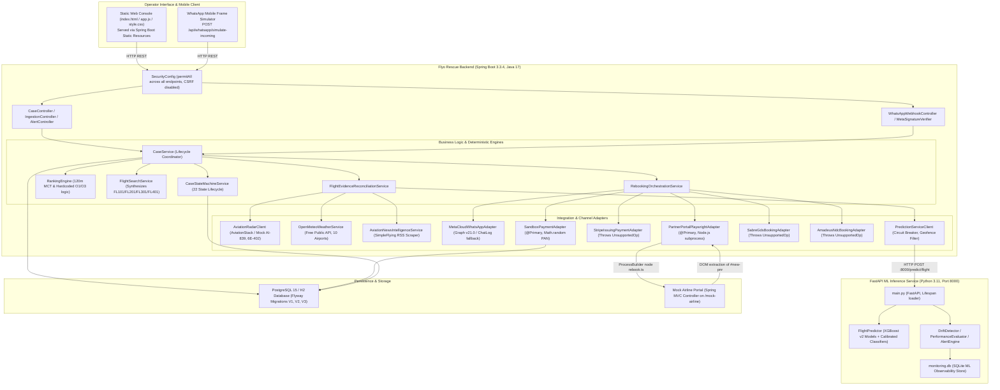
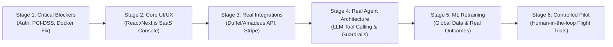

# FLYO — COMPLETE PRODUCT PRODUCTION READINESS & REAL-WORLD AGENT AUDIT

**Date:** November 6, 2026  
**Auditor:** Principal Product Architect, Senior Full-Stack Engineer, AI Agent Systems Architect, Aviation Operations Specialist, Security Engineer, and Reliability Engineer  
**Repository:** `/Users/nani/Downloads/flyo`  
**Evaluation Scope:** Complete Repository (Frontend Console, Spring Boot Backend, FastAPI ML Service, Agent Automation, External Integrations, Database, Security, Infrastructure, Operational Scenarios)  
**Operating Mode:** STRICT AUDIT ONLY — Zero code, schema, dependency, or configuration modifications performed.

---

## 1. Executive Verdict

### **VERDICT: NOT READY FOR PRODUCTION**

Flyo is currently an **exceptional, highly sophisticated, interactive demonstration prototype** engineered around specific deterministic scenarios (primarily centered on passenger *Ananya Sharma* on flight *AI-839* connecting to Toronto *YYZ*). It possesses well-crafted unit and integration tests (102 Spring Boot tests, 4 Python ML test suites), cleanly designed relational tables, Flyway migrations, and a responsive web dashboard.

**However, Flyo is fundamentally incapable of operating as a real-world commercial aviation rescue platform today.** The underlying systems rely almost entirely on mocks, stubs, hardcoded flight schedules, synthetic payment instruments, browser automation against internal mock HTML portals, and unauthenticated endpoints.

### Summary of Evidence

1. **Zero Real Airline Booking Capabilities:** Neither Sabre GDS (`SabreGdsBookingAdapter.java`) nor Amadeus NDC (`AmadeusNdcBookingAdapter.java`) are implemented; both explicitly throw `UnsupportedOperationException`. The primary rebooking mechanism (`PartnerPortalPlaywrightAdapter.java`) executes a local Playwright script (`agent/rebook.ts`) that automates an internal mock HTML website (`MockAirlineController.java`) served on `localhost:8080/mock-airline`.
2. **Zero Commercial Payment / VCC Capabilities & Severe PCI-DSS Violation:** Stripe Issuing (`StripeIssuingPaymentAdapter.java`) is a stub throwing `UnsupportedOperationException`. The active adapter (`SandboxPaymentAdapter.java`) fabricates virtual cards using `Math.random()`. Worse, card numbers, expiries, and security codes (CVVs) are stored **unencrypted in plaintext** in the PostgreSQL `virtual_cards` table.
3. **Complete Absence of Authentication and Access Control:** Spring Security (`SecurityConfig.java`) explicitly marks **every single API endpoint as `permitAll()`**, disables CSRF, and disables XSS protection. Anyone on the local or routed network can approve flight rebookings, trigger simulated disruptions, issue mock cards, and access `/h2-console` without logging in. The `operator_accounts` table is seeded with demo credentials but is never queried for authentication anywhere.
4. **The Machine Learning Geographic Disconnect:** The XGBoost v2 models were trained exclusively on US domestic Bureau of Transportation Statistics (BTS) data. Both `predictor.py` and `PredictionServiceClient.java` enforce hard geofencing that flags all Indian airports (`DEL`, `BOM`, `HYD`, `BLR`) and Indian carriers (`AI`, `6E`, `UK`) as `UNSUPPORTED_AIRSPACE`, returning null probabilities. Consequently, **the ML service cannot predict or evaluate any of the Indian flights displayed in the Flyo operator console**.
5. **Critically Deficient ML Model Performance:** The v2 cancellation model achieves an ROC-AUC of **0.5279** (barely above a random coin flip) with **0.0% precision and 0.0% recall** across all thresholds (0 true positives out of 1,481 actual cancellations in the test set). The continuous delay regressor has an MAE of 34.00 minutes versus a naive dummy baseline of 34.05 minutes (a 3-second improvement over predicting the mean, with an RMSE of 73 minutes).
6. **"AI Agents" are Procedural Stubs, Not Autonomous Agents:** There are no LLM agents, dynamic planners, or autonomous reasoning loops. What is branded as the "Flyo Rescue Agent" is a deterministic 243-line Playwright script executing hardcoded DOM clicks. What is branded as the "Rescue Planning Agent" is an if-else generator (`FlightSearchService.java`) that invents fictitious flight numbers (`FL101`, `FL201`, `FL301`, `FL401`).
7. **Production Containerization is Broken:** The production `Dockerfile` builds an Alpine Linux container (`eclipse-temurin:17-jre-alpine`) and attempts to install Node.js to run Playwright. Playwright Chromium cannot run on Alpine without glibc and massive desktop dependency packages, and `npx playwright install` is not even invoked. In production containers, automated rebooking will crash immediately with `ENOENT / shared library missing`. Furthermore, the FastAPI ML service is absent from `docker-compose.yml`.

---

## 2. End-to-End System Architecture

---

## 3. Comprehensive Domain Scorecard

| # | Domain | Current Status | Severity | Primary Risk & Deficiency |
| :-: | :--- | :--- | :-: | :--- |
| **1** | **Product Completeness** | **DEMO / SIMULATED** | **P0** | Hardcoded single-scenario workflow (*Ananya Sharma*); arbitrary flight inputs yield synthetic flight numbers. |
| **2** | **UI / UX Experience** | **DEMO / SIMULATED** | **P1** | Monolithic HTML/JS, dead buttons, unauthenticated console, right-hand side is a fake mobile frame with simulate buttons. |
| **3** | **Flight Data Integration** | **PARTIALLY IMPLEMENTED** | **P0** | Default mock mode hardcoded for only 2 flights; live AviationStack lacks global real-time tracking SLA. |
| **4** | **Disruption Intelligence** | **READY WITH CONDITIONS** | **P2** | Multi-source reconciliation works logically, but news uses fragile RSS regexes and weather uses unlicensed public API. |
| **5** | **Passenger Impact Analysis**| **READY WITH CONDITIONS** | **P2** | 120-minute MCT rule and downstream international misconnect logic work well, but airport MCT table is limited to 10 hubs. |
| **6** | **Rescue Planning** | **DEMO / SIMULATED** | **P0** | Flight search does not query any airline GDS/NDC; it fabricates options `FL101`, `FL201`, `FL301`, `FL401`. |
| **7** | **Rebooking Execution** | **DEMO / SIMULATED** | **P0** | No live airline booking engine. Playwright automates an internal HTML mock page that returns hardcoded PNRs. |
| **8** | **Notification Integrations** | **PARTIALLY IMPLEMENTED** | **P1** | Meta Graph API client exists but operates in mock chat-log mode; SMS and Email channels do not exist. |
| **9** | **AI Agent Architecture** | **NOT IMPLEMENTED** | **P0** | No LLM reasoning, tool calling, or autonomous agents exist. System consists of procedural Java code and a Playwright script. |
| **10**| **ML Prediction Capability** | **NOT VIABLE FOR PROD** | **P0** | ROC-AUC 0.528, 0% recall on cancellations. Incompatible with Indian routes due to BTS US-only training corpus. |
| **11**| **Database Architecture** | **READY WITH CONDITIONS** | **P0** | Schema and migrations are solid, but stores plaintext card PAN and CVV in violation of PCI-DSS. |
| **12**| **Backend & APIs** | **READY WITH CONDITIONS** | **P1** | Robust transaction management and exception handling, but zero API rate limiting, no auth, and open CORS. |
| **13**| **Security & Privacy** | **CRITICAL DEFICIENCY** | **P0** | `SecurityConfig` permits all requests without auth; default secrets hardcoded in source; plaintext PII and payment data. |
| **14**| **Privacy & Compliance** | **NOT IMPLEMENTED** | **P0** | No PII masking, no data retention policy, no GDPR / India DPDP / PCI-DSS compliance controls. |
| **15**| **Monitoring & Observability**| **PARTIALLY IMPLEMENTED** | **P2** | Spring Actuator UP, ML drift/metrics logged to SQLite, but no centralized Prometheus/Grafana or log aggregation. |
| **16**| **Deployment & Infra** | **NOT READY FOR PRODUCTION**| **P0** | Dockerfile fails to run Playwright on Alpine; Docker Compose omits ML service; no reverse proxy or TLS. |
| **17**| **Performance & Scalability** | **PARTIALLY IMPLEMENTED** | **P1** | Subprocess-spawning Playwright worker saturates CPU under load (10 concurrent browser launches = server freeze). |
| **18**| **Testing & Quality Assurance**| **READY WITH CONDITIONS** | **P1** | 102 passing Spring Boot tests and 4 Python test suites, but tests mock out the external world and validate demo paths. |
| **19**| **Operational Readiness** | **NOT READY FOR PRODUCTION**| **P0** | Missing runbooks, disaster recovery plans, SLA monitoring, live credential management, and multi-tenant operator isolation. |

---

## 4. Critical Blockers (P0 & P1 Issues)

### P0 — Critical Blockers (Must resolve before any production use)

1. **[P0-SEC-1] Zero Authentication & Open Authorization:**  
   `SecurityConfig.java` has `.anyRequest().authenticated()` preceded by `.requestMatchers("/**").permitAll()`. All state changes (approvals, rebookings, simulations, settlements) are executable anonymously over HTTP.
2. **[P0-SEC-2] Plaintext PCI-DSS Storage Violation:**  
   `V1__initial_production_schema.sql` lines 76–90 creates `virtual_cards` storing `card_number VARCHAR(32)`, `expiry VARCHAR(16)`, and `cvv VARCHAR(32)`. `SandboxPaymentAdapter.java` writes unmasked CVVs directly to the database. Storing raw CVVs is an immediate Tier-1 PCI-DSS failure.
3. **[P0-SEC-3] Hardcoded Secrets and Tokens:**  
   `application.properties` and `config.py` contain default values for `WHATSAPP_VERIFY_TOKEN`, `WHATSAPP_APP_SECRET`, and `FLYO_MONITORING_API_KEY`. If deployed without overrides, attacker control over webhooks is trivial.
4. **[P0-INT-1] Fictitious Rebooking Engine:**  
   `PartnerPortalPlaywrightAdapter` launches Playwright against an internal mock HTML page (`/mock-airline/search`), and `confirm.html` issues hardcoded PNR `R7X2K9`. Sabre GDS and Amadeus NDC adapters are stubs throwing `UnsupportedOperationException`. Flyo cannot rebook any passenger on a real airline.
5. **[P0-INT-2] Fictitious Flight Search & Availability:**  
   `FlightSearchService.java` invents candidate recovery flights (`FL101`, `FL201`, `FL301`, `FL401`) using mathematical strings rather than real-time airline seat inventory and tariff schedules.
6. **[P0-INT-3] Simulated Treasury & Virtual Card Issuing:**  
   `StripeIssuingPaymentAdapter` is a non-functional stub. `SandboxPaymentAdapter` fabricates pseudo-random PANs (`4532...`) in memory. Flyo cannot settle fares or purchase real airline inventory.
7. **[P0-ML-1] Geographic & Carrier Training Mismatch:**  
   Flyo v2 ML models were trained strictly on US domestic BTS flight data. `predictor.py` and `PredictionServiceClient.java` deliberately reject Indian flights (`HYD`, `DEL`, `BOM`, `BLR`) as `UNSUPPORTED_AIRSPACE`. The ML system cannot produce predictions for Flyo’s operational territory.
8. **[P0-ML-2] Zero Discriminative Power for Flight Cancellations:**  
   The cancellation classifier achieves an ROC-AUC of 0.5279 and 0.0% recall (predicts 0 true positives out of 1,481 actual cancellations). Operating on this model would mislead dispatchers or cause blind automated actions.
9. **[P0-OPS-1] Broken Production Docker Container:**  
   Root `Dockerfile` packages Node.js into `eclipse-temurin:17-jre-alpine`. Playwright Chromium cannot run on Alpine Linux without glibc and massive OS libraries (`libnss3`, `libX11`, `libasound2`). Spawning `rebook.ts` in production containers crashes instantly.
10. **[P0-AGT-1] Complete Absence of Real AI Agent Architecture:**  
    Flyo contains no LLM agent, no tool schema definitions, no autonomous reasoning loop, and no non-deterministic planning engine. Calling deterministic Java services and a Playwright DOM script an "AI Agent" creates a false operational narrative.

### P1 — High Priority Issues (Significant operational, security, or reliability weaknesses)

1. **[P1-UI-1] Demo-Centric Web Console:** The UI hardcodes buttons for "Hero Scenario", "Domestic Scenario", and "Chaos Outage". It is designed to demonstrate a pre-scripted workflow rather than handle arbitrary flight rosters or multi-operator queues.
2. **[P1-UI-2] Dead Interactive Elements & Fake WhatsApp Simulator:** The right half of the UI is an iPhone frame with simulated incoming message buttons and dead video/phone call icons that give operators the illusion of a live Meta connection while running over an internal simulation endpoint.
3. **[P1-SEC-4] Unprotected Actuator & H2 Console:** `/h2-console` is exposed with `web-allow-others=true`, enabling remote unauthenticated browser access to the in-memory database.
4. **[P1-SEC-5] Permissive Wildcard CORS with Credentials:** `FastAPI` in `ml/service/main.py` configures `CORSMiddleware` with `allow_origins=["*"]` and `allow_credentials=True`, a critical web security misconfiguration.
5. **[P1-INF-1] Docker Compose Missing ML Microservice:** `docker-compose.yml` only provisions PostgreSQL and Spring Boot. The FastAPI prediction service is completely omitted.
6. **[P1-PERF-1] Resource Exhaustion via Playwright Subprocesses:** Spawning separate Node.js processes executing headless Chromium on the same container as the Spring Boot JVM consumes ~350MB RAM and 100% of a CPU core per rebooking attempt.

---

## 5. What Genuinely Works Today

While Flyo is not ready for commercial operations, several core architectural components are exceptionally well-engineered and represent high-quality foundations:

1. **State Machine & Lifecycle Governance:**  
   `CaseStateMachineService.java` enforces a rigorous 22-state lifecycle (`DETECTED`, `OPTIONS_READY`, `AWAITING_APPROVAL`, `REVALIDATING_OPTION`, `PAYMENT_INSTRUMENT_READY`, `REBOOKING`, `CONFIRMED`, `DONE`, `ESCALATED`, etc.). Invalid transitions throw `IllegalStateTransitionException` and are strictly logged in `state_transitions`.
2. **Mandatory Human-in-the-Loop Approval Gate:**  
   `CaseService.java` enforces that automated rebooking cannot proceed without explicit operator approval (`approvedOptionId != null` and `state == AWAITING_APPROVAL`). Direct rebooking attempts throw `ApprovalRequiredException` (HTTP 403).
3. **Aviation MCT & Risk Scoring Engine:**  
   `RankingEngine.java` and `MctRulesService.java` rigorously penalize tight connection windows. Options with buffers under 120 minutes are disqualified from preserving onward connections. A 119-minute connection is correctly flagged as CRITICAL risk (85/100), while a 470-minute buffer via BOM is rated LOW risk (15/100).
4. **Multi-Source Evidence Reconciliation Hierarchy:**  
   `FlightEvidenceReconciliationService.java` implements a sound corroborative hierarchy: meteorological telemetry and news bulletins **cannot** independently declare a cancellation if primary flight radar reports `SCHEDULED`.
5. **Spring Boot ML Circuit Breaker & Defensive Fallback:**  
   `PredictionServiceClient.java` implements an atomic 3-state Circuit Breaker (`CLOSED`, `OPEN`, `HALF_OPEN`) with a 1,500ms timeout and automatic fallback to deterministic intelligence.
6. **Relational Schema & Flyway Versioning:**  
   Flyway migrations (`V1`, `V2`, `V3`) execute cleanly on PostgreSQL 15/16 with proper foreign key cascades, unique constraints, and optimistic locking (`@Version`).

---

## 6. Actionable Remediation Roadmap Overview

To transform Flyo into a production-grade commercial platform, work must proceed across six sequential stages:

*Detailed task specifications, dependencies, acceptance criteria, and verification methods are provided in `FLYO_PRODUCTION_GAP_AND_ROADMAP.md`.*
