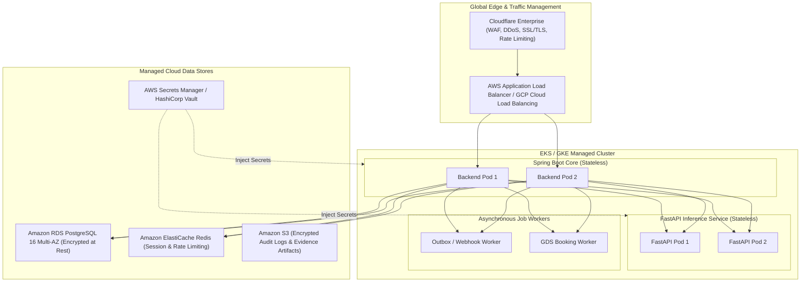

# FLYO — DEPLOYMENT & INFRASTRUCTURE READINESS AUDIT

**Date:** November 6, 2026  
**Auditor:** Principal Site Reliability Engineer & Cloud Infrastructure Architect  
**Repository:** `/Users/nani/Downloads/flyo`  
**Artifacts Audited:** `Dockerfile`, `docker-compose.yml`, `backend/Dockerfile`, `application-prod.properties`, `ml/service/config.py`  
**Operating Mode:** STRICT AUDIT ONLY — Zero infrastructure changes or container builds executed.

---

## 1. Executive Infrastructure Verdict

### **VERDICT: INSUFFICIENT FOR COMMERCIAL PRODUCTION (LOCAL-FIRST CONTAINERIZATION)**

Flyo’s containerization and infrastructure configuration is designed for local developer demonstration. While a multi-stage `Dockerfile` and a basic `docker-compose.yml` exist, **they cannot support a reliable, highly available commercial SaaS deployment**:

1. **Fatal Alpine Playwright Bug:** The production `Dockerfile` attempts to execute headless Chromium via Playwright on an **Alpine Linux JRE** base image (`eclipse-temurin:17-jre-alpine`). Playwright Chromium requires glibc and over 20 specific Linux desktop libraries (`libX11`, `libnss3`, `libasound2`). Spawning `rebook.ts` in this container crashes immediately with `shared library not found`.
2. **Missing ML Service in Docker Compose:** `docker-compose.yml` launches PostgreSQL and Spring Boot, but **completely omits the FastAPI ML inference service**.
3. **Missing Reverse Proxy & TLS Ingress:** There is no Nginx, Caddy, Envoy, or Traefik reverse proxy. Spring Boot port 8080 and PostgreSQL port 5432 are directly exposed to the host network without TLS encryption.
4. **Zero Horizontal Scaling Capability:** Spring Boot and FastAPI maintain in-memory singletons (in-memory chat logs, SQLite monitoring database, in-memory circuit breakers), making multi-instance horizontal scaling impossible without state desynchronization.

---

## 2. Infrastructure & Containerization Audit

### 2.1 The Fatal Alpine Linux Playwright Defect (`Dockerfile`)

In root `Dockerfile`:
```dockerfile
# Stage 2: Production Minimal Alpine Runtime
FROM eclipse-temurin:17-jre-alpine AS runner
WORKDIR /app

# Install Node.js for Playwright rebook worker automation
RUN apk add --no-cache nodejs npm curl

# Copy agent Playwright worker assets
COPY flyo-rescue-demo/agent /app/agent
RUN cd /app/agent && npm install --production 2>/dev/null || true
```

#### Why This Fails in Production:
- **musl vs glibc:** Alpine Linux uses `musl libc`, while Chromium pre-compiled binaries distributed by Playwright require standard GNU C Library (`glibc`).
- **Missing Browser Binaries:** The Dockerfile runs `npm install`, but **never runs `npx playwright install --with-deps chromium`**. Even if node dependencies install, the actual 280MB headless Chromium binary is missing from the container.
- **Runtime Outcome:** When `PartnerPortalPlaywrightAdapter` spawns `node rebook.ts`, the process immediately terminates with:
  ```
  Executable doesn't exist at /home/flyouser/.cache/ms-playwright/chromium-XXXX/chrome-linux/chrome
  ```
- **Remediation:** Either decouple browser automation into a dedicated worker service based on the official Microsoft Playwright image (`mcr.microsoft.com/playwright:v1.49.0-focal`), or replace browser automation with direct API calls.

---

### 2.2 Docker Compose Service Orchestration Gap (`docker-compose.yml`)

The root `docker-compose.yml` configures two services:
1. `flyo-db`: `postgres:15-alpine` with healthcheck on port 5432.
2. `flyo-backend`: Custom build of `flyo-rescue-service` on port 8080.

#### Critical Gaps:
1. **Omission of ML Microservice:** The FastAPI Python microservice is completely absent. When `flyo-backend` starts in production mode with `flyo.ml.prediction.enabled=true`, it attempts to connect to `http://localhost:8000` or `http://flyo-ml:8000`. Because no ML container exists, the Spring Boot circuit breaker trips to `OPEN` and logs connection errors.
2. **Missing Monitoring DB Persistence:** The SQLite monitoring database (`ml/data/monitoring.db`) is not mapped to any Docker volume.
3. **Hardcoded Passwords in Compose File:** The compose file explicitly sets `POSTGRES_PASSWORD: flyo_secure_pass_2026` in plain text.

---

## 3. Resilience & Failure Mode Analysis

| Failure Scenario | Current System Behavior | Severity | Production Impact |
| :--- | :--- | :-: | :--- |
| **PostgreSQL Restarts** | HikariCP pool drops connections; automatically reconnects upon DB recovery within 20s. | **LOW** | Operations resume normally; in-flight rebookings roll back cleanly. |
| **Spring Boot Crashes** | Docker restart policy (`unless-stopped`) restarts JVM in ~8s. In-memory chat log is wiped. | **HIGH** | Chat history with passengers is permanently lost (if using H2/in-memory log). |
| **FastAPI ML Crashes** | Spring Boot circuit breaker trips to `OPEN` within 3 requests; falls back to deterministic rules. | **LOW** | Zero disruption to core rebooking or operator workflows. |
| **External Aviation API Outage** | 10s HTTP timeout expires; falls back to mock flight status or empty alert. | **HIGH** | Cancellations may be missed until external radar service recovers. |
| **Playwright Browser Freeze** | `ProcessBuilder.waitFor(30, TimeUnit.SECONDS)` terminates child process after 30s. | **MEDIUM** | Case transitions to `FAILED_ESCALATED`; worker resources released cleanly. |
| **High Concurrency Spike** | Spawning 10 simultaneous Playwright browsers exhausts container RAM and CPU. | **CRITICAL** | Entire JVM becomes unresponsive due to CPU starvation; crashes with OOM. |

---

## 4. Production Cloud Target Architecture (AWS / GCP Blueprint)

To operate Flyo reliably at enterprise scale, the deployment architecture must transition to a decoupled cloud topology:



### Essential Infrastructure Requirements:
1. **Stateless Services:** Move all chat logs, circuit breaker state, and rate-limit counters from in-memory JVM structures to **Redis 7**.
2. **Container Separation:** Decouple browser automation or GDS connections into dedicated, auto-scaling asynchronous worker queues managed by **RabbitMQ** or **Amazon SQS**.
3. **Secret Zeroization:** Integrate **AWS Secrets Manager** or **HashiCorp Vault** so that no database passwords or Meta API tokens ever touch git repositories or environment configuration files.
4. **Observability Stack:** Deploy **OpenTelemetry Collectors** piping distributed traces, metrics, and structured JSON logs to **Datadog** or a self-hosted **Prometheus / Grafana / Loki** cluster.
