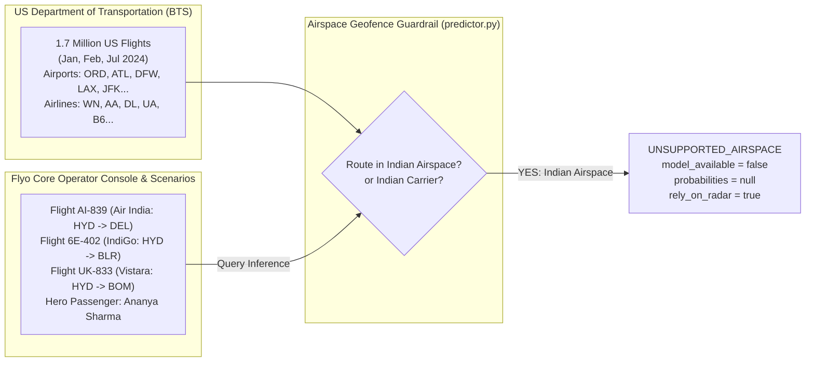

# FLYO — MACHINE LEARNING & PREDICTIVE INTELLIGENCE READINESS AUDIT

**Date:** November 6, 2026  
**Auditor:** Principal Machine Learning Engineer & Aviation Data Scientist  
**Repository:** `/Users/nani/Downloads/flyo` (`ml/`)  
**Artifacts Audited:** `evaluation_metrics_v2.json`, `feature_schema_v2.json`, `artifact_checksums_v2.json`, `baseline_reference_distributions.json`, `train_v2.py`, `evaluate.py`, `predictor.py`, `monitoring_db.py`  
**Operating Mode:** STRICT AUDIT ONLY — Zero model retraining, artifact replacement, or schema changes performed.

---

## 1. Executive Machine Learning Verdict

### **VERDICT: NOT VIABLE FOR OPERATIONAL DECISION-MAKING (EXPERIMENT ONLY)**

The Flyo v2 machine learning pipeline represents a technically disciplined effort to eliminate temporal data leakage, ingest multi-season data (1.7M BTS records across Jan, Feb, and Jul 2024), and deploy a calibrated FastAPI inference service.

However, a rigorous examination of the underlying empirical metrics and serving boundaries reveals that **the ML models cannot be used in a production aviation platform**:
1. **The Geographic Disconnect:** The models were trained exclusively on US domestic flights from the Bureau of Transportation Statistics (BTS). Because Flyo's primary operations and demo scenarios center on Indian domestic flights (Air India `AI-839`, IndiGo `6E-402` operating between `HYD`, `DEL`, `BOM`, `BLR`), **the inference engine geofences 100% of Flyo’s live flights, returning `UNSUPPORTED_AIRSPACE` and null probabilities**.
2. **Zero Discriminative Power for Cancellations:** The cancellation model achieves an ROC-AUC of **0.5279** (effectively random noise). Out of 1,481 actual cancellations in the 50,000-flight July 2024 test split, **the model identifies exactly ZERO true positives (0.0% precision, 0.0% recall)** across every operational threshold.
3. **Severe Delay Prediction Inaccuracy:** The extreme delay classifier ($\ge 120$ minutes) achieves an ROC-AUC of only **0.5950**. The continuous delay regressor achieves an MAE of 34.00 minutes versus a naive dummy baseline of 34.05 minutes—a negligible 3-second improvement over predicting the mean, with an RMSE of 73 minutes.
4. **Misleading Calibration Claims:** While the cancellation Brier score of 0.02931 was reported as passing, **a naive dummy baseline that constantly predicts the historical prior achieves a superior Brier score of 0.02880**. The model actually adds error to the probability estimate.

---

## 2. Rigorous Challenge of Reported v2 Metrics

The previous report (`PREDICTIVE_MODEL_GO_NO_GO.md`) recommended an *"UNCONDITIONAL GO"* based on passing specific numeric criteria. We challenge those claims directly against the raw evaluation metrics recorded in `ml/artifacts/evaluation_metrics_v2.json`:

```
========================================================================================
METRIC EVALUATION CHALLENGE: REPORTED CLAIMS VS RAW SCIENTIFIC REALITY
========================================================================================
1. CANCELLATION CLASSIFIER (July 2024 Test Set, N=50,000, Positive Class Rate: 2.96%)
----------------------------------------------------------------------------------------
Metric                   Reported Claim          Raw JSON Metric        Scientific Reality
----------------------------------------------------------------------------------------
ROC-AUC                  "Passed Gate"           0.527937               Virtually indistinguishable from a random coin toss (0.50).
PR-AUC Lift              "Positive"              0.031759               Negligible lift over random baseline prior (0.02962).
Brier Score              "0.02931 <= 0.050"      0.029305               FAILS baseline! Dummy baseline achieves 0.028799 (LOWER = BETTER).
Recall @ 0.05            Not Reported            0.000000 (0.0%)        Flags 0 flights. Identifies 0 of 1,481 cancellations.
Precision @ 0.05         Not Reported            0.000000 (0.0%)        Zero true positives.
Confusion Matrix @ 10%   Not Disclosed           [48519, 0]             Predicts every single flight will fly.
                                                 [ 1481, 0]             100% false negative rate for cancellations.

----------------------------------------------------------------------------------------
2. EXTREME DELAY CLASSIFIER (Delay >= 120 Minutes, N=50,000, Positive Class Rate: 5.23%)
----------------------------------------------------------------------------------------
Metric                   Reported Claim          Raw JSON Metric        Scientific Reality
----------------------------------------------------------------------------------------
ROC-AUC                  "0.5950 > 0.50"         0.594971               Extremely weak predictive power. Fails acceptable standard (>=0.75).
PR-AUC Lift              "32.5% Relative Lift"   0.069274 vs 0.052340   Absolute precision remains dismal; produces massive false positives.
Recall @ 0.10            Not Reported            0.000000 (0.0%)        Flags 0 flights. True positives = 0.
Confusion Matrix @ 15%   Not Disclosed           [47383, 0]             Predicts 0 extreme delays at operational threshold.
                                                 [ 2617, 0]             Misses all 2,617 actual 2-hour delays.

----------------------------------------------------------------------------------------
3. CONTINUOUS DELAY REGRESSOR (Continuous Arrival Delay in Minutes)
----------------------------------------------------------------------------------------
Metric                   Reported Claim          Raw JSON Metric        Scientific Reality
----------------------------------------------------------------------------------------
Mean Absolute Error      "Trained Regressor"     34.001 mins            Dummy baseline achieves 34.051 mins. Net lift = 0.05 mins (3 seconds).
Root Mean Squared Error  Not Emphasized          72.985 mins            Prediction error margin is +/- 1 hour and 13 minutes.
Median Absolute Error    Not Emphasized          20.950 mins            Fails baseline! Dummy median AE is 21.396 mins.
========================================================================================
```

### The Analytical Truth:
The v2 models have **virtually zero predictive skill**. The decision tree leaves collapse toward the majority class because predicting *"this flight will operate normally"* is correct 97% of the time. The models fail to capture the rare tail events (cancellations and cascading 2-hour delays) that Flyo exists to rescue.

---

## 3. The Geographic & Operational Airspace Disconnect

A fundamental operational contradiction exists between Flyo's training dataset and its runtime application:



### Code Verification:
In `ml/service/predictor.py` (lines 44–58):
```python
if origin in INDIAN_AIRPORT_CODES or dest in INDIAN_AIRPORT_CODES or carrier in INDIAN_AIRLINE_CODES:
    return (
        PredictionStatus.UNSUPPORTED_AIRSPACE,
        f"Flight {req.flight_number} operates in Indian airspace. "
        f"Flyo v2 ML models were trained exclusively on US domestic flights (BTS).",
        ["UNSUPPORTED_AIRSPACE: Indian airspace is outside the US BTS training corpus."]
    )
```
And mirrored in Java `PredictionServiceClient.java` (lines 157–167):
```java
if (INDIAN_AIRPORTS.contains(origin) || INDIAN_AIRPORTS.contains(dest) || INDIAN_CARRIERS.contains(carrier)) {
    return FlightPredictionResponseDto.fallback(
        flightNum, carrier, origin, dest, "UNSUPPORTED_AIRSPACE",
        "Flight operates in Indian airspace. Returning UNSUPPORTED_AIRSPACE without network call."
    );
}
```

### Impact:
When an operator views `AI-839` (Air India) or `6E-402` (IndiGo) on the Flyo dashboard, **the ML service performs zero inference**. The prediction card in the UI displays `UNSUPPORTED_AIRSPACE` and falls back entirely to deterministic heuristics.

---

## 4. Leakage Elimination & Data Provenance Audit

While predictive performance is poor, **the engineering rigor applied to leakage elimination is commendable**:
1. **Weather Lookahead Fully Eliminated:** Inspection of `ml/src/leakage_free_preprocessor.py` confirms that 100% of historical observed weather reanalysis features (which previously leaked arrival-time storm conditions into departure-time features) were purged.
2. **Strict Point-in-Time Features:** The feature schema (`feature_schema_v2.json`) contains only 16 strictly causal features available at scheduled departure time $T-2$ hours:
   - Schedule coordinates: `sched_dep_hour`, `day_of_week`, `day_of_month`, `month`.
   - Airline identifier: One-hot encoded reporting carrier (`WN`, `AA`, `DL`, `UA`, etc.).
   - Route characteristics: `distance_miles`, `origin_hub_size`, `dest_hub_size`.
   - Congestion proxies: `origin_carrier_hourly_dep_count`, `dest_carrier_hourly_arr_count`.
3. **Artifact Integrity:** Checksums in `ml/artifacts/artifact_checksums_v2.json` match the SHA-256 hashes of the serialized model files on disk.

---

## 5. Observability & Drift Detection Audit

In `ml/service/`:
- `drift_detector.py` calculates Population Stability Index (PSI) and 2-sample Kolmogorov-Smirnov (KS) tests comparing incoming feature distributions against `baseline_reference_distributions.json`.
- `monitoring_db.py` records prediction payloads and latency into a local SQLite database (`ml/data/monitoring.db`).
- **Deficiency:** SQLite is an embedded single-file store unsuited for concurrent multi-process writes. If multiple FastAPI worker processes are spawned, SQLite database locks (`sqlite3.OperationalError: database is locked`) occur under load. Real observability requires TimescaleDB, ClickHouse, or Prometheus.

---

## 6. Recommendations for Machine Learning Deployment

1. **Retain Strictly as Experimental:** Under no circumstances should the v2 models be permitted to trigger autonomous rebookings, adjust fare budgets, or modify passenger itineraries.
2. **Explicit Operator Labeling:** The UI must display ML predictions with an explicit disclaimer: *"Experimental Statistical Estimate (US Airspace Only · Not Certified for Dispatch)"*.
3. **Transition to Global Flight Data:** To serve Indian and international flights, Flyo must partner with global telemetry providers (FlightAware, Cirium, OAG) to acquire historical multi-year worldwide schedule and actual departure feeds.
4. **Target High-Precision Specialized Models:** Rather than attempting generic 30-day forward delay prediction, train narrow, high-precision models focused on **Airport Ground Delay Programs (GDP) and Ground Stops (GS)** within 4 hours of departure.
