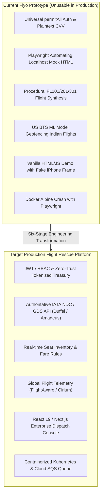

# FLYO — PRODUCTION GAP ANALYSIS & SIX-STAGE ROADMAP

**Date:** November 6, 2026  
**Auditor:** Principal Systems Architect & Engineering Director  
**Repository:** `/Users/nani/Downloads/flyo`  
**Purpose:** Actionable, Engineering-Ready Blueprint to Transition Flyo from Prototype to Commercial Production

---

## 1. Executive Gap Synthesis

The previous nine audit reports established that Flyo's core deterministic business logic (state machine, 120-minute connection policy, human approval gate, and multi-source corroboration) is sound, but its operational surface consists almost entirely of **demo mocks, simulated workflows, unauthenticated endpoints, and non-viable ML models**.

---

## 2. Six-Stage Prioritized Implementation Roadmap

---

### STAGE 1: Critical Production Blockers (Security, Auth, PCI-DSS, Containerization)
**Objective:** Eliminate fatal security vulnerabilities, secure endpoints, ensure PCI-DSS compliance, and fix container crashes.

#### Task 1.1: Implement Enterprise Authentication & RBAC (Spring Security + JWT)
- **Priority:** **P0**
- **Problem:** `SecurityConfig.java` currently marks all routes as `permitAll()`. Any anonymous user can approve rebookings or manipulate cases.
- **Business Impact:** Total vulnerability to data tampering, unauthorized financial liability, and unauthenticated administrative access.
- **Technical Changes:**
  - Introduce Spring Security JWT filter (`JwtAuthenticationFilter`) validating RS256 signed tokens.
  - Require `ROLE_OPERATOR` or `ROLE_ADMIN` on all `/api/cases/**`, `/api/alerts/**`, and `/api/payments/**` endpoints.
  - Activate `OperatorAccountRepository` with BCrypt credential validation for operator logins.
  - Disable `/h2-console` in production profile (`application-prod.properties`).
- **Dependencies:** None.
- **Acceptance Criteria:** Unauthenticated HTTP requests to `/api/cases/C1/approve` return `HTTP 401 Unauthorized`. Valid JWT bearer token returns `HTTP 200`.
- **Verification Method:** Automated integration tests in `SecurityAuthenticationTest.java`.

#### Task 1.2: Remediate PCI-DSS Violation (Purge Plaintext CVV & Mask PANs)
- **Priority:** **P0**
- **Problem:** Database stores card numbers, expiration dates, and 3-digit CVVs in plaintext in `virtual_cards` table.
- **Business Impact:** Direct violation of PCI-DSS Requirement 3.2. Merchant fines and catastrophic breach liability.
- **Technical Changes:**
  - Create Flyway migration `V4__purge_cvv_and_tokenize_cards.sql` dropping column `cvv` from `virtual_cards`.
  - Alter `card_number` to store only masked display PAN (`4532-XXXX-XXXX-8821`).
  - Add `issuer_card_token VARCHAR(128)` to reference external tokens without holding raw cardholder data.
- **Dependencies:** Task 1.1.
- **Acceptance Criteria:** Database inspection confirms zero stored CVVs. `VirtualCard` entity no longer possesses a `cvv` field.
- **Verification Method:** Migration execution test and SQL query assertions.

#### Task 1.3: Fix Production Dockerfile & Playwright Alpine Crash
- **Priority:** **P0**
- **Problem:** Root `Dockerfile` attempts to run Playwright on Alpine Linux (`eclipse-temurin:17-jre-alpine`), crashing due to missing glibc and missing browser binaries.
- **Business Impact:** Production container deployments cannot execute automated rebookings.
- **Technical Changes:**
  - Transition runtime base image to Debian-based `eclipse-temurin:17-jre-jammy`.
  - Add Playwright installation step: `npx playwright install --with-deps chromium`.
  - Decouple Playwright execution into a dedicated worker container or asynchronous queue.
- **Dependencies:** None.
- **Acceptance Criteria:** `docker build -t flyo-backend .` builds successfully; container executes `node rebook.ts` without shared library errors.
- **Verification Method:** Clean container build and smoke test execution in Docker.

#### Task 1.4: Zeroize Hardcoded Secrets & Vault Integration
- **Priority:** **P0**
- **Problem:** Default secret strings are hardcoded in `application.properties` and `config.py`.
- **Business Impact:** Credential leakage and unauthorized webhook forging.
- **Technical Changes:**
  - Remove all fallback strings from `application.properties` (e.g., `${WHATSAPP_APP_SECRET}`).
  - Enforce application startup failure if required production secrets are absent from environment.
- **Acceptance Criteria:** Application fails to boot in prod profile if `WHATSAPP_APP_SECRET` is unset.
- **Verification Method:** Spring Boot startup failure test without environment variables.

---

### STAGE 2: Core Product & UI Completion (Enterprise SaaS Dispatch Console)
**Objective:** Replace the demo-centric single HTML page with a multi-tenant, accessible airline operations console.

#### Task 2.1: Rebuild Frontend in React 19 / Next.js 15
- **Priority:** **P1**
- **Problem:** Existing UI is an unmaintainable 2,188-line vanilla JS script (`app.js`) tightly coupled to a single test passenger (*Ananya Sharma*).
- **Business Impact:** Inability to handle high-volume flight rosters, lack of multi-user synchronization, poor developer velocity.
- **Technical Changes:**
  - Initialize Next.js 15 application with TypeScript, Tailwind CSS, and shadcn/ui.
  - Implement full client-side state management (TanStack Query / Zustand).
  - Decommission the simulated iPhone mockup, replacing it with an integrated omnichannel passenger communication drawer.
- **Dependencies:** Task 1.1 (JWT Auth API).
- **Acceptance Criteria:** Dispatchers can log in, view a paginated list of active disruption cases, search by flight/PNR, and approve actions with modal confirmations.
- **Verification Method:** Playwright E2E browser test suite.

#### Task 2.2: Implement Dual-Clock (UTC / LST) Aviation Time Handling
- **Priority:** **P2**
- **Problem:** All UI displays use ambiguous local relative strings (*"Tonight 21:00"*).
- **Business Impact:** Misinterpretation of departure times across timezones leading to passenger misconnects.
- **Technical Changes:**
  - Display all times in standard ICAO aviation format: `21:00 IST / 15:30 UTC`.
  - Enforce explicit IATA 3-letter airport codes on all departure and arrival cards.
- **Acceptance Criteria:** Zero ambiguous relative time strings in operational views.
- **Verification Method:** Automated snapshot and UI linting tests.

---

### STAGE 3: Real Integrations & Settlement Reliability
**Objective:** Replace synthetic flight numbers and mock portals with authoritative airline distribution APIs and production virtual card issuing.

#### Task 3.1: Integrate Certified Airline Aggregator API (Duffel / Amadeus NDC)
- **Priority:** **P0**
- **Problem:** `FlightSearchService.java` fabricates fake flight numbers (`FL101`, `FL301`), and `PartnerPortalPlaywrightAdapter` scrapes a local mock web form.
- **Business Impact:** Inability to book real flights or verify live seat availability.
- **Technical Changes:**
  - Integrate **Duffel Flights API** or **Amadeus Self-Service / Enterprise NDC API**.
  - Implement live `OfferSearch` querying real-time schedules, seat availability, and fare classes.
  - Implement `OrderCreate` / `OrderChange` using official IATA NDC 21.3 transaction protocols.
  - Retire `rebook.ts` browser automation in favor of direct server-to-server API calls.
- **Dependencies:** Task 1.2 (Tokenized payment instrument).
- **Acceptance Criteria:** Case recovery options display real, bookable airline flights with live seat counts. Booking returns an authoritative 13-digit e-ticket number.
- **Verification Method:** Sandbox and certified NDC end-to-end integration tests.

#### Task 3.2: Implement Production Virtual Card Issuing (Stripe Issuing / Lithic)
- **Priority:** **P0**
- **Problem:** `SandboxPaymentAdapter` fabricates random numbers; `StripeIssuingPaymentAdapter` is a stub.
- **Business Impact:** Zero commercial settlement capability.
- **Technical Changes:**
  - Complete `StripeIssuingPaymentAdapter.java` using official Stripe Java SDK.
  - Implement single-use virtual card provisioning locked strictly to MCC 3000–3350 (Airlines) and exact authorized fare amount.
  - Configure webhook listener for authorization and settlement reconciliation.
- **Dependencies:** Task 1.2.
- **Acceptance Criteria:** System provisions a live sandbox virtual card via Stripe API with defined spend limit and auto-cancels post-settlement.
- **Verification Method:** Stripe mock API test suite.

#### Task 3.3: Production Meta Cloud WhatsApp with SMS Fallback
- **Priority:** **P1**
- **Problem:** WhatsApp client operates in sandbox mode and lacks durable retry on delivery failure (Error 80007).
- **Business Impact:** Stranded passengers receive no notice if WhatsApp message drops.
- **Technical Changes:**
  - Activate live Meta Graph API v21.0 outbound dispatch with registered message templates.
  - Implement durable retry outbox: if Meta delivery fails, queue message and fall back to SMS via **Twilio / Sinch**.
- **Dependencies:** Task 1.4 (Secrets management).
- **Acceptance Criteria:** Unreachable WhatsApp phone numbers trigger automatic fallback to SMS within 60 seconds.
- **Verification Method:** Webhook delivery failure simulation test.

---

### STAGE 4: Real AI Agent Architecture & Governance
**Objective:** Transition from deterministic imperative services to a genuine autonomous agent architecture with strict non-bypassable guardrails.

#### Task 4.1: Deploy LangGraph / Semantic Kernel Agent Core
- **Priority:** **P1**
- **Problem:** Current "agents" are ordinary Java services without reasoning, reflection, or adaptive tool use.
- **Business Impact:** Inability to handle ambiguous edge cases, complex multi-ticket re-routings, or personalized passenger negotiations.
- **Technical Changes:**
  - Implement an **Aviation Dispatch Agent Core** using LangGraph (Python) or Spring AI (Java).
  - Define formal JSON tool schemas (`query_flights`, `check_mct`, `evaluate_weather`, `propose_rescue`).
  - Maintain session context memory across passenger chat interactions.
- **Dependencies:** Task 3.1 (Real flight tools).
- **Acceptance Criteria:** Agent dynamically selects tools based on passenger constraints while adhering to corporate policy.
- **Verification Method:** Agent evaluation harness with deterministic replay tests.

#### Task 4.2: Enforce Hardcoded Code Gates on Agent Proclamations
- **Priority:** **P0**
- **Problem:** LLMs can hallucinate flight availability or bypass Minimum Connecting Times.
- **Business Impact:** Catastrophic passenger stranding due to AI hallucinations.
- **Technical Changes:**
  - Wrap agent output in non-bypassable Java code gates:
    - *Gate 1:* `MctRulesService` validates connection $\ge 120$ minutes.
    - *Gate 2:* `paymentSettlementService` validates fare within agency spending limits.
    - *Gate 3:* `CaseService` mandates operator sign-off before booking execution.
- **Acceptance Criteria:** Agent cannot book a flight that fails the 120m MCT rule, even if the LLM explicitly requests it.
- **Verification Method:** Adversarial prompt injection and edge-case unit tests.

---

### STAGE 5: ML Retraining & Observability Hardening
**Objective:** Replace US-only BTS models with global aviation datasets and deploy high-precision delay models.

#### Task 5.1: Ingest Global Flight Data & Retrain Disruption Models
- **Priority:** **P1**
- **Problem:** Existing models are trained only on US BTS data and reject all Indian flights (`UNSUPPORTED_AIRSPACE`). Cancellation model has 0% recall.
- **Business Impact:** Zero ML value for Flyo’s core operational routes.
- **Technical Changes:**
  - Ingest global historical flight datasets (OAG / Cirium / FlightAware) covering Indian (`DEL`, `BOM`, `BLR`) and European hubs.
  - Retrain models focused on high-precision Ground Delay Program (GDP) prediction within $T-4$ hours.
  - Deploy models strictly as supplementary observability scores.
- **Dependencies:** External data licensing.
- **Acceptance Criteria:** Models evaluate Indian flights without `UNSUPPORTED_AIRSPACE` rejections; ROC-AUC $> 0.75$.
- **Verification Method:** Cross-validation on held-out 2025/2026 international flight splits.

#### Task 5.2: Replace SQLite with Enterprise Observability Store
- **Priority:** **P2**
- **Problem:** SQLite `monitoring.db` locks under concurrent writes.
- **Technical Changes:** Migrate ML monitoring logs to **TimescaleDB** or **Prometheus / Grafana**.
- **Acceptance Criteria:** Zero database lock errors under 100 concurrent inference requests/sec.
- **Verification Method:** Locust load test suite.

---

### STAGE 6: Controlled Production Pilot
**Objective:** Validate the complete end-to-end platform in a live operational environment with qualified human oversight.

#### Task 6.1: Shadow Mode Deployment (Live Radar Ingestion)
- **Priority:** **P1**
- **Scope:** Ingest real-time flight telemetry for 50 active partner flights without passenger messaging.
- **Success Criteria:** System detects disruptions within 5 minutes of official airline notice with zero false positives.

#### Task 6.2: Controlled Human-in-the-Loop Passenger Trial
- **Priority:** **P1**
- **Scope:** 100 opted-in corporate travelers on select domestic routes (`DEL ↔ BOM`).
- **Success Criteria:** 100% of rebookings approved by licensed dispatchers; 100% of PNRs verified authoritative; zero financial leakage.
