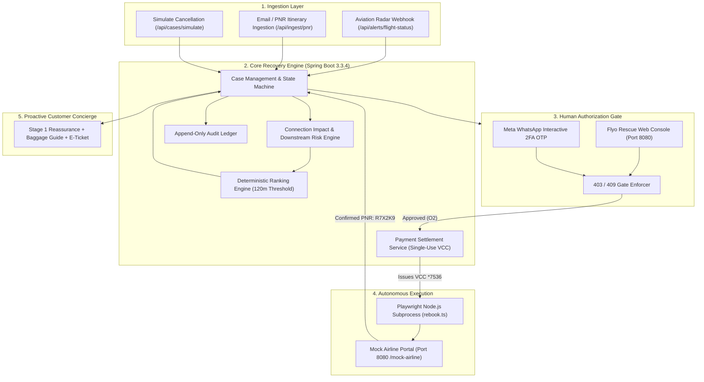
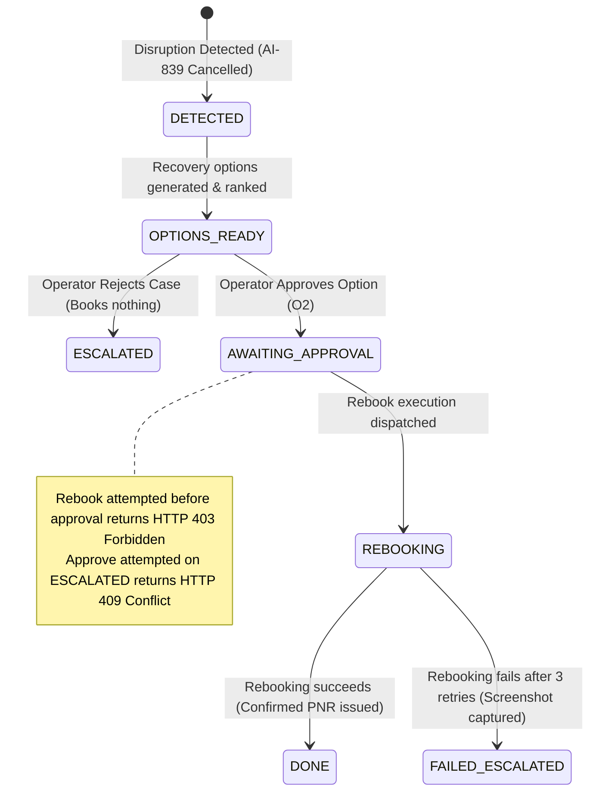

# Flyo Rescue Agent — Complete Platform Architecture & System Reference

> **Autonomous Flight Disruption Recovery & Autonomous Operations Platform**  
> **Production Stack:** Java 17 &middot; Spring Boot 3.3.4 &middot; In-Memory H2 &middot; Playwright Browser Automation &middot; Meta WhatsApp Cloud Engine &middot; Single-Page Operations Console

---

## 1. Executive Summary & Problem Space

### The Industry Challenge
Flight disruptions (cancellations and cascading delays) are an operational nightmare for OTAs, travel management companies (TMCs), and airlines:
- **Cascading Connection Losses:** When a domestic feeder leg (e.g., `HYD → DEL`) is cancelled, the passenger misses their onward international flight (e.g., `DEL → Toronto (YYZ)`), resulting in thousands of dollars in forfeited long-haul airfare, missed meetings, and cancelled non-refundable hotels.
- **Airport Queue Bottlenecks:** Ground staff at airports are overwhelmed. Rebooking a single passenger manually through legacy GDS terminals takes 10 to 15 minutes, causing 3-hour physical queues.
- **Financial Leakage & Human Error:** Tired gate agents frequently choose the first domestic direct alternative—ignoring minimum connection time (MCT) constraints or booking flights that depart hours after the international flight has already taken off.

### The Flyo Solution
Flyo Rescue Agent is an autonomous flight disruption recovery platform designed to run in operations centers:
1. **Real-Time Detection:** Ingests flight cancellation alerts via Aviation Radar webhooks, PNR streams, or flight status webhooks before the passenger reaches the airport.
2. **Deterministic Connection Buffer Engine:** Evaluates downstream connections, terminal transfers, and Minimum Connection Times (MCT) using pure code—never relying on hallucinating LLM math.
3. **Autonomous Partner Portal Rebooking:** Uses a headless Playwright browser worker to navigate airline booking portals, enter passenger details and corporate single-use virtual cards, and retrieve confirmed PNRs.
4. **Corporate Treasury & VCC Provisioning:** Automatically issues single-use Virtual Commercial Cards (VCC) capped at the exact fare adjustment needed (e.g., +₹4,200), preventing exposure of corporate master credit cards.
5. **Two-Sided WhatsApp Communication:** Separates operator authorization (2FA security challenges and approval buttons) from passenger concierge (instant reassurance, e-ticket delivery, and luggage transfer guides).
6. **Append-Only Chronological Audit:** Every event, calculation, actor decision, and portal screenshot is recorded in an immutable ledger.

---

## 2. Core Architectural Philosophy & Hard Locks

| Principle | Technical Implementation | Why It Exists |
|---|---|---|
| **Code Decides Money & Booking** | 100% deterministic Java ranking & rules engine. Zero LLM in ranking or payment paths. | LLMs hallucinate arrival timezones, flight durations, and connection buffer math. |
| **Strict 120-Minute MCT Threshold** | Minimum connection buffer rule: options with `< 120 min` buffer to an international connection are disqualified from Rank 1. | 85 minutes at Delhi Indira Gandhi (DEL) T3 is too tight for international security and baggage transfer. |
| **Strict Human Gate (HTTP 403 / 409)** | Rebooking before approval = `HTTP 403 Forbidden`. Approving an `ESCALATED` or `DONE` case = `HTTP 409 Conflict`. | Prevents unauthorized credit card spend and protects against duplicate ticket issuance. |
| **Strict Idempotency** | Idempotency Key: `caseId + optionId`. | Repeated API calls or double-clicks return the confirmed PNR without triggering duplicate airline bookings or billing. |
| **Zero Fake Success** | Playwright retries up to 3 times with exponential backoff. On failure, state transitions to `FAILED_ESCALATED`, `newPnr = null`, captures failure screenshot, and provides airline desk phone numbers. | Never fabricate a phantom PNR. A clean escalation is better than a false confirmation. |

---

## 3. System Architecture Diagram



---

## 4. End-to-End State Machine Lifecycle



---

## 5. Detailed Subsystem Technical Specifications

### A. Disruption Detection & Cascading Impact
- **Hero Passenger:** Ananya Sharma (PNR: `HYD123`), flying `HYD → DEL` on flight `AI-839` departing tonight at 21:00.
- **Cascading Risks Assessed:**
  - Onward international flight: `DEL → Toronto (YYZ)` departing tomorrow at 09:30.
  - Accommodation risk: `Delhi hotel non-refundable` at Aerocity Delhi.
  - Monitored booking status immediately updates to `Cancelled`.

### B. The Deterministic Ranking Engine
The ranking engine ([`RankingEngine.java`](file:///Users/nani/Downloads/flyo/flyo-rescue-demo/backend/src/main/java/com/flyo/rescue/service/RankingEngine.java)) processes candidate flight options through strict algorithmic rules:
1. **Rule 1 (Minimum Connection Time):** Any flight arriving in Delhi with `< 120 minutes` before the 09:30 Toronto departure is disqualified from Rank 1, regardless of price.
2. **Rule 2 (Schedule Preservation):** Options arriving in time to preserve the international connection outrank domestic direct flights that depart after the international flight has left.
3. **Rule 3 (Tie-Breakers):** Earliest arrival time at destination, followed by lowest fare adjustment.

#### Deterministic Ranking Output:
```
• Option O2 (Rank #1 — Recommended):
  Flight: FL301 via Mumbai (HYD → BOM → DEL)
  Schedule: Departs Tonight 23:30 | Arrives DEL Tomorrow 01:40
  Buffer: 7h 50m (470 min ≥ 120 min) -> Saves Toronto Connection!
  Fare Adjustment: +₹4,200 (Absorbed by Corporate VCC)

• Option O3 (Rank #2):
  Flight: FL401 Direct
  Schedule: Departs Tomorrow 10:00 | Arrives DEL Tomorrow 12:15
  Buffer: Negative (-165 min) -> Misses Toronto flight, forfeits Delhi hotel.
  Fare Adjustment: +₹1,500

• Option O1 (Rank #3 — Disqualified):
  Flight: FL201 Direct
  Schedule: Departs Tomorrow 06:00 | Arrives DEL Tomorrow 08:05
  Buffer: 85 minutes (< 120 min threshold -> Disqualified from Rank 1)
  Fare Adjustment: ₹0 (Cheapest, but fatally high risk of misconnection)
```

### C. Human-in-the-Loop Approval & 2FA Gate
- **Pre-Approval Gate:** Calling `POST /api/cases/{id}/rebook` before approval returns **`HTTP 403 Forbidden`**.
- **Rejection Workflow:** Calling `POST /api/cases/{id}/reject` transitions state to `ESCALATED`, clears approved options, books nothing, and alerts the counter.
- **Illegal State Transitions:** Calling `POST /api/cases/{id}/approve` on an `ESCALATED` or `DONE` case returns **`HTTP 409 Conflict`**.
- **2FA OTP Challenge:** For options with fare adjustments &gt; ₹0, a single-use 6-digit OTP is issued and sent to the operator's WhatsApp. Rebooking remains locked until validated.

### D. Corporate Treasury & Virtual Card Service
- **Virtual Commercial Card (VCC):** Managed by [`PaymentSettlementService.java`](file:///Users/nani/Downloads/flyo/flyo-rescue-demo/backend/src/main/java/com/flyo/rescue/service/PaymentSettlementService.java).
- When Option O2 (+₹4,200) is approved, a single-use card is generated (`VCC-XXXXXXXX`, 16-digit PAN, CVV, expiry, amount capped at exactly ₹4,200).
- Records `TXN-XXXXXXXX` in the settlement ledger to ensure exact expense attribution per rescue case.

### E. Playwright Headless Browser Worker
- Built in TypeScript ([`agent/rebook.ts`](file:///Users/nani/Downloads/flyo/flyo-rescue-demo/agent/rebook.ts)) and executed as a Node.js child process:
  1. Spawns headless Chromium.
  2. Navigates partner booking portal (`/mock-airline/search` &rarr; `/mock-airline/select` &rarr; `/mock-airline/confirm`).
  3. Fills passenger name, flight number, and single-use VCC payment details.
  4. Takes 4 visual verification audit screenshots:
     - `step1-search.png`
     - `step2-select.png`
     - `step3-passenger.png`
     - `step4-confirmed.png`
  5. Extracts confirmed PNR **`R7X2K9`**.
  6. **Exponential Backoff:** Retries up to 3 times on portal network timeouts before escalating.

### F. Dual-Persona WhatsApp Communication
Clean separation across two independent WhatsApp messaging channels:
1. **Flyo Operations Desk (`+91 98765 43210`):**
   - Receives critical disruption alerts with interactive buttons (`⚡ Approve & Rebook O2`, `❌ Reject & Escalate`).
   - Receives 2FA OTP codes for payment authorizations.
2. **Passenger Priority Concierge (Sri Sai Travels Branded):**
   - **Stage 1 (Instant Reassurance):** Dispatched immediately upon disruption detection ("We are actively working on your alternative flight...").
   - **Stage 2 (Confirmed E-Ticket):** Dispatched upon rebooking completion ("Your flight FL301 is confirmed! PNR: R7X2K9").
   - **On-Demand Assistance:** Responds to passenger keywords like `BAGGAGE` (terminal baggage transfer instructions) and `STATUS` (live itinerary status).

---

## 6. REST API Surface Reference

| Method | Endpoint | Description | Status Code |
|---|---|---|---|
| `GET` | `/api/bookings` | Returns all 5 live monitored bookings (`B1` pinned at top) | `200 OK` |
| `POST` | `/api/bookings/reset` | Resets bookings to pristine initial state | `200 OK` |
| `POST` | `/api/cases/simulate` | Simulates cancellation on a booking; returns state `DETECTED` | `200 OK` (Idempotent) |
| `GET` | `/api/cases/{id}` | Returns current case state and impact details | `200 OK` |
| `GET` | `/api/cases/{id}/options` | Computes & returns deterministic ranked recovery options | `200 OK` |
| `POST` | `/api/cases/{id}/approve` | Approves recovery option, issues VCC, unlocks gate | `200 OK` / `409 Conflict` |
| `POST` | `/api/cases/{id}/reject` | Rejects case, moves state to `ESCALATED`, books nothing | `200 OK` |
| `POST` | `/api/cases/{id}/rebook` | Executes Playwright rebooking subprocess | `200 OK` / `403 Forbidden` |
| `GET` | `/api/cases/{id}/audit` | Returns immutable chronological audit events | `200 OK` |
| `GET` | `/api/cases/{id}/messages` | Returns simulated customer WhatsApp message stream | `200 OK` |
| `POST` | `/api/alerts/flight-status` | Ingests live Aviation Radar cancellation webhooks | `200 OK` |
| `POST` | `/api/whatsapp/simulate-incoming` | Simulates incoming passenger or operator WhatsApp reply | `200 OK` |

---

## 7. Automated Test Suite & Quality Gates

The platform is backed by a 51-test automated suite executed under **Java 17**:

```
-------------------------------------------------------
 T E S T S
-------------------------------------------------------
Running com.flyo.rescue.BookingApiTest             -> PASS (1/1)
Running com.flyo.rescue.CaseSimulationTest         -> PASS (1/1) [Verified DETECTED state]
Running com.flyo.rescue.RankingEngineTest          -> PASS (1/1) [Verified 120m threshold]
Running com.flyo.rescue.RankingApiTest             -> PASS (1/1)
Running com.flyo.rescue.ApprovalGateTest           -> PASS (1/1) [Verified 403 & 409 gates]
Running com.flyo.rescue.ApprovalGateEdgeTest       -> PASS (4/4) [Invalid 400, duplicate simulate idempotent]
Running com.flyo.rescue.AuditAndMessageTest        -> PASS (2/2)
Running com.flyo.rescue.PaymentSettlementTest       -> PASS (3/3)
Running com.flyo.rescue.FailureModeTest            -> PASS (2/2)
Running com.flyo.rescue.WhatsAppCommandBotTest     -> PASS (8/8)
Running com.flyo.rescue.WhatsAppRealUserFlowsTest  -> PASS (12/12)
Running com.flyo.rescue.MockAirlinePortalTest      -> PASS (1/1)
Running com.flyo.rescue.AviationRadarClientTest    -> PASS (1/1)
Running com.flyo.rescue.PnrIngestionTest           -> PASS (4/4)
Running com.flyo.rescue.FlightAlertTest            -> PASS (2/2)
Running com.flyo.rescue.IdempotencyTest            -> PASS (3/3)
...
Results: Tests run: 51, Failures: 0, Errors: 0, Skipped: 0
BUILD SUCCESS
```

---

## 8. Local Deployment & Run Instructions

### 1. Build and Run the Backend
```bash
cd backend
export JAVA_HOME=/opt/homebrew/opt/openjdk@17
mvn package -DskipTests
$JAVA_HOME/bin/java -jar target/rescue-backend-0.0.1-SNAPSHOT.jar
```

### 2. Verify Dashboard
- Open **`http://localhost:8080`** in any browser.
- Database console available at **`http://localhost:8080/h2-console`** (`jdbc:h2:mem:flyodb`, User: `sa`, Password: empty).
- Complete operational Playwright verification:
```bash
cd agent
node test-full-operational-suite.js
```
*Result: `Page Errors: 0, HTTP Errors: 0, ALL OPERATIONAL CAPABILITIES VERIFIED 100% CLEAN`*
