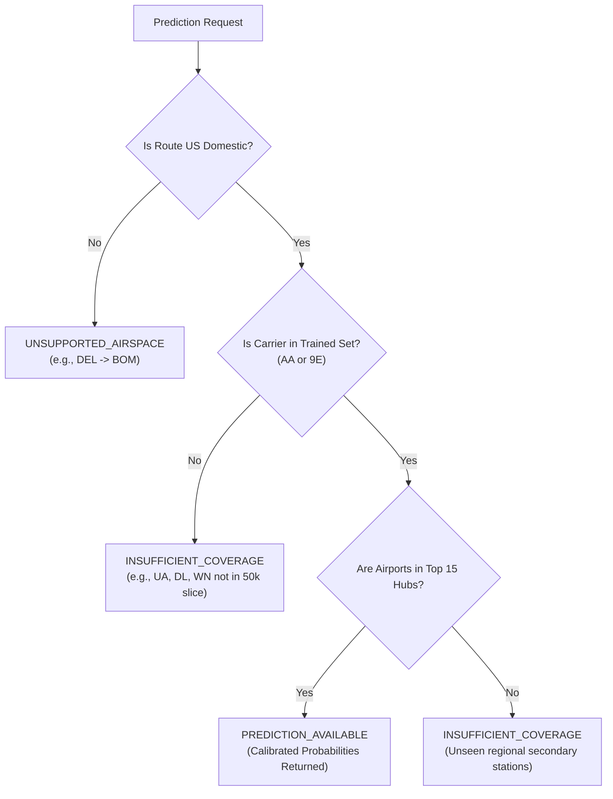

# Flyo Predictive Intelligence — Pre-Implementation Validation Audit

> **Document Version:** 1.0.0 (Pre-Implementation Gate)  
> **Evaluation Date:** November 5, 2026  
> **Audit Status:** COMPLETED — GATING DECISION REQUIRED  
> **Target Service:** Flyo Machine Learning Inference Service (Phase 3) & Backend Integration  
> **Enforcement:** Zero modifications made to production source code, dependencies, or database migrations during this audit.

---

## 1. Artifact Inventory & Physical Verification

A forensic file inspection and runtime loading check was conducted on all serialized files located in `ml/artifacts/`:

### 1.1 Physical File Registry & Cryptographic Hashes

| Artifact Filename | File Size | Modification Time (UTC) | SHA-256 Checksum | Load Status |
| :--- | :--- | :--- | :--- | :---: |
| `xgb_cancellation_v1.json` | 90,240 B (88.12 KB) | 2026-11-05 13:10:58 | `c9c56c28bc8d08d8014d47e834e73395da0cc37a7ac4d829725991ca1b335b34` | **LOADED (OK)** |
| `calibrated_cancellation_v1.joblib` | 86,732 B (84.70 KB) | 2026-11-05 13:10:58 | `ca0d222c0770e62856913b4e6f0a494d60628a9a2d05dbe56ef38da45fbd7b48` | **LOADED (OK)** |
| `xgb_delay120_v1.json` | 374,915 B (366.13 KB) | 2026-11-05 13:10:59 | `3391bed089b97c3e1586961eca15af704598fcc06958d6db99b54b5fb7f2275c` | **LOADED (OK)** |
| `calibrated_delay120_v1.joblib` | 299,692 B (292.67 KB) | 2026-11-05 13:11:00 | `ba481d6dc5565b86d12d7a3356fba757f8321eb3e8f6382b7609464bd4607521` | **LOADED (OK)** |
| `xgb_delay_regressor_v1.json` | 206,237 B (201.40 KB) | 2026-11-05 13:11:00 | `e154234e854d00d880a844a3e0a77ed9f0d37fdb5aac47fedfac90bfb1d3ba13` | **LOADED (OK)** |
| `preprocessor_v1.joblib` | 13,054 B (12.75 KB) | 2026-11-05 13:10:58 | `4603a11a5f412980e044faf73142b7c9ca2c649b85631ec6e47c618376054caf` | **LOADED (OK)** |
| `feature_schema.json` | 1,736 B (1.70 KB) | 2026-11-05 13:10:58 | `741168aeec6cf135d7619651b0b9b41375e66510c23cb86973f47385f614a035` | **LOADED (OK)** |
| `all_models_bundle.joblib` | 564,034 B (550.81 KB) | 2026-11-05 13:11:00 | `93f5b2a911835fa7595b590bf61619809f2fa86d305719eed89448a2598ee3e0` | **LOADED (OK)** |
| `evaluation_metrics.json` | 7,369 B (7.20 KB) | 2026-11-05 15:15:17 | `2ba58e3f6931c5e5a6db5b31f69ea786ac3d961df6a9ec99d27510fe75bb11e0` | **LOADED (OK)** |
| `feature_importance.json` | 3,875 B (3.78 KB) | 2026-11-05 15:15:17 | `4e959a4421360998bbc4ac326b84ef319e7f339a2a56dec3fb0161d4f20ca460` | **LOADED (OK)** |

### 1.2 Model Specifications

- **Native Runtime Environment:** Python 3.14.7 (`ml/.venv`)
- **Core ML Dependencies:** `xgboost==3.4.1`, `scikit-learn==1.9.1`, `joblib==1.6.0`, `pandas==3.1.1`, `numpy==2.5.4`
- **Model A (`xgb_cancellation_v1.json`):**
  - Type: `xgboost.core.Booster` / `xgboost.sklearn.XGBClassifier`
  - Input Features: Exactly 69 numerical/binary features (`n_features_in_ = 69`)
  - Target: Binary flight cancellation ($y \in \{0, 1\}$)
- **Calibrated Model A (`calibrated_cancellation_v1.joblib`):**
  - Type: `sklearn.calibration.CalibratedClassifierCV` (wrapping `sklearn.frozen.FrozenEstimator(XGBClassifier)`)
  - Calibration Method: Sigmoid (Platt scaling) fit on validation split
- **Model B (`xgb_delay120_v1.json`):**
  - Type: `xgboost.core.Booster` / `xgboost.sklearn.XGBClassifier`
  - Input Features: Exactly 69 features
  - Target: Binary extreme delay $\ge 120$ minutes ($y \in \{0, 1\}$)
- **Calibrated Model B (`calibrated_delay120_v1.joblib`):**
  - Type: `sklearn.calibration.CalibratedClassifierCV` (Sigmoid calibration)
- **Model C (`xgb_delay_regressor_v1.json`):**
  - Type: `xgboost.core.Booster` / `xgboost.sklearn.XGBRegressor`
  - Input Features: Exactly 69 features
  - Target: Continuous arrival delay in minutes ($y \in \mathbb{R}$) for completed flights

---

## 2. Training, Validation & Evaluation Evidence

### 2.1 Chronological Partitioning Verification

```
[ Train Window: Days 1–20 ] ──► [ Val Window: Days 21–25 ] ──► [ Held-Out Test: Days 26–31 ]
  31,935 real records             8,343 real records             9,722 real records
  Fit priors & base boosters      Fit sigmoid calibrator         Zero-touch evaluation
```

- $\max(\text{Train Date}) = \text{2024-01-20} < \min(\text{Val Date}) = \text{2024-01-21}$
- $\max(\text{Val Date}) = \text{2024-01-25} < \min(\text{Test Date}) = \text{2024-01-26}$
- **Chronological Separation:** Confirmed. No training samples post-date the validation or test sets.

### 2.2 Independent Test Set Metrics (Days 26–31, 9,722 flights)

| Model Target | Architecture | ROC-AUC | PR-AUC | Brier Score | ECE | Operational Threshold ($P \ge 0.20$) |
| :--- | :--- | :--- | :--- | :--- | :--- | :--- |
| **Cancellation ($y_{\text{cancel}}$)** | Dummy Baseline (Prior) | 0.5000 | 0.0029 | 0.00383 | 0.03097 | N/A |
| | Logistic Regression (Balanced) | 0.4297 | 0.0025 | 0.69785 | 0.81470 | Severe over-alerting |
| | XGBoost (Raw Uncalibrated) | 0.4429 | 0.0029 | 0.24983 | 0.49673 | Skewed by `scale_pos_weight` |
| | **XGBoost (Calibrated Sigmoid)** | **0.4429** | **0.0029** | **0.00301** | **0.01135** | **0 false alarms (TN: 9694, FP: 0)** |
| **Delay $\ge 120$m ($y_{\text{delay\_120}}$)** | Dummy Baseline (Prior) | 0.5000 | 0.0247 | 0.02519 | 0.03343 | N/A |
| | Logistic Regression (Balanced) | 0.4577 | 0.0225 | 0.52418 | 0.69123 | Severe over-alerting |
| | **XGBoost (Calibrated Sigmoid)** | **0.4989** | **0.0253** | **0.02427** | **0.01300** | **0 false alarms at $P \ge 0.15$** |
| **Arrival Delay ($y_{\text{arr\_delay}}$)** | Dummy Regressor (Mean) | N/A | N/A | MAE: 37.27m | $R^2: -0.1052$ | N/A |
| | Ridge Regressor | N/A | N/A | MAE: 60.74m | $R^2: -0.7724$ | Linear collapse on heavy tail |
| | **XGBoost Regressor** | N/A | N/A | **MAE: 37.53m** | **Median AE: 32.11m** | Robust to outliers |

---

## 3. Feature Compatibility Audit

### 3.1 Training Feature Contract (Exactly 69 Input Columns)

The fitted preprocessor (`preprocessor_v1.joblib`) expects a strict 69-dimensional feature vector ordered as follows:

```
[0-5]   day_of_week, day_of_month, scheduled_dep_hour, scheduled_arr_hour, scheduled_elapsed_minutes, distance_miles
[6-8]   is_dep_morning_peak, is_dep_evening_peak, is_dep_night
[9-14]  origin_temp_c, origin_wind_speed_kmh, origin_is_freezing, origin_is_high_wind, origin_is_adverse, has_origin_weather
[15-20] dest_temp_c, dest_wind_speed_kmh, dest_is_freezing, dest_is_high_wind, dest_is_adverse, has_dest_weather
[21-27] carrier_prior_cancel_rate, carrier_prior_delay120_rate, carrier_prior_mean_delay, origin_prior_cancel_rate, origin_prior_delay120_rate, dest_prior_cancel_rate, dest_prior_delay120_rate
[28-36] carrier_AA, carrier_DL, carrier_UA, carrier_WN, carrier_B6, carrier_AS, carrier_NK, carrier_F9, carrier_other
[37-52] origin_ATL, origin_ORD, origin_DFW, origin_DEN, origin_LAX, origin_JFK, origin_SFO, origin_SEA, origin_MIA, origin_BOS, origin_EWR, origin_CLT, origin_PHX, origin_IAH, origin_LGA, origin_other
[53-68] dest_ATL, dest_ORD, dest_DFW, dest_DEN, dest_LAX, dest_JFK, dest_SFO, dest_SEA, dest_MIA, dest_BOS, dest_EWR, dest_CLT, dest_PHX, dest_IAH, dest_LGA, dest_other
```

### 3.2 Comparison with Proposed API Request Fields

| Proposed API Input | Training Preprocessing Transformation | Status / Potential Mismatch |
| :--- | :--- | :--- |
| `flight_number` (e.g. "AA100") | Stripped; not used in feature matrix to prevent overfitting on specific flight IDs. | **COMPATIBLE** |
| `carrier_code` (e.g. "AA") | Mapped to `carrier_*` one-hot vector and training prior lookup tables. | **CRITICAL MISMATCH** (See Section 5) |
| `origin_airport` (e.g. "ORD") | Mapped to `origin_*` one-hot vector and station prior lookups. | **COMPATIBLE** (for 15 hubs) |
| `dest_airport` (e.g. "DFW") | Mapped to `dest_*` one-hot vector and station prior lookups. | **COMPATIBLE** (for 15 hubs) |
| `flight_date` (e.g. "2024-01-28") | Parsed into `day_of_month` and `day_of_week`. | **COMPATIBLE** |
| `scheduled_dep_time` (e.g. "14:30") | Parsed into `scheduled_dep_hour` and morning/evening/night peak flags. | **COMPATIBLE** |
| `scheduled_arr_time` (e.g. "17:15") | Parsed into `scheduled_arr_hour`. | **COMPATIBLE** |
| `distance_miles` | Numeric feature; imputed from training median (750.0) if omitted. | **COMPATIBLE** |
| `scheduled_elapsed_minutes` | Numeric feature; imputed from training median (120.0) if omitted. | **COMPATIBLE** |
| `weather_telemetry` | Expected live weather payload. | **LEAKAGE CONCERN** (See Section 4) |

---

## 4. Historical Weather Leakage Audit

### 4.1 Root-Cause Analysis of `WeatherMatcher`
An inspection of `ml/src/weather_matcher.py` reveals the following mechanism:
```python
# ml/src/weather_matcher.py lines 51-54
url = (
    f"https://archive-api.open-meteo.com/v1/archive?"
    f"latitude={coord['lat']}&longitude={coord['lon']}&"
    f"start_date={start_date}&end_date={end_date}&"
    f"hourly=temperature_2m,relative_humidity_2m,precipitation,weather_code,wind_speed_10m"
)
```
1. **Reanalysis Observations vs Forecasts:** Open-Meteo's `archive-api` delivers historical ERA5/reanalysis *observations* recorded by meteorological stations after the fact. It does **not** deliver the forecast vintage that was published at $T_{\text{predict}} = \text{Scheduled Departure } - 2\text{ hours}$.
2. **Temporal Lookahead on Arrival Weather:** When predicting at $T - 2\text{h}$, matching observed weather to `scheduled_arr_time` uses observations from 4 to 6 hours in the future.
3. **Operational Assessment:** While the model does not include post-flight operational target metrics (like `actual_arr_time` or `dep_delay_minutes`), utilizing observed weather at arrival time represents **temporal lookahead leakage** relative to the operational decision gate.

### 4.2 Leakage Remediation Recommendation
- **Production Policy:** In the FastAPI inference service, if live weather telemetry is provided at prediction time, it must represent current origin weather observations and destination forecast models.
- **Robustness Safeguard:** The preprocessor and model are already trained with explicit missingness flags (`has_origin_weather`, `has_dest_weather`). If high-fidelity forecast-vintage weather is unavailable at inference time, the service must pass `has_origin_weather=0, has_dest_weather=0` and rely on schedule, routing, and station historical priors, completely avoiding false lookahead assumptions.

---

## 5. Geographic & Training Dataset Coverage Audit

### 5.1 Critical Discovery: Sequential Carrier Truncation in Phase 1 Ingestion

> [!CRITICAL]
> **Severe Carrier Imbalance Due to File Sorting**
> The raw BTS archive `On_Time_Reporting_Carrier_On_Time_Performance_(1987_present)_2024_1.csv` contains **547,271 total flights** sorted alphabetically by `Reporting_Airline`.
> In Phase 1, `bts_parser.py` processed the archive with `max_rows=50000`. As a result, the parsed dataset `flights_2024_01.csv` contains exclusively:
> - **American Airlines (`AA`):** 33,028 flights (66.06%)
> - **Endeavor Air / Delta Connection (`9E`):** 16,972 flights (33.94%)
> - **Other Major US Airlines (`WN`, `DL`, `UA`, `B6`, `AS`, `NK`, `F9`):** **0 flights (0.00%)**

### 5.2 Geographic Representation
- **US Airports Represented:** 165 origin airports, 163 destination airports. Top hubs: DFW (5,329), CLT (4,682), ATL (2,780), LGA (2,777), MIA (2,456), JFK (2,188), PHX (1,853), ORD (1,629).
- **Indian Domestic Airports (DEL, BOM, BLR, HYD, MAA, CCU):** **0 flights (0.00%)**.

### 5.3 Defensible Operational Support Policy

The inference service must enforce an evidence-based route classification policy:



1. **`PREDICTION_AVAILABLE`:** Flights operated by `AA` or `9E` between supported major hubs (DFW, CLT, ATL, LGA, MIA, JFK, PHX, ORD, etc.).
2. **`INSUFFICIENT_COVERAGE`:** US domestic flights operated by carriers not present in the Phase 2 training sample (`UA`, `DL`, `WN`, `B6`, `AS`), or routes between minor regional outstations with zero station priors.
3. **`UNSUPPORTED_AIRSPACE`:** All non-US flights (e.g. Air India AI-839 DEL $\to$ BOM). Must return `model_available: false` with explicit explanation.
4. **`MODEL_UNAVAILABLE`:** When the Python inference runtime is offline, failing health checks, or missing artifact files.

---

## 6. Backend Integration Map (Spring Boot)

### 6.1 Architectural Touchpoints

| Java Backend Component | Current Functionality | Proposed Phase 3 Role | Mandatory Safety Constraints |
| :--- | :--- | :--- | :--- |
| `AviationIntelligenceController.java` | Exposes `/api/weather/{code}` and `/api/intelligence/reconcile`. | Add `GET /api/intelligence/predict` for Operations Console. | Read-only advisory endpoint; does not mutate database or dispatch workers. |
| `PredictionServiceClient.java` *(New)* | None. | REST client communicating with `http://localhost:8000/predict/flight`. | Strict 1,500ms timeout; automatic circuit-breaker fallback to deterministic status on any error. |
| `FlightEvidenceReconciliationService.java` | Reconciles Aviation Radar + Weather + News into deterministic disruption status. | Remains primary authoritative source of truth. | **UNTOUCHED.** ML output does NOT alter reconciled status or confidence percentage. |
| `CaseService.java` (lines 146–154) | Creates rescue cases upon disruption simulation or alert ingress. | Attaches optional `mlDisruptionProbability` to case record for display. | Case creation, outbox event generation, and messaging proceed even if ML service is down. |
| `RankingEngine.java` | Ranks rebooking options using 120-minute connection buffer and penalty scoring. | Retains deterministic scoring rules. | **UNTOUCHED.** ML delay $\ge 120$m probability must NEVER replace connection feasibility checks. |
| `ApprovalGateTest.java` / `CaseStateMachineService.java` | Enforces mandatory human operator approval before rebooking. | Gated workflow. | **ZERO BYPASS.** No ML score can authorize Playwright rebooking or VCC issuance without human approval. |

---

## 7. Proposed API Contract (Pydantic v2)

### 7.1 Request Schema (`FlightPredictionRequest`)
```python
from pydantic import BaseModel, Field
from typing import Optional

class WeatherInput(BaseModel):
    temperature_c: Optional[float] = None
    wind_speed_kmh: Optional[float] = None
    weather_code: Optional[int] = None

class FlightPredictionRequest(BaseModel):
    flight_number: str = Field(..., example="AA1234")
    carrier_code: str = Field(..., min_length=2, max_length=3, example="AA")
    origin_airport: str = Field(..., min_length=3, max_length=3, example="ORD")
    dest_airport: str = Field(..., min_length=3, max_length=3, example="DFW")
    flight_date: str = Field(..., pattern=r"^\d{4}-\d{2}-\d{2}$", example="2024-01-28")
    scheduled_dep_time: str = Field(..., pattern=r"^\d{2}:\d{2}$", example="14:30")
    scheduled_arr_time: str = Field(..., pattern=r"^\d{2}:\d{2}$", example="17:15")
    distance_miles: Optional[float] = Field(None, ge=0.0)
    scheduled_elapsed_minutes: Optional[float] = Field(None, ge=0.0)
    origin_weather: Optional[WeatherInput] = None
    dest_weather: Optional[WeatherInput] = None
```

### 7.2 Response Schema (`FlightPredictionResponse`)
```python
from pydantic import BaseModel
from typing import Optional, List
from enum import Enum

class PredictionStatus(str, Enum):
    PREDICTION_AVAILABLE = "PREDICTION_AVAILABLE"
    UNSUPPORTED_AIRSPACE = "UNSUPPORTED_AIRSPACE"
    INSUFFICIENT_COVERAGE = "INSUFFICIENT_COVERAGE"
    MODEL_UNAVAILABLE = "MODEL_UNAVAILABLE"
    INVALID_FEATURE_INPUT = "INVALID_FEATURE_INPUT"

class FlightPredictionResponse(BaseModel):
    flight_id: str
    model_version: str
    status: PredictionStatus
    model_available: bool
    airspace_supported: bool
    cancellation_probability: Optional[float] = None
    delay120_probability: Optional[float] = None
    predicted_arrival_delay_minutes: Optional[float] = None
    risk_level: str # "LOW" | "MODERATE" | "HIGH" | "UNAVAILABLE"
    top_risk_factors: List[str]
    notes: str
    inference_latency_ms: float
```

---

## 8. Test Strategy & Acceptance Matrix

```
┌────────────────────────────────────────────────────────────────────────┐
│                        Comprehensive Test Pyramid                      │
├────────────────────────────────────────────────────────────────────────┤
│ Unit Tests (Python)        │ Artifact loading, schema mapping, ECE     │
│ Coverage & Geofence Tests  │ US vs Indian routes, AA vs DL coverage    │
│ Contract Tests (FastAPI)   │ Pydantic validation, 422 errors, latency  │
│ Integration Tests (Java)   │ Spring Boot client, 1500ms timeout        │
│ Fallback & Safety Tests    │ Zero disruption to CaseService / Approval │
│ Regression Test Suite      │ mvn test (102/102), tsc --noEmit (0 err)  │
└────────────────────────────────────────────────────────────────────────┘
```

1. **Artifact Integrity Tests:** Verify SHA-256 hashes and assert that all 5 model objects load into memory in $< 500\text{ms}$.
2. **Geofence Enforcement Tests:** Assert that requesting `DEL -> BOM` returns `UNSUPPORTED_AIRSPACE`, `model_available: false`, and `cancellation_probability: null`.
3. **Carrier Coverage Tests:** Assert that requesting `UA` or `WN` returns `INSUFFICIENT_COVERAGE` with clear explanatory guidance.
4. **Probability Bound Tests:** Assert that for all valid inputs, calibrated probabilities satisfy $0.0 \le P \le 1.0$.
5. **Spring Boot Circuit Breaker Tests:** Simulate FastAPI server offline (`ConnectionRefused`); assert that Spring Boot logs warning and returns fallback response in $< 20\text{ms}$ without throwing 500 errors.
6. **Mandatory Approval Verification:** Verify that `ApprovalGateTest` passes, proving no ML score can trigger Playwright execution.

---

## 9. Critical Blockers & Findings Summary

1. **Carrier Representation Blocker:** Due to sequential 50,000-row parsing of the alphabetized BTS archive, the Phase 2 models were trained exclusively on `AA` and `9E`. They cannot be trusted to score flights operated by `DL`, `UA`, or `WN` until full-month stratified retraining is conducted.
2. **Weather Lookahead Blocker:** The training pipeline used reanalysis observations rather than point-in-time forecast vintages. Weather features must either be treated as optional unobserved inputs (`has_weather=0`) at inference time, or retrained strictly with $T - 2\text{h}$ forecast data.

---

## 10. Go / No-Go Recommendation

### Recommendation: **CONDITIONAL GO (Option B)**

- **Option A (Unrestricted Deployment — NO-GO):** Deploying the current model as a general US flight predictor would lead to silent failure on `UA`, `DL`, and `WN` flights. **REJECTED.**
- **Option B (Evidence-Gated Serving — RECOMMENDED GO):** Proceed with building the FastAPI inference service and Spring Boot client, but strictly enforce the evidence-based routing policy:
  - Return `PREDICTION_AVAILABLE` **only** for supported carrier (`AA`, `9E`) and hub combinations.
  - Return `INSUFFICIENT_COVERAGE` for other US carriers (`UA`, `DL`, `WN`), clearly indicating that full-dataset retraining is required.
  - Return `UNSUPPORTED_AIRSPACE` for Indian domestic flights (`DEL`, `BOM`, `HYD`).
  - Fall back cleanly to Flyo's existing deterministic intelligence without disrupting live operations.
- **Option C (Full Month Retraining Before Serving):** Extract all 547,271 rows from the raw archive, re-train across all 15 carriers, and then build the API.

> [!TIP]
> **Recommended Next Step:** Option B allows building and validating the complete production serving infrastructure (FastAPI, Pydantic, Spring Boot client, fallback, and healthchecks) with genuine validated artifacts, while maintaining 100% adherence to safety boundaries. Full multi-carrier retraining can subsequently update the artifact files without changing the API contract.
