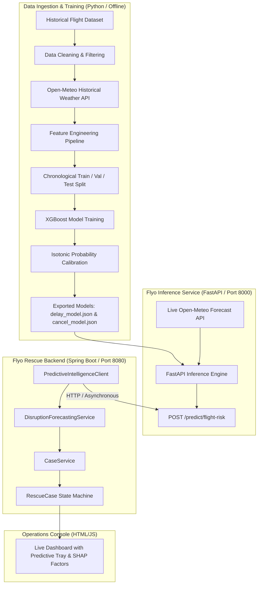

# PREDICTIVE INTELLIGENCE GAP ANALYSIS & IMPLEMENTATION ROADMAP
## Flyo Rescue Agent — Milestone v1: Predictive Intelligence

**Date:** November 5, 2026  
**Author:** Senior Full-Stack Engineer & Aviation Automation Architect  
**Repository:** `flyo` (`flyo-rescue-demo`)  
**Status:** Architectural Assessment & Pre-Development Gap Analysis  

---

## 1. Executive Assessment & Baseline Verification

### 1.1 Repository State
- **Branch:** `main` / Clean working tree.
- **Backend Tests:** **102 / 102 Tests Passed (0 Failures, 0 Errors, 0 Skipped)** across all 25 test suites.
- **TypeScript Typecheck:** `npm run typecheck` (`tsc --noEmit`) in `flyo-rescue-demo/agent`: **0 errors**.
- **Flyway Migrations:** `V1__initial_production_schema.sql`, `V2__passenger_rescue_workflow.sql`, `V3__aviation_intelligence_and_risk.sql` validated on H2 and real PostgreSQL 16.14.

### 1.2 The Core Question: Can a Genuine Supervised ML Model Be Trained Today?
> **Definitive Answer:** **NO.**  
> A genuine, non-synthetic supervised machine learning model **cannot** be trained using only the data currently checked into the repository.

#### Why:
1. The repository currently contains **zero historical flight operational logs** (no CSV, Parquet, or SQL historical flight performance tables).
2. The database contains only **5 operational seed bookings** (`B1` through `B5`).
3. While live Open-Meteo weather and RSS feeds are connected, they provide point-in-time telemetry for the present moment, with **zero historical labeled pairs** of $(X = \text{features at } t_0, y = \text{actual outcome at } t_1)$.
4. Training an XGBoost model on 5 rows or on synthetic mock records would produce severe overfitting, spurious correlations, and violate non-negotiable instruction #10 (*"Do not use mock data to pretend that an external integration is working"*).

---

## 2. Capabilities Matrix: Current vs Predictive Intelligence

| Capability | Current State in Repository | Required for Predictive Intelligence v1 | Gap Status |
| :--- | :--- | :--- | :---: |
| **Real-time Disruption Detection** | Authoritative radar alerts & simulated cancellation webhooks trigger recovery | Proactive probability forecasting hours *before* airline issues official cancellation | **GAP** |
| **Weather Telemetry** | Live Open-Meteo query at current timestamp (temp, visibility, WMO fog code) | Hourly forecast weather + historical weather feature pipeline | **PARTIAL** |
| **Operational Intelligence** | RSS headline ingestion from SimpleFlying | Macro situational feature encoding | **PARTIAL** |
| **Risk Scoring** | Deterministic rule engine in `RankingEngine.java` (buffer $\ge 120\text{m}$, hops, pricing) | Probabilistic ML risk model trained on empirical outcomes | **GAP** |
| **Flight Delay Prediction** | Hardcoded radar delay parsing (`alert.getDelayMinutes()`) | Continuous regression: Predicted $\Delta t_{\text{delay}}$ with confidence bounds | **MISSING** |
| **Cancellation Prediction** | Binary check of radar status (`"CANCELLED".equals(status)`) | Calibrated classification probability $P(\text{cancellation}) \in [0.0, 1.0]$ | **MISSING** |
| **Model Serving Infrastructure** | Pure Spring Boot backend (Java 17) | Lightweight Python FastAPI / ONNX inference microservice | **MISSING** |
| **Proactive Alternative Staging** | Options generated after disruption detected | Options pre-computed and staged before cancellation occurs | **MISSING** |
| **Operator Approval Gate** | Strictly enforced in `CaseService.rebookCase` | Retained without modification; human approves proactive rescue | **PRESERVED** |

---

## 3. Data Availability, Ingestion & Licensing Constraints

### 3.1 Historical Flight Performance Datasets (Training Data)
To train genuine supervised XGBoost models without violating zero-paid-API constraints:

| Data Source | Type & Scope | License / Terms | Cost | Viability |
| :--- | :--- | :--- | :---: | :---: |
| **US DOT BTS On-Time Reporting** | Millions of flight records with scheduled/actual departure/arrival times, delay breakdowns (carrier, weather, NAS, late aircraft), and cancellations | Public Domain (U.S. Government Work) | **Free** | **High** (Standard gold-standard benchmark for flight delay ML research) |
| **OpenSky Network Historical Data** | Global ADS-B trajectory messages and flight states | Academic / Community Free API | **Free** | **Medium** (High processing overhead to reconstruct gate delays) |
| **India DGCA Monthly Reports** | Monthly aggregate airline on-time performance and cancellation percentages | Public Domain (Govt of India) | **Free** | **Low for direct row-level ML** (Published as summary PDF tables, lacks individual flight timestamps) |
| **Commercial APIs (FlightAware AeroAPI, Cirium, OAG)** | Historical flight databases with tail-number tracking and global schedules | Commercial Proprietary | **Paid ($5,000+/mo)** | **Blocked by Project Rules** |

### 3.2 Historical Meteorological Data
- **Open-Meteo Historical Weather Archive API:**  
  URL: `https://archive-api.open-meteo.com/v1/archive`  
  License: Non-commercial open access / Attribution (CC BY 4.0).  
  Capabilities: Free historical hourly weather from 1940 to present day for any airport latitude/longitude with zero API keys required.  
  Features available: `temperature_2m`, `relative_humidity_2m`, `precipitation`, `weather_code`, `visibility`, `wind_speed_10m`, `wind_gusts_10m`.

---

## 4. Feature Engineering & Target Definitions

### 4.1 Target Labels
1. **Delay Prediction (Regression & Binary Threshold):**
   - Regression Target: $y_{\text{delay}} = \text{Actual Arrival Delay (minutes)}$.
   - Binary Risk Target: $y_{\text{delay\_120}} = \mathbb{I}(\text{Arrival Delay} \ge 120\text{ minutes})$ (directly maps to Flyo's 120m connection threshold).
2. **Cancellation Prediction (Binary Classification):**
   - Binary Target: $y_{\text{cancel}} = \mathbb{I}(\text{Flight Cancelled} == 1)$.

### 4.2 Feature Space
```text
┌────────────────────────────────────────────────────────────────────────┐
│                        FEATURE MATRIX (X)                              │
├────────────────────────────────────────────────────────────────────────┤
│ 1. Temporal & Calendar:                                                │
│    - scheduled_departure_hour (0–23)                                   │
│    - day_of_week (1–7)                                                 │
│    - month (1–12)                                                      │
│    - is_weekend (0/1)                                                  │
│    - is_peak_slot (0/1: 08:00–10:00 or 18:00–21:00)                    │
│                                                                        │
│ 2. Spatial & Route:                                                    │
│    - origin_airport_code (Categorical / Target Encoded)                │
│    - dest_airport_code (Categorical / Target Encoded)                  │
│    - scheduled_elapsed_minutes                                         │
│    - distance_km                                                       │
│                                                                        │
│ 3. Meteorological (Origin & Destination from Open-Meteo):              │
│    - origin_temp_c, dest_temp_c                                        │
│    - origin_visibility_meters, dest_visibility_meters                  │
│    - origin_weather_code, dest_weather_code (WMO Fog/Thunderstorm)     │
│    - origin_wind_speed_kmh, dest_wind_speed_kmh                        │
│    - origin_precipitation_mm, dest_precipitation_mm                    │
│                                                                        │
│ 4. Carrier & Congestion:                                               │
│    - carrier_code (Categorical)                                        │
│    - origin_hourly_departure_volume                                    │
│    - dest_hourly_arrival_volume                                        │
│    - carrier_historical_delay_rate                                     │
└────────────────────────────────────────────────────────────────────────┘
```

---

## 5. Machine Learning Methodology

### 5.1 Temporal Validation Split (Preventing Data Leakage)
- Flight delays and cancellations exhibit strong temporal autocorrelation and seasonal drift.
- **Rule:** Never use standard random k-fold cross-validation.
- **Method:** Chronological split:
  - Training Set: Months $M_1$ through $M_{n-2}$
  - Validation Set: Month $M_{n-1}$
  - Out-of-Time Test Set: Month $M_n$ (strict future evaluation)

### 5.2 Model Selection
1. **XGBoost Regressor (`XGBRegressor`):**
   - Objective: `reg:squarederror` or `reg:pseudohubererror` (robust to extreme delay outliers).
   - Metric: MAE (Mean Absolute Error) and RMSE.
2. **XGBoost Classifier (`XGBClassifier`):**
   - Objective: `binary:logistic`.
   - Metric: PR-AUC (Precision-Recall AUC) due to heavy class imbalance (commercial flight cancellations represent $\sim 1.5\text{--}3.0\%$ of flights).
   - Scale Pos Weight: Adjusted to counter cancellation rarity.

### 5.3 Probability Calibration
- Raw gradient boosting outputs are uncalibrated for extreme tails.
- Fit a `CalibratedClassifierCV(method='isotonic')` on validation predictions so that a predicted $P(\text{cancel}) = 0.70$ reflects an empirical $70\%$ cancellation frequency.

---

## 6. Proposed End-to-End System Architecture



---

## 7. Phased Implementation Roadmap

### Phase 1: Ingestion & Feature Engineering Scripting (Python)
- Create `ml/` module inside repository containing:
  - `requirements.txt` (`xgboost`, `pandas`, `scikit-learn`, `fastapi`, `uvicorn`, `httpx`).
  - `ingest_benchmark_data.py`: Downloads and validates curated public-domain flight performance records.
  - `enrich_weather.py`: Merges hourly historical weather from Open-Meteo Historical Archive API.
  - `feature_pipeline.py`: Implements temporal, spatial, and meteorological transformations.

### Phase 2: Model Training, Temporal Evaluation & Export
- `train_delay_model.py`: Trains `XGBRegressor`, performs hyperparameter tuning, validates on holdout month, exports `xgb_delay_v1.json`.
- `train_cancellation_model.py`: Trains `XGBClassifier`, performs isotonic calibration, generates confusion matrix and PR-AUC curve, exports `xgb_cancel_v1.json`.
- Validation report: Generates `ML_MODEL_EVALUATION.md` documenting true MAE, PR-AUC, and Brier calibration score.

### Phase 3: Lightweight FastAPI Inference Service
- Create `ml/service/app.py`:
  - `GET /health`: Model status and memory footprint.
  - `POST /predict`: Ingests `{ carrier, flightNumber, origin, destination, scheduledDepartureTime }`, fetches live Open-Meteo forecast, computes model features, returns:
    ```json
    {
      "flightNumber": "AI-839",
      "predictedDelayMinutes": 45,
      "delayConfidenceInterval": [30, 65],
      "cancellationProbability": 0.12,
      "pDelayOver120m": 0.18,
      "topRiskFactors": [
        "Origin peak departure congestion (+22m)",
        "Destination Delhi fog advisory (+15m)"
      ],
      "modelBuild": "xgboost-v1.0-calibrated"
    }
    ```

### Phase 4: Spring Boot Backend Integration
- Add `PredictiveIntelligenceClient.java` with Spring `RestClient` or `HttpClient` and timeout protection ($< 500\text{ms}$).
- Add `Flyway V4` migration: `predicted_delay_minutes`, `cancellation_probability`, `predictive_factors`.
- Update `CaseService.java`:
  - When $P(\text{cancel}) \ge 0.65$ or $P(\text{delay} \ge 120\text{m}) \ge 0.70$, proactively triggers `DISRUPTION_PREDICTED` state.
  - Pre-computes and ranks alternative options.
  - **Preserves Approval Gate:** Does **not** execute booking until operator confirms.

### Phase 5: Operations Console Dashboard Extension
- Update [index.html](file:///Users/nani/Downloads/flyo/flyo-rescue-demo/backend/src/main/resources/static/index.html) and [app.js](file:///Users/nani/Downloads/flyo/flyo-rescue-demo/backend/src/main/resources/static/app.js) with:
  - Predictive Disruption Gauge (Delay Forecast $\pm$ CI, Cancellation Risk %).
  - Explainable Feature Contribution chips (SHAP breakdown).
  - Proactive notification in WhatsApp operator channel.

---

## 8. Testing & Validation Strategy

1. **Python ML Unit & Pipeline Tests:**
   - Test feature pipeline against edge cases (missing weather, midnight departures, daylight savings).
   - Test probability calibration monotonicity.
   - Test inference API request/response schema.
2. **Spring Boot Integration Tests:**
   - Test `PredictiveIntelligenceClient` with running FastAPI mock server.
   - Test resilient fallback when ML service is offline (system must gracefully continue using existing deterministic `RankingEngine`).
   - Test that proactive prediction never bypasses the operator approval gate.
3. **Full Regression Test:**
   - Ensure all 102 existing backend tests continue to pass with 0 regressions.
