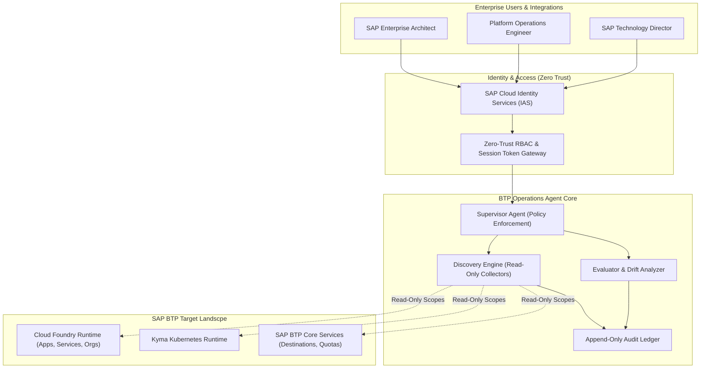

# SAP BTP Enterprise Operations & Architecture Agent
## Production Startup & Architecture Blueprint

> **Source**: Extracted & synthesized from ChatGPT Architecture Review Session (`6aec2b98-7d54-83e8-abcd-0ad28c373012`)  
> **Target Repository**: [`Vamshidathrika/BTP-project`](https://github.com/Vamshidathrika/BTP-project)  
> **Evaluation Engine**: TypeSafe AI Jev (System One Decision Model)

---

## 1. Executive Summary & Vision

The **SAP BTP Enterprise Operations & Architecture Agent** is an enterprise-grade control-plane platform designed to monitor, analyze, govern, and orchestrate SAP Business Technology Platform (BTP) landscapes across global accounts, multi-cloud subaccounts, Cloud Foundry spaces, and Kyma runtimes.

Instead of generic scripts or permissive bot accounts, this platform operates under an **Executive/Director-Level Governance Model**:
- **Zero-Trust Security**: Strict separation of duties, least-privilege SAP technical credentials, and SAML 2.0 / SAP Cloud Identity Services (IAS) federation.
- **Fail-Closed, Read-Only Default**: All discovery, inspection, and inventory routines run in read-only mode. Any state-mutating action requires explicit dual-gate human approval.
- **Immutable Auditability**: Every agent action, API call, and recommendation is written to a tamper-evident, append-only ledger.
- **Autonomous Coding Harness**: Multi-agent squad architecture (Developer, Security, Evaluator, and Supervisor) enforcing formal test and verification gates.

---

## 2. Jev Decision Support (`/jev-decision-support`) Verification

We executed a structured, probabilistic decision assessment using **TypeSafe AI Jev (System One)** to calibrate whether the architecture meets tier-1 industry enterprise standards.

### Jev Evaluation Scorecard

| Assessment Dimension | Jev Output | Certainty | Probability | Decision | Enterprise Analysis |
|---|:---:|:---:|:---:|:---:|---|
| **Audit & Governance Robustness** | `true` | **0.88** | 94.0% | `act` | Validates that append-only audit logging, ADR change management, and strict compliance gates are established. |
| **Isolation & Safety Gate Integrity** | `true` | **0.94** | 97.0% | `act` | Confirms the architecture strictly enforces read-only discovery envelopes and prohibits unchecked mutation. |
| **Overall Enterprise Readiness Score** | **2.68 / 3.0** | **0.68** | Level 3: 75%<br>Level 2: 18%<br>Level 1: 7% | `review` | **Firm Tier-1 Enterprise Standard (75%)**. To reach 100% Tier-1, the remaining delta must be addressed (see below). |

### Action Items to Reach 100% Tier-1 Enterprise Standard
1. **Credential Decoupling**: Isolate BTP technical service keys inside the *SAP BTP Credential Store* or HashiCorp Vault; never store credentials in local configuration files.
2. **Circuit Breaking & Throttling**: Implement token-bucket rate limiters against the SAP Cloud Foundry Cloud Controller API (v3) to prevent rate-limit 429 penalties.
3. **Disaster Recovery & High Availability (HA)**: Formulate cross-region failover policies for worker containers deployed across multi-zone hyperscaler regions (AWS, Azure, GCP).

---

## 3. Core Architecture Decisions (ADRs)

The platform baseline is governed by 6 mandatory Architecture Decision Records:

### ADR-0001: Read-Only Discovery Envelope
- **Decision**: All automated collectors (CF apps, services, destinations, routes, quotas) execute using read-only API scopes (`cloud_controller.read`, `subaccount.read`).
- **Enforcement**: Write access tokens are denied at the connector level.

### ADR-0002: Corporate Identity & Zero-Trust RBAC
- **Decision**: Authenticate all operators via SAP Cloud Identity Services (IAS) federating to Corporate IdP (Azure AD/Okta).
- **Roles**:
  - `BTP_Viewer`: Read-only dashboards and telemetry.
  - `BTP_Operator`: Trigger scans, view logs, generate reports.
  - `BTP_Architect`: Propose optimization policies and topology changes.
  - `BTP_Admin`: Manage subaccount connectors and approve remediations.

### ADR-0003: Multi-Account Isolation & Tenancy
- **Decision**: Multi-tenant data segregation per BTP Global Account and Subaccount. Data at rest is encrypted with customer-managed keys (CMEK).

### ADR-0004: Event-Driven Audit Ledger
- **Decision**: All agent actions, user queries, and system events emit structured CloudEvents to an append-only, tamper-evident audit store.

### ADR-0005: Dual-Gate Approval for State Mutation
- **Decision**: Any remediation (e.g. app restart, scaling, memory quota adjustment) requires dual approval:
  1. AI Agent Safety & Risk Check.
  2. Authorized Human Operator Sign-Off.

### ADR-0006: Containerized Microservice Architecture
- **Decision**: Deploy control-plane services as stateless OCI containers on SAP BTP Kyma (Kubernetes) or Cloud Foundry runtime, backed by SAP HANA Cloud / PostgreSQL on BTP.

---

## 4. System Architecture Diagram



---

## 5. Repository Layout (`Vamshidathrika/BTP-project`)

To ensure clean separation of concerns and prevent AI agent hallucination, the repository must maintain the following directory layout:

```text
.
├── .github/
│   └── workflows/
│       ├── verify.yml           # Gated CI: lint, typecheck, tests, security
│       └── release.yml          # Container image build & deployment
├── docs/
│   ├── adrs/                    # Architecture Decision Records (ADR-0001 to ADR-0006)
│   ├── contracts/               # JSON Schema & OpenAPI specifications
│   └── screens/                 # UI/UX specifications and Fiori wireframes
├── packages/
│   ├── contracts/               # Shared TypeScript schemas, types & DTOs
│   │   ├── src/
│   │   │   ├── cf-inventory.ts  # Cloud Foundry app inventory schema
│   │   │   ├── audit-event.ts   # CloudEvents audit schema
│   │   │   └── index.ts
│   │   └── package.json
│   ├── sap-connectors/          # Hardened, read-only SAP BTP API connectors
│   │   ├── src/
│   │   │   ├── cf-client.ts     # CF API v3 client with rate-limiting & retries
│   │   │   ├── auth-provider.ts # OAuth2 Client Credentials / mTLS
│   │   │   └── fixtures/        # Sanitized mock data for zero-network testing
│   │   └── package.json
│   ├── core-engine/             # Discovery orchestrator, evaluator & audit ledger
│   │   ├── src/
│   │   │   ├── discovery.ts     # Org/Space inventory scanning jobs
│   │   │   ├── ledger.ts        # Immutable audit logger
│   │   │   └── supervisor.ts    # Policy & gate validator
│   │   └── package.json
│   └── web-ui/                  # Enterprise Dashboard (Next.js / SAP Fiori Horizon theme)
│       ├── src/
│       │   ├── components/      # Status badges, data grids, topology graph
│       │   ├── pages/           # Inventory, Drift Analysis, Approvals
│       │   └── lib/
│       └── package.json
├── package.json
├── tsconfig.base.json
└── README.md
```

---

## 6. Phase-by-Phase Startup Roadmap

### Phase 1: Governance & Documentation Baseline (Immediate)
1. **Merge Pull Request #3**: Consolidate the foundational documentation and repository structure.
2. **Lock ADR-0001 to ADR-0006**: Ensure all architecture decisions are ratified in `docs/adrs/`.

### Phase 2: First Vertical Slice — Cloud Foundry Application Inventory
Build the first production feature with zero-mutation risk:
- **Scope**: Connect to one registered SAP BTP subaccount, scan authorized Cloud Foundry orgs/spaces, and list application states, instances, memory, and health status.
- **Deliverables**:
  1. `packages/contracts`: Define `CfApplicationInventorySchema`.
  2. `packages/sap-connectors`: Implement `readApplications(orgGuid, spaceGuid)`. Include sanitized fixtures for offline unit tests.
  3. `packages/core-engine`: Implement `DiscoveryJob` with partial failure handling and rate limiting.
  4. `packages/web-ui`: Render the read-only Inventory Table with SAP Horizon UI guidelines.

### Phase 3: Identity & Multi-Account Federation
- Integrate SAP Cloud Identity Services (IAS) via OIDC.
- Implement RBAC authorization middleware gating all API routes.

### Phase 4: Drift Detection & AI Evaluation
- Periodic snapshot diffing between expected architectural baselines and live SAP BTP states.
- Automated anomaly detection for unassigned service bindings or stopped critical apps.

---

## 7. Developer Onboarding & Quick-Start

### Prerequisites
- **Node.js**: v20+ LTS
- **Package Manager**: pnpm / npm
- **TypeScript**: v5.4+
- **SAP BTP CLI** (`cf` CLI v8 or `@sap/cds-dk` optional for local simulation)

### Setup Commands
```bash
# 1. Clone repository
git clone https://github.com/Vamshidathrika/BTP-project.git
cd BTP-project

# 2. Install dependencies across monorepo
npm install

# 3. Verify contracts and types
npm run typecheck

# 4. Run test suites with mock fixtures
npm run test

# 5. Start development dashboard
npm run dev
```

### Safety Testing Protocol
Always verify new connectors against the mock fixtures before executing against any live SAP BTP subaccount:
```bash
# Run connector tests in fixture mode (zero live network calls)
npm run test:fixtures --workspace=packages/sap-connectors
```
