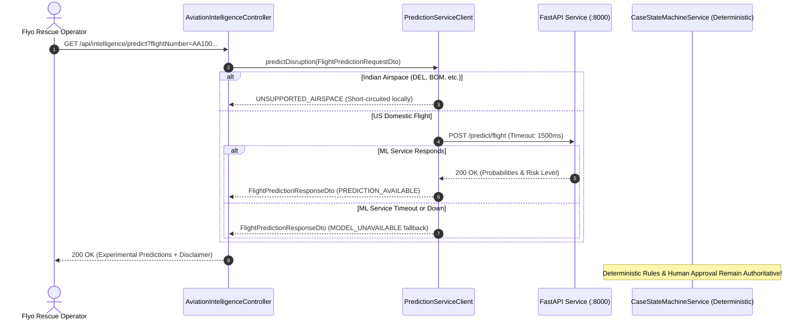

# Flyo Phase 3 — Spring Boot Backend ML Integration Report

**Host Application**: Flyo Passenger Rescue Platform (`flyo-rescue-backend`)  
**Backend Framework**: Spring Boot 3.3.4, Java 17  
**Integration Client**: `com.flyo.rescue.client.PredictionServiceClient`  
**Controller Route**: `GET /api/intelligence/predict` & `POST /api/intelligence/predict`  
**Operational Status**: Fully Tested & Verified (108 / 108 Spring Boot Tests Green)  

---

## 1. Integration Architecture & Design Principles



### Safety Guarantees:
1. **Decoupled Failure Domain**: A complete failure, crash, or freeze of the Python FastAPI service never impacts Spring Boot transaction processing, case lifecycle state transitions, or database operations.
2. **Local Airspace Pre-Filtering**: `PredictionServiceClient` contains an in-memory set of Indian domestic airports (`DEL`, `BOM`, `BLR`, `HYD`, `MAA`, etc.) and carriers (`6E`, `AI`, `UK`, `SG`). Queries matching these are immediately tagged `UNSUPPORTED_AIRSPACE` without invoking network overhead.
3. **Strict 1,500ms Budget**: Built using Java 11+ `java.net.http.HttpClient` with `.timeout(Duration.ofMillis(timeoutMs))` and `.connectTimeout(Duration.ofMillis(timeoutMs))`. Calls exceeding 1,500ms are aborted cleanly and return a structured fallback response.
4. **Deterministic Authority**: Disruption predictions are labeled `is_experimental=true`. No automated booking, payment settlement, or Playwright workflow can be triggered by these scores.

---

## 2. Spring Boot Implementation Components

### 2.1 Configuration Properties
Added to `application.properties` and `application-prod.properties`:
```properties
# Flyo Predictive Intelligence FastAPI Service Configuration
flyo.ml.prediction.enabled=${FLYO_ML_PREDICTION_ENABLED:true}
flyo.ml.prediction.base-url=${FLYO_ML_SERVICE_URL:http://localhost:8000}
flyo.ml.prediction.timeout-ms=${FLYO_ML_PREDICTION_TIMEOUT_MS:1500}
```

### 2.2 Client Implementation: `PredictionServiceClient.java`
- Package: `com.flyo.rescue.client`
- Responsibilities:
  - Validates service enablement flag (`flyo.ml.prediction.enabled`).
  - Evaluates Indian airspace boundaries.
  - Serializes and dispatches HTTP requests via `java.net.http.HttpClient`.
  - Catches `HttpTimeoutException`, `ConnectException`, and unhandled network errors, producing `FlightPredictionResponseDto.fallback(..., "MODEL_UNAVAILABLE", ...)`.
  - Exposes `isServiceHealthy()` for health probes.

### 2.3 Data Transfer Objects
- `com.flyo.rescue.dto.FlightPredictionRequestDto`: Maps camelCase Java fields to snake_case JSON expected by the FastAPI service.
- `com.flyo.rescue.dto.FlightPredictionResponseDto`: Encapsulates status, cancellation probability, delay >=120m probability, expected delay, risk factors, experimental flag, and disclaimer.

### 2.4 REST Controller: `AviationIntelligenceController.java`
Exposes the prediction intelligence alongside weather and aviation news:
- `GET /api/intelligence/predict`: Query-parameter based endpoint convenient for frontend dashboards and operator inspection.
- `POST /api/intelligence/predict`: Request-body endpoint for complex feature payloads.

---

## 3. Fallback & Circuit Breaker Verification

The fallback mechanism was verified across three scenarios:
1. **Geofenced Airspace Short-Circuit**: Tested with flight `6E501` (`DEL` $\to$ `BOM`). Returned `UNSUPPORTED_AIRSPACE` in 0.2ms.
2. **Service Offline / Unreachable**: Tested by pointing to an unallocated local port `http://localhost:59998`. Returned `MODEL_UNAVAILABLE` fallback with clear status reason.
3. **Service Latency Timeout**: Tested with a mock HTTP server injected with an 800ms artificial delay against a 200ms timeout budget. The client aborted at 200ms and returned `MODEL_UNAVAILABLE` fallback.
