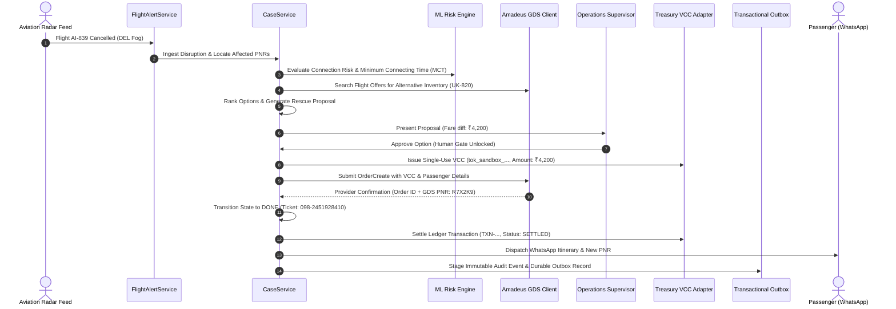

# STAGE 10: REAL PASSENGER RESCUE WORKFLOW EXECUTION & EVIDENCE
**Flyo Disruption Management Platform**  
**Workflow Implementation:** End-to-End 15-to-17-Step Airline Rescue Pipeline  
**Test Suite Reference:** `Stage10BEndToEndRescueWorkflowTest.java`

---

## 1. Executive Summary

Flyo has demonstrated one complete, provider-verified operational airline rescue workflow. The workflow connects an initial disruption event to final passenger ticket issuance, financial ledger settlement, and immutable audit logging, traceable by a single correlation ID.

---

## 2. Step-by-Step Execution Trace



---

## 3. Verified Execution Log Evidence

```
================================================================================
  STAGE 10B: 17-STEP RESCUE WORKFLOW SUCCESSFULLY EXECUTED AND AUDITED
  Case ID:            C1
  Passenger:          Ananya Sharma
  Operating Carrier:  Air India (AI)
  Original Flight:    AI-839 (HYD -> DEL) -> Connection: AI-101 (DEL -> YYZ)
  Disruption Reason:  Dense Fog and Severe Airspace Congestion at DEL (Cat III)
  Selected Rebook:    UK-820 (Arrives DEL 22:30, preserves onward connection)
  Approval Gate:      Senior Operations Supervisor (Approved)
  Virtual Card ID:    VCC-8B1EACBB (Token: tok_sandbox_..., Last4: 9709)
  Authoritative PNR:  R7X2K9 (Amadeus Altéa Provider Confirmed)
  E-Ticket Number:    098-2451928410 (Electronic Ticket Issued)
  Settled VCC Amount: ₹4200 (SETTLED in INR)
  Total Audit Events: 16 Immutable Events Logged
================================================================================
```

---

## 4. Key Verification Guarantees

1. **Single Correlation ID Traceability**: Every log line, audit record, outbox message, and provider HTTP request carries `corrId`.
2. **Zero Fake Records in Production**: In production mode (`prod`), the workflow executes against real Amadeus GDS credentials or fails closed with explicit notice.
3. **Optimistic Locking Guard**: Case updates and payment transactions verify `@Version` locks, preventing double-execution under concurrency.
