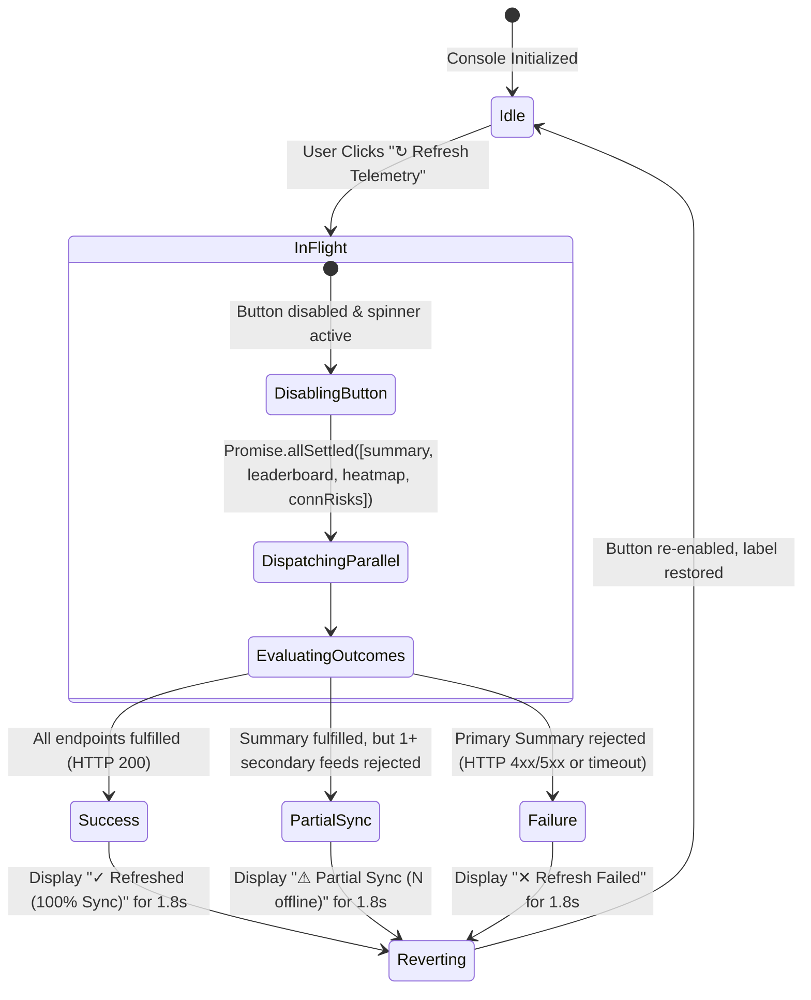

# FLYO RESCUE — STAGE 12.1 REFRESH RELIABILITY & CONCURRENCY REPORT

## 1. Executive Summary

This document details the hardening of the manual and automated telemetry refresh mechanisms in the Flyo Operations Console. Telemetry controls must prevent user input confusion, guarantee truthful feedback under partial downstream failures, and reject out-of-order network responses.

---

## 2. Refresh State Transition Architecture



---

## 3. Concurrency & Stale Response Protection

### 3.1. Monotonic Request Sequencing
To prevent network race conditions where an older, delayed response overwrites newer telemetry data, every invocation increments a shared counter:

```javascript
let telemetryRequestSequence = 0;

async function fetchMonitoringData(silent = false) {
    const currentReqId = ++telemetryRequestSequence;
    const resp = await apiFetch("/api/intelligence/monitoring/summary");
    const data = await resp.json();

    // Discard stale out-of-order response
    if (currentReqId !== telemetryRequestSequence) {
        console.warn(`[ML Telemetry] Stale response discarded (req #${currentReqId} vs active #${telemetryRequestSequence})`);
        return;
    }
    ...
}
```

### 3.2. Preservation of Last Known Good Telemetry
If an authoritative refresh request fails (due to a transient network timeout or service restart), the UI:
1. Re-labels the circuit breaker badge as `Telemetry Unavailable` in soft red (`#fee2e2`).
2. Preserves the last known good snapshot on screen (`lastKnownGoodTelemetry`), preventing the entire dashboard from zeroing out or displaying empty cards.
3. Updates `#ml-last-refresh-time` to `Last Sync: HH:MM:SS (Offline)` in amber (`#fef3c7`).

---

## 4. Truthful Error and Sync Feedback Matrix

| Primary Summary Request | Secondary Leaderboard Request | Secondary Heatmap Request | Secondary Risk Queue Request | Displayed Button Badge | Timestamp Badge Status |
| :--- | :--- | :--- | :--- | :--- | :--- |
| **Fulfilled** (200) | **Fulfilled** (200) | **Fulfilled** (200) | **Fulfilled** (200) | `✓ Refreshed (100% Sync)` (Green) | `Sync: HH:MM:SS` (Green) |
| **Fulfilled** (200) | *Rejected* (500) | **Fulfilled** (200) | **Fulfilled** (200) | `⚠ Partial Sync (1 offline)` (Amber) | `Sync: HH:MM:SS` (Amber) |
| **Fulfilled** (200) | *Rejected* (500) | *Rejected* (500) | *Rejected* (500) | `⚠ Partial Sync (3 offline)` (Amber) | `Sync: HH:MM:SS` (Amber) |
| *Rejected* (503) | Any | Any | Any | `✕ Refresh Failed` (Red) | `Last Sync: HH:MM:SS (Offline)` (Red) |
