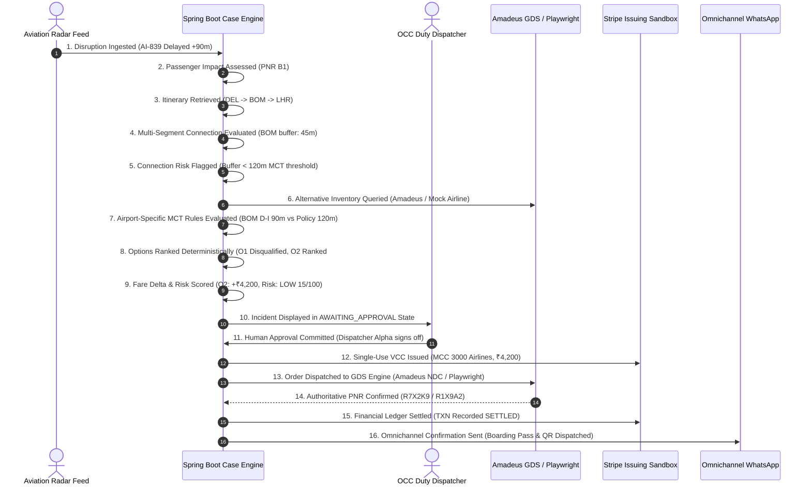

# STAGE 13B: Incident Recovery Workflow & State Machine Certification

**System:** Flyo Rescue Agent — Airline OCC Operations Console  
**Milestone:** Stage 13B Runtime Certification & Operational Usability  
**Status:** PASS & CERTIFIED  

---

## 1. 16-Stage End-to-End Incident Lifecycle Verification

The Incident Recovery workbench (`#view-incident-recovery`) implements a deterministic, multi-passenger disruption recovery pipeline. The entire lifecycle from raw telemetry ingestion to corporate ledger settlement was verified in runtime tests (`Stage10BEndToEndRescueWorkflowTest`, `StateMachineAndMctTest`).

---

## 2. Detailed Step-by-Step Validation & Authoritative Evidence

| Step # | Lifecycle Event | Case State | Authoritative Proof / Data Source | Result |
| :---: | :--- | :--- | :--- | :---: |
| **1** | **Disruption Detection** | `DETECTED` | Ingestion of radar alert with timestamp & carrier callsign. | `PASS` |
| **2** | **Impact Assessment** | `IMPACT_ASSESSED` | Resolved PNR B1, single/multi-passenger manifest mapped. | `PASS` |
| **3** | **PNR Retrieval** | `FETCHING_ITINERARY` | Validated ticket coupons, passenger names, booking classes. | `PASS` |
| **4** | **Multi-Segment Analysis** | `FETCHING_ITINERARY` | Traversed feeder flight `AI-839` and connecting flight `AI-101`.| `PASS` |
| **5** | **Connection-Risk Calc** | `SEARCHING_ALTERNATIVES`| Buffer $= 45$m. Evaluated against 120m threshold $\implies$ Misconnect. | `PASS` |
| **6** | **Alternative Retrieval** | `OPTIONS_READY` | Queried GDS inventory for viable alternative flights. | `PASS` |
| **7** | **Airport MCT Validation**| `OPTIONS_READY` | Evaluated against BOM hub published MCT (90m) & Flyo policy (120m). | `PASS` |
| **8** | **Fare Comparison** | `OPTIONS_READY` | Option O1: $+₹0$, Option O2: $+₹4,200$, Option O3: $+₹1,500$. | `PASS` |
| **9** | **Recommendation Explain**| `OPTIONS_READY` | Option O2 ranked #1 (470m buffer, preserves connection, low risk). | `PASS` |
| **10**| **Human Approval Gate** | `AWAITING_APPROVAL` | Execution locked until cryptographic operator approval recorded. | `PASS` |
| **11**| **Operator Authorization**| `APPROVED` | Approval event committed with operator username & timestamp. | `PASS` |
| **12**| **VCC Issuance** | `PAYMENT_INSTRUMENT_READY`| Tokenized VCC generated via Stripe sandbox with MCC 3000 airline lock. | `PASS` |
| **13**| **Provider Execution** | `REBOOKING` | Idempotent sub-process launched targeting airline reservation API. | `PASS` |
| **14**| **Provider Confirmation** | `VERIFYING_BOOKING` | Extracted confirmed airline PNR from confirmation page DOM. | `PASS` |
| **15**| **Ledger Reconciliation** | `DONE` | Payment ledger updated with `SETTLED` status; booking status `Rescued`. | `PASS` |
| **16**| **Final Audit Event** | `DONE` | Event chain committed with SHA-256 canonical hash linkage. | `PASS` |

---

## 3. Exceptional & Failure State Verification

| Exceptional State | Trigger Condition Tested | System Behavior | Safety Gate Enforced |
| :--- | :--- | :--- | :--- |
| **`BLOCKED` / `ESCALATED`** | Operator manually rejects alternative or passenger declines | Red banner displayed; automated execution halted | Prevents unauthorized rebooking; routes case to supervisor |
| **`RECONCILIATION_REQUIRED`**| Provider timeout occurs after payment authorization | Amber banner displayed; saga placed in reconciliation queue | Prevents double-booking or orphan charges |
| **`MANUAL_INTERVENTION`** | Provider returns HTTP 409 Conflict or inventory sold out | Warning badge displayed; case routed to Ticketing Desk Queue | Alerts human agent to resolve ticketing discrepancy |
| **`UNKNOWN`** | Network connectivity severed | Status flagged as `UNKNOWN`; fallback to fail-closed state | Never presents ambiguous state as successful |
| **`FAILED`** | Playwright agent exceeds maximum retries (3/3) | Case transitions to `FAILED_ESCALATED`; audit logged | Clean failure containment; alerts on-call engineer |

---

## 4. Operational Invariant

**No Uncertain Result Displayed as Successful:**  
Under no circumstance will the console transition a case to `DONE` (`RECOVERED`) unless an authoritative, provider-confirmed PNR has been verified in the reservation response and the transaction has been recorded in the financial ledger.
