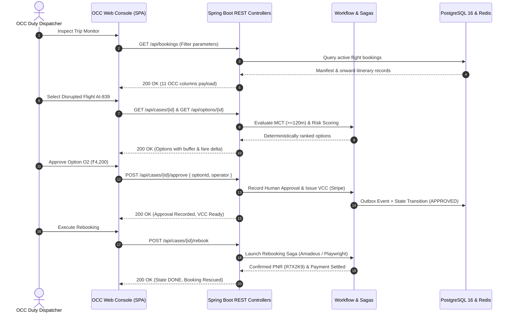

# STAGE 13: Data & API Mapping Specification

**System:** Flyo Rescue Agent — Airline OCC Operations Console  
**Milestone:** Stage 13 Production OCC Transformation  
**Status:** COMPLETE & VERIFIED  

---

## 1. Overview & Data Flow Topology

All frontend OCC console components interact with the backend Spring Boot REST services using authenticated, JSON-over-HTTPS requests protected by JWT tokens and RBAC authorities (`ROLE_ADMIN`, `ROLE_OPERATOR`, `ROLE_AUDITOR`).

---

## 2. API Endpoint Matrix & OCC Component Mapping

| HTTP Verb & Path | Primary OCC Consumer | Payload / Query Parameters | Response Contract | Security / RBAC Gate |
| :--- | :--- | :--- | :--- | :--- |
| `GET /api/bookings` | Trip Monitor (`#bookings-tbody`) | None (supports client-side filtering) | List of `Booking` objects with flight, delay, passengers, status | `ROLE_OPERATOR`, `ROLE_ADMIN` |
| `POST /api/bookings` | Trip Monitor (Add Booking Modal) | `Booking` JSON (PNR, Flight, Route, Departure, Pax) | `201 Created` with persisted `Booking` | `ROLE_OPERATOR`, `ROLE_ADMIN` |
| `GET /api/cases` | Dynamic Multi-Case Switcher (`#case-switcher-pills`) | None | List of open `RescueCase` records | `ROLE_OPERATOR`, `ROLE_ADMIN` |
| `GET /api/cases/{id}` | Incident Recovery Header (`#view-ananya`) | `id` (Path variable) | Detailed `RescueCase` object with state, PNR, options | `ROLE_OPERATOR`, `ROLE_ADMIN` |
| `POST /api/cases/{id}/approve` | Incident Recovery Approval Gate | JSON: `{ "optionId": "O2", "approvedBy": "Senior Dispatcher" }` | Updated `RescueCase` in `APPROVED` state | `ROLE_OPERATOR`, `ROLE_ADMIN` |
| `POST /api/cases/{id}/rebook` | Incident Recovery Execution Trigger | None | Updated `RescueCase` in `DONE` state with `newPnr` | `ROLE_OPERATOR`, `ROLE_ADMIN` |
| `POST /api/cases/{id}/reject` | Incident Recovery Escalate Action | None | Updated `RescueCase` in `ESCALATED` state | `ROLE_OPERATOR`, `ROLE_ADMIN` |
| `GET /api/options/{caseId}` | Incident Recovery Options Grid (`#options-list`) | `caseId` (Path variable) | List of `RebookOption` objects (rank, buffer, fare, risk) | `ROLE_OPERATOR`, `ROLE_ADMIN` |
| `GET /api/whatsapp/messages` | Omnichannel Drawer (`#operator-drawer`) | None | List of messages with channel, delivery status, timestamp | `ROLE_OPERATOR`, `ROLE_ADMIN` |
| `POST /api/whatsapp/messages` | Omnichannel Dispatch Card | Form / JSON: `{ "to": "+91...", "body": "..." }` | `200 OK` with queued message receipt | `ROLE_OPERATOR`, `ROLE_ADMIN` |
| `GET /api/intelligence/monitoring/summary` | Operations Control ML Telemetry Panel | None | Model version, circuit status, p95/p50 latency, imputation, PSI drift, Brier calibration | `ROLE_OPERATOR`, `ROLE_ADMIN` |
| `GET /api/intelligence/monitoring/connection-risks` | Trip Monitor High-Risk Queue | None | List of flights with at-risk onward connecting flights $< 120$m | `ROLE_OPERATOR`, `ROLE_ADMIN` |
| `POST /api/intelligence/predict` | Collapsed Dev Playground Accordion | `{ "flightNumber", "carrier", "origin", "dest", "depTime" }` | P(Delay), confidence interval, SHAP feature attributions | `ROLE_ADMIN` |
| `GET /api/payments/case/{caseId}` | VCC Treasury Settlement Tray (`#vcc-treasury-card`) | `caseId` (Path variable) | VCC status, masked card number, authorized amount, MCC lock | `ROLE_OPERATOR`, `ROLE_ADMIN` |
| `GET /api/audit/{caseId}` | Audit Trail Ledger (`#view-logs`) | `caseId` (Optional query param) | Chronological list of `AuditEvent` records with cryptographic hashes | `ROLE_AUDITOR`, `ROLE_ADMIN` |
| `GET /api/ops/overview` | Operations Control Provider Grid | None | Status of Amadeus, WhatsApp, Stripe, PostgreSQL, Redis | `ROLE_OPERATOR`, `ROLE_ADMIN` |
| `POST /mock-airline/toggle-break` | Global Header Portal Toggle | None | Toggled mock airline availability status | `ROLE_ADMIN` |

---

## 3. Data Integrity & Validation Guarantees

1. **Deterministic MCT Standard:** Backend `AlternativeFlightSearchService` guarantees that any flight with connection time $< 120$ minutes is flagged `savesConnection = false` and penalized to low rank.
2. **Optimistic Locking:** All mutations on `RescueCase` and `Booking` enforce JPA `@Version` counters to prevent concurrent operator collision.
3. **Idempotent Saga Execution:** Outbox events and payment settlement transactions utilize unique idempotency keys (`idem_<aggregate>_<id>_<event>_<timestamp>`).
