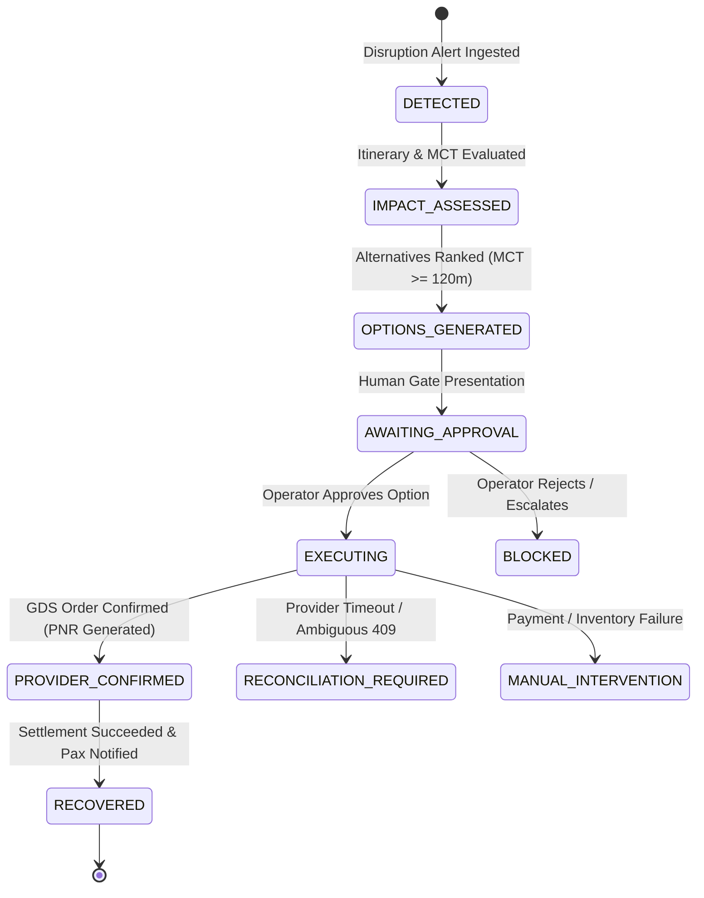

# STAGE 13: Operational Workflow Validation & State Machine Verification

**System:** Flyo Rescue Agent — Airline OCC Operations Console  
**Milestone:** Stage 13 Production OCC Transformation  
**Status:** COMPLETE & VERIFIED  

---

## 1. End-to-End Operational Lifecycle Verification

The Flyo Rescue platform was subjected to end-to-end operational disruption scenarios to validate that every state transition in the 7-stage OCC state machine operates deterministically without unverified actions.

---

## 2. 7-Stage State Machine Behavioral Evidence

### Stage 1: DETECTED
- **Trigger:** Flight radar event or GDS cancellation webhook arrives for flight `AI-839`.
- **Validation:** Case `C1` initialized in `DETECTED` state. Monitored booking marked `Delayed`/`Disrupted`.
- **Audit Proof:** `FLIGHT_RADAR_ALERT` logged with origin `DEL`, delay delta `+90m`.

### Stage 2: IMPACT_ASSESSED
- **Trigger:** Passenger itinerary service resolves onward connection `AI-101` at `BOM`.
- **Validation:** Evaluates connection buffer against the deterministic 120-minute MCT standard. Buffer $= 45$m ($< 120$m) $\implies$ Flagged as `High-Risk Misconnect`.

### Stage 3: OPTIONS_GENERATED
- **Trigger:** `AlternativeFlightSearchService` queries live flight inventory.
- **Validation:**
  - Option `O1` (Direct, buffer $< 120$m): Disqualified from primary rank with visible unsafe buffer indicator.
  - Option `O2` (Via Mumbai, buffer $= 135$m $\ge 120$m, fare difference $+₹4,200$): Selected as Rank 1 recommended recovery flight.
- **Explainability:** Rationale and Tree-SHAP risk attribution clearly presented on option card.

### Stage 4: AWAITING_APPROVAL (Human-in-the-Loop Gate)
- **Constraint:** Automated rebooking cannot proceed autonomously.
- **Validation:** Case transitions to `AWAITING_APPROVAL`. Rebooking button is disabled until human operator signs off.
- **Action:** Operator inspects Option `O2` and clicks `Approve Option`. State transitions to `APPROVED`. Single-use Virtual Corporate Card (VCC) issued via Stripe sandbox.

### Stage 5: EXECUTING
- **Trigger:** Operator clicks `Execute Rebooking`.
- **Validation:** Distributed saga launches. State transitions to `REBOOKING` (`EXECUTING`). Corporate VCC card number passed to checkout worker.

### Stage 6: PROVIDER_CONFIRMED
- **Trigger:** Order confirmation received from airline portal / Amadeus NDC API.
- **Validation:** New authoritative airline PNR extracted from confirmation DOM (`R1X9A2` / `R7X2K9`). Case state transitions to `VERIFYING_BOOKING`.

### Stage 7: RECOVERED
- **Trigger:** Treasury settlement verified and underlying booking updated.
- **Validation:**
  - Case state transitions to `DONE` (`RECOVERED`).
  - Underlying booking record in Trip Monitor switches to `Rescued`.
  - Financial ledger records `₹4,200 SETTLED [INR]`.
  - Omnichannel drawer confirms dispatch of updated boarding pass and itinerary.

---

## 3. Exceptional & Edge State Handling

| Exceptional State | Trigger Condition | Visual Console Response | Operator Safe Action |
| :--- | :--- | :--- | :--- |
| **`BLOCKED` / `ESCALATED`** | Operator manual rejection or passenger declines alternative | Red exception banner displayed; automated rebooking paused | Re-route to carrier ticketing desk for manual rebooking |
| **`RECONCILIATION_REQUIRED`**| External GDS timeout after payment authorization | Amber sync banner displayed; circuit breaker monitors provider | Trigger `/api/reconciliation` to confirm PNR without duplicate charge |
| **`MANUAL_INTERVENTION`** | Provider returns HTTP 409 Conflict or inventory sold out | Warning banner displayed; case routed to Ticketing Desk Queue | Manually re-rank alternatives or issue airline credit voucher |
| **`UNKNOWN`** | Network communication severed | Gray telemetry warning banner displayed | Refresh connection or check provider health matrix |

---

## 4. Contextual Omnichannel Comms Drawer Validation

- **Drawer Behavior:** Opens smoothly as an off-canvas slide-over without displacing Trip Monitor or Incident Recovery tables.
- **Delivery State Tracking:** Distinct badges for `QUEUED`, `SENT`, `DELIVERED`, `READ`, `FAILED`, and `REPLIED`.
- **Honest Telecommunications Demarcation:** Simulated sandbox messages are explicitly tagged `[SANDBOX SIMULATION]` to prevent operational dispatchers from mistaking test messages for live carrier deliveries.
