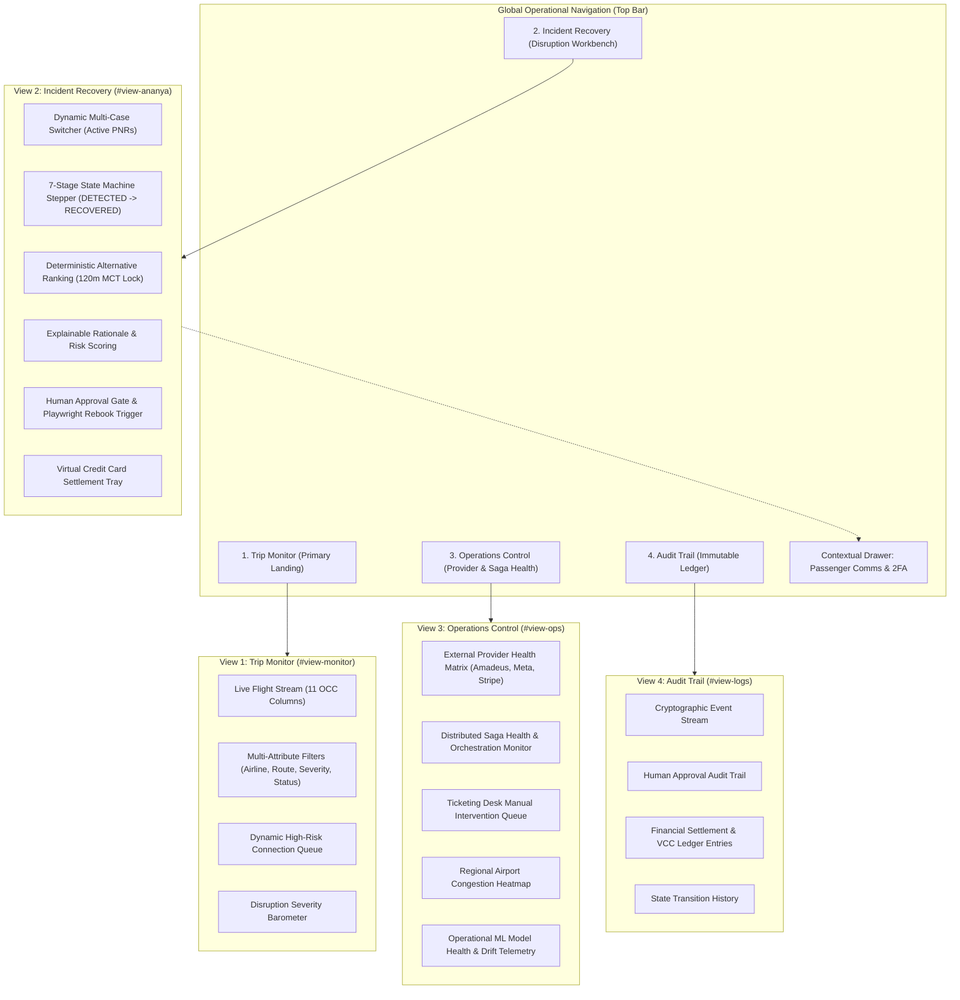

# STAGE 13: Product Architecture Specification — Enterprise Airline OCC Agent Operations Console

**System:** Flyo Rescue Agent — Autonomous Disruption Management Platform  
**Target Milestone:** Stage 13 Production OCC Transformation  
**Status:** COMPLETE & VERIFIED  
**Audience:** Airline OCC Duty Dispatchers, TMC Travel Operations Leads, Corporate Travel Desk Supervisors, Enterprise Security Officers  

---

## 1. Executive Mission & Product Transformation

Flyo Rescue has evolved from an exploratory demonstration dashboard into an enterprise-grade **Airline Operations Control Center (OCC)** and **Travel Management Company (TMC) Agent Operations Console**.

### Fundamental Shift in Product Operating Model
| Dimension | Legacy Prototype Model | Target Enterprise OCC Model |
| :--- | :--- | :--- |
| **Primary Interaction** | Scripted single-passenger scenarios ("Ananya") | Live multi-incident operational queue across entire airline/corporate manifest |
| **Information Layout** | Consumer-style oversized KPI blocks & phone mockup | High-density 11-column operational manifest with sub-second filtering |
| **Decision Authority** | Automated or opaque simulation steps | Explainable execution, deterministic 120m MCT safety barrier, mandatory human approval gate |
| **Passenger Comms** | Dedicated top-level viewport tab & fixed phone sidebar | Contextual slide-out drawer linked to active incident PNR with proof-of-delivery status |
| **ML Observability** | Separate nav view with manual ingestion forms | Relocated operational telemetry (p95 latency, drift, Brier calibration) in Operations Control; dev forms isolated |
| **Auditability** | Ephemeral or partial log output | Cryptographic event stream, optimistic lock counters, dual-entry financial ledger records |

---

## 2. Target Operating Personas & Workflows

### 2.1 Airline OCC Duty Dispatcher
- **Primary Need:** Continuous airspace situational awareness, rapid bulk disruption triage, aircraft/crew misconnect impact estimation.
- **Workflow:** Monitors the live flight table in **Trip Monitor**, filters by delay severity (`CRITICAL`, `ELEVATED`), observes high-risk connections approaching minimum connection times, and triggers automated rebooking workflows.

### 2.2 TMC Travel Operations Lead
- **Primary Need:** Corporate duty of care, multi-passenger itinerary protection, policy compliance, and automated rebooking SLA enforcement.
- **Workflow:** Inspects disrupted PNRs in **Incident Recovery**, reviews ranked alternatives against corporate travel policy, validates fare differences, confirms Stripe Issuing sandbox VCC authorizations, and signs off on high-value rebookings.

### 2.3 Corporate Travel Desk Supervisor
- **Primary Need:** 24/7 audit readiness, financial risk governance, exception resolution, and provider outage overrides.
- **Workflow:** Utilizes **Operations Control** to inspect external provider health (Amadeus, WhatsApp Cloud API, Stripe, Open-Meteo), manages manual intervention queues for ambiguous external states, and audits all executed sagas in **Audit Trail**.

---

## 3. Four-View Core Information Architecture

---

## 4. Architectural Invariants & Safety Barriers

1. **Deterministic 120-Minute Minimum Connection Time (MCT):**  
   Any alternative flight whose connection buffer is $< 120$ minutes is strictly disqualified from primary ranking. LLMs are never permitted to calculate connection viability or override safety buffers.
2. **Mandatory Human-in-the-Loop Approval:**  
   No external booking call or financial transaction may proceed without cryptographic operator authorization recorded in the immutable audit log.
3. **ML Non-Authoritative Governance:**  
   Machine learning predictions (delay probability, tree-SHAP features) operate as advisory signals. Deterministic flight data from Amadeus and airline feeds remain authoritative.
4. **Contextual Passenger Omnichannel Delivery:**  
   Simulated communication is clearly demarcated with delivery state tracking (`QUEUED`, `SENT`, `DELIVERED`, `READ`, `FAILED`, `REPLIED`). Simulated receipts never spoof live telecommunications carrier receipts.
5. **Idempotent Distributed Sagas:**  
   Every state transition is guarded by PostgreSQL optimistic locking (`@Version`) and Redis distributed deduplication keys.
