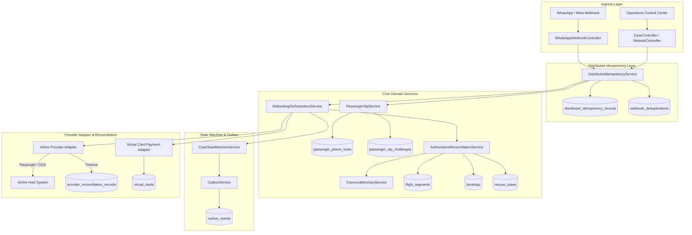

# Stage 14 — Architecture Assessment: Distributed Transaction Integrity & Real-World Booking Reconciliation

## Executive Summary
Stage 14 addresses the transition of the Flyo Autonomous Rescue Platform from a single-node in-memory prototype into a resilient, distributed transactional system. Prior to Stage 14, while individual service logic handled passenger interactions and rebooking, the system lacked distributed concurrency safety, persistent idempotency across application restarts, durable rate-limiting, and authoritative 5-way booking reconciliation.

Stage 14 introduces distributed database-backed idempotency, persistent phone-lockout protection against brute-force attacks, atomic single-use OTP consumption, timeout reconciliation with provider host verification, and canonical itinerary isolation to prevent cross-booking contamination.

---

## Architectural Pillars

### 1. Distributed Idempotency Architecture
- **Problem**: In-memory synchronized sets (`Set<String>`) or localized locks fail in multi-worker environments, during container restarts, or under duplicate webhook deliveries.
- **Solution**: Durable relational coordination via `distributed_idempotency_records` and `webhook_deduplications`.
  - Primary key / unique constraint enforcement at the storage engine level.
  - Distinct state lifecycle: `IN_PROGRESS` $\rightarrow$ `COMPLETED` / `EXPIRED`.
  - Atomic compare-and-swap (CAS) lock acquisition via `DistributedIdempotencyService.tryAcquire()` utilizing database transactions (`Propagation.REQUIRES_NEW`).
  - Automatic TTL expiration detection for abandoned leases.

### 2. Multi-Way Authoritative Reconciliation Engine
- **Problem**: Siloed decisions where airline rebooking, PNR issuance, and virtual card payments proceed without verifying that the option matches the canonical booking origin, destination, and passenger identity.
- **Solution**: `AuthoritativeReconciliationService` performs an atomic 5-way cross-validation:
  1. **Canonical Booking Record**: Verifies original booking exists, active status, passenger name, and route boundaries.
  2. **Canonical Flight Segments**: Ensures disrupted segment belongs to the itinerary and preserves downstream connections.
  3. **Disruption Evidence**: Verifies that radar and meteorological signals corroborate the cancellation.
  4. **Recovery Option**: Enforces origin matching ($O_{orig} == B_{orig}$) and destination compatibility ($O_{dest} == B_{final\_dest}$ or valid hub).
  5. **Provider Response / PNR Record**: Validates airline host confirmation against PNR format and flight numbers.
  - If any discrepancy is identified, the case transitions to `DATA_RECONCILIATION_REQUIRED` and immediately halts consequential financial or ticketing actions.

### 3. Provider Host Inquiry & Timeout Handling
- **Problem**: When a network timeout occurs during airline booking submission, naive retries cause duplicate bookings, while immediate failure may orphan an already-created airline ticket and card charge.
- **Solution**: Three-outcome state machine:
  - **Outcome A (Confirmed Success)**: PNR extracted $\rightarrow$ `PROVIDER_CONFIRMED` $\rightarrow$ payment capture $\rightarrow$ e-ticket verification $\rightarrow$ `DONE`.
  - **Outcome B (Confirmed Failure)**: Carrier rejects $\rightarrow$ void VCC authorization $\rightarrow$ `EXECUTION_FAILED` $\rightarrow$ `BOOKING_FAILED`.
  - **Outcome C (Unknown Outcome / Timeout)**: Socket timeout $\rightarrow$ `PROVIDER_OUTCOME_UNKNOWN` $\rightarrow$ `RECONCILING` $\rightarrow$ Host inquiry probe with `providerRequestId`. If confirmed uncreated: void VCC $\rightarrow$ `RESOLVED_NOT_CREATED`. If undetermined: escalate to `DATA_RECONCILIATION_REQUIRED`.

### 4. Cryptographic Passenger Authentication & Lockout Protection
- **Problem**: Predictable OTP generation, plain-text token storage in relational tables, and in-memory attempt counters that reset on container restart.
- **Solution**:
  - `SecureRandom` cryptographic 6-digit generation.
  - Zero plain-text OTP persistence: SHA-256 hash storage in `passenger_otp_challenges.otp_hash`.
  - Atomic single-use consumption: CAS update `UPDATE passenger_otp_challenges SET used = TRUE WHERE id = ? AND used = FALSE`.
  - Persistent lockout: Database-backed `passenger_phone_locks` table. Exceeding 3 failed attempts locks out the phone across all nodes and application restarts for 15 minutes.

---

## Architectural Topology Diagram

