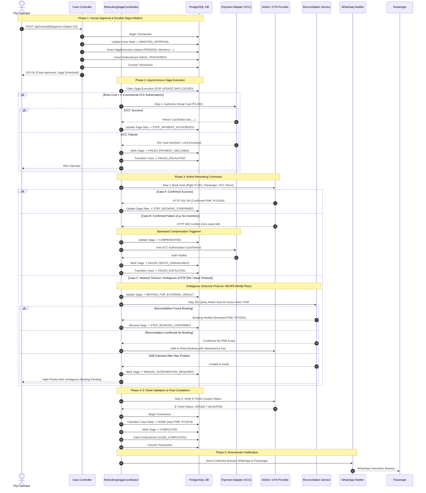

# FLYO — STAGE 1 ARCHITECTURE AND SEQUENCE FLOWS: TRANSACTIONAL OUTBOX & DISTRIBUTED SAGA

**Document Version:** 1.0.0  
**Status:** Approved Engineering Specification  
**Date:** November 6, 2026  
**Engineering Discipline:** Principal Distributed Systems Architect  

---

## 1. High-Level System Architecture

Stage 1 transforms Flyo from a synchronous single-threaded prototype into a reliable, failure-resilient distributed orchestration backend. It addresses the dual-write problem and uncontained external network failures through two complementary patterns:
1. **Transactional Outbox with Lease-Based Atomic Dispatching:** Ensures 100% durable event generation coupled with database business transactions and at-least-once asynchronous delivery to external listeners without dual-write inconsistencies.
2. **Persistent Distributed Saga Orchestrator:** Manages consequential multi-step operations (payment authorization, airline booking dispatch, status reconciliation, e-ticket validation, and customer notification) across unpredictable external systems.

```mermaid
flowchart TD
    subgraph Client/User Layer
        OP["Human Operator / Passenger"]
        WH["Meta WhatsApp Webhook"]
    end

    subgraph Flyo Core Backend (Spring Boot 3.3.4)
        SEC["Spring Security (JWT / RBAC)"]
        API["REST & Webhook Controllers"]
        
        subgraph Transactional Boundary 1 [Commit Business State & Outbox]
            CS["Case Service / State Machine (44 States)"]
            DB_CASE[("PostgreSQL: rescue_cases")]
            DB_OUTBOX[("PostgreSQL: outbox_events")]
        end
        
        subgraph Outbox Dispatcher Subsystem
            SCHED["OutboxDispatcherWorker (@Scheduled)"]
            LEASES["Lease Manager (FOR UPDATE SKIP LOCKED)"]
            ROUTER["Idempotent Event Consumer Router"]
        end

        subgraph Distributed Saga Subsystem
            SAGA_COORD["RebookingSagaCoordinator"]
            DB_SAGA[("PostgreSQL: saga_executions")]
            RECON["Ambiguity & Reconciliation Engine"]
            COMP["Compensation Manager"]
        end
    end

    subgraph External System Boundaries
        PROV_AIR["Airline / GDS Provider Boundary"]
        PROV_PAY["Payment / VCC Provider Boundary"]
        PROV_MSG["WhatsApp / Notification Boundary"]
    end

    OP -->|Approve Option| SEC --> API --> CS
    WH -->|Inbound Action| API --> CS
    CS --> DB_CASE
    CS --> DB_OUTBOX
    
    DB_OUTBOX -.->|Claim Lease| LEASES --> SCHED
    SCHED --> ROUTER
    ROUTER -->|Trigger Saga| SAGA_COORD
    
    SAGA_COORD <--> DB_SAGA
    SAGA_COORD -->|Step 1: VCC Auth| PROV_PAY
    SAGA_COORD -->|Step 2: Book Seat| PROV_AIR
    PROV_AIR -.->|Timeout / Ambiguous| RECON
    RECON <--> PROV_AIR
    SAGA_COORD -.->|On Irrecoverable Failure| COMP
    COMP -->|Void Authorization| PROV_PAY
    SAGA_COORD -->|Step 3: Notify Outcome| PROV_MSG
```

---

## 2. Transactional Outbox Design & Lifecycle

### 2.1 Event Envelope Structure
Every event staged in `outbox_events` implements a versioned envelope conforming to enterprise event standards:

```json
{
  "eventId": "evt_019a3b7c-8d4e-7112-9c12-3847291a0f9b",
  "eventType": "RESCUE_CASE_APPROVED",
  "eventVersion": 1,
  "aggregateType": "RESCUE_CASE",
  "aggregateId": "C1",
  "tenantId": "default",
  "correlationId": "corr_c89b21f0-4d32-411a-bf31-921820491823",
  "causationId": "cmd_approve_option_O2",
  "idempotencyKey": "idem_outbox_C1_APPROVED_v1",
  "payload": "{\"caseId\":\"C1\",\"optionId\":\"O2\",\"flight\":\"FL301\",\"extraCost\":4200,\"passengerName\":\"Ananya Sharma\"}",
  "status": "PENDING",
  "attemptCount": 0,
  "maxRetries": 5,
  "availableAt": "2026-11-06T11:15:00Z",
  "createdAt": "2026-11-06T11:15:00Z",
  "publishedAt": null,
  "lockedBy": null,
  "lockedAt": null,
  "lastErrorCode": null,
  "errorMessage": null
}
```

### 2.2 Event States & State Machine
```
[PENDING] ----(Worker Claims via SKIP LOCKED)----> [CLAIMED]
    |                                                 |
    |                                                 +----(Success)-----> [COMPLETED]
    |                                                 |
    |                                                 +----(Transient Failure & Retries < Max)
    |                                                 |       |
    |<--------(Backoff Delay: available_at updated)---+       |
    |                                                         v
    +------------------(Retries >= Max)-----------------> [DEAD_LETTER]
```

### 2.3 Dispatching Algorithm:
1. **Atomic Batch Claiming:**
   ```sql
   SELECT id, event_type, payload, correlation_id 
   FROM outbox_events
   WHERE status = 'PENDING' 
     AND available_at <= CURRENT_TIMESTAMP
   ORDER BY created_at ASC
   LIMIT :batchSize
   FOR UPDATE SKIP LOCKED;
   ```
2. **Lease Allocation:** The worker assigns `locked_by = :workerId` and `locked_at = CURRENT_TIMESTAMP`, setting `status = 'CLAIMED'`.
3. **Lease Expiration Recovery:** A periodic task inspects events where `status = 'CLAIMED'` and `locked_at < CURRENT_TIMESTAMP - INTERVAL '2 minutes'`. Expired leases are reset to `PENDING` with an incremented attempt count.
4. **Exponential Backoff with Jitter:**
   $$\text{delay} = \min\left(300, 2^{\text{attemptCount}} \times 2\right) \pm \text{jitter}(0, 2) \text{ seconds}$$
5. **Dead-Letter Handling:** After 5 failed dispatch attempts, event transitions to `DEAD_LETTER` with `last_error_code` recorded, triggering operational alerts.

---

## 3. Distributed Saga Orchestration: Rebooking Workflow

The rebooking saga coordinates the multi-step recovery process across agency credit facilities, external booking systems, ticket issuers, and passenger notifications.

### 3.1 Saga States

| State | Semantic Meaning |
| :--- | :--- |
| `PENDING` | Saga created and recorded in database; awaiting execution dispatch. |
| `RUNNING` | Active step currently executing. |
| `WAITING_FOR_EXTERNAL_RESULT` | Asynchronous command dispatched; waiting for external callback or reconciliation query. |
| `RETRY_PENDING` | Transient failure encountered; backoff timer active before next step execution. |
| `COMPENSATING` | Permanent failure detected in downstream step; executing backward compensation (e.g. voiding VCC auth). |
| `COMPLETED` | All saga steps completed successfully; final outcome verified with carrier. |
| `FAILED` | Saga failed cleanly with all necessary compensations executed. |
| `MANUAL_INTERVENTION_REQUIRED` | Ambiguity cannot be automatically resolved or compensation failed. Operator action required. |

### 3.2 Detailed Step-by-Step Sequence Flow



---

## 4. Ambiguity Resolution and Compensation Rules

1. **Rule 1 (Timeout Isolation):** Under no circumstance may a booking command be retried immediately following a socket read timeout or HTTP 504 Gateway Timeout. The external provider may have successfully authorized the seat allocation prior to the connection drop.
2. **Rule 2 (Reconciliation Pre-Check):** Before retrying any rebooking operation, the reconciliation worker must query the carrier using the deterministic booking reference or passenger itinerary search.
3. **Rule 3 (Bounded Compensation):** Compensations are executed in reverse order of execution (SAGA backward compensation). If a VCC was charged, it is voided/refunded. If an unconfirmed hold was created, it is released.
4. **Rule 4 (Fail-Closed on Unresolvable Ambiguity):** If reconciliation cannot determine whether a booking or payment occurred, the saga enters `MANUAL_INTERVENTION_REQUIRED`. It will **never** automatically mark the case `DONE` or `FAILED` without human confirmation.
