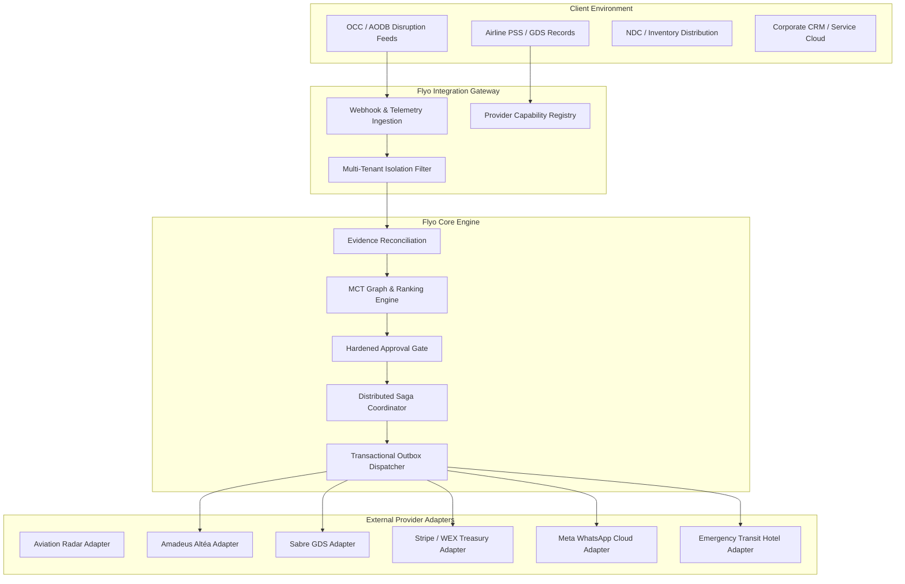

# Stage 2: Provider-Neutral Integration Architecture Specification

**Author:** Principal Distributed Systems Architect & Forward Deployment Engineer  
**Date:** November 6, 2026  
**System:** Flyo Autonomous Disruption Recovery Engine  

---

## 1. Architectural Philosophy: The Intelligence & Orchestration Boundary

Flyo is an integration-first aviation rescue orchestration platform. It is **not** a replacement Passenger Service System (PSS), Airline Inventory Database (AODB), Global Distribution System (GDS), or Central Reservations System (CRS).

Flyo deploys into client enterprise environments (Airlines, TMCs, OTAs) as an intelligence and execution boundary:
1. **Reads authoritative state** from client systems of record.
2. **Reconciles operational evidence** across multi-sensor feeds.
3. **Optimizes deterministic rescue options** with Minimum Connecting Time (MCT) graph intelligence.
4. **Enforces human-in-the-loop governance** via explicit, authenticated, auditable approval gates.
5. **Orchestrates execution** via resilient sagas and provider-neutral adapters.
6. **Reconciles external state continuously** to detect drift, phantom bookings, and orphaned authorizations.

---

## 2. Core Provider Interfaces & Contracts

Flyo segregates provider integrations into 10 decoupled, provider-neutral interfaces located in `com.flyo.rescue.integration`:

| Interface | Method Signature | Purpose |
| :--- | :--- | :--- |
| `FlightStatusProvider` | `checkFlightStatus(flightNumber, date)` | Retrieves live operational status, delay duration, and diversion airport. |
| `BookingRetrievalProvider` | `retrieveBooking(bookingReference)` | Retrieves authoritative passenger itinerary, segments, and ticket numbers. |
| `PnrLookupProvider` | `lookupPnr(pnr, passengerSurname)` | Queries airline PSS host for live coupon status and passenger contact info. |
| `TicketVerificationProvider` | `verifyTicket(pnr, ticketNumber)` | Validates e-ticket coupon status (OPEN, CHECKED_IN, FLOWN, VOID, EXCHANGED). |
| `FlightRebookingProvider` | `executeRebooking(request)` | Executes order creation or reissue against airline NDC / GDS host. |
| `PaymentAuthorizationProvider`| `authorizePayment(request)` | Issues tokenized, MCC-locked virtual cards for rebooking settlement. |
| `PaymentSettlementProvider` | `settlePayment(request)` | Confirms settlement and logs merchant charge details in the treasury ledger. |
| `HotelAccommodationProvider` | `reserveEmergencyAccommodation(req)`| Issues emergency transit hotel check-in vouchers for stranded passengers. |
| `MessagingProvider` | `sendMessage(request)` | Sends multi-channel passenger care alerts (WhatsApp HSM, SMS). |
| `CrmSynchronizationProvider` | `syncCase(request)` | Replicates disruption history and audit log into corporate CRM (Salesforce). |

---

## 3. Resilience, Timeouts & Circuit Breakers

All external provider calls must adhere to strict boundary safety rules:
1. **Network Timeouts**: Connect timeout: 5s, Read timeout: 15s.
2. **Exponential Backoff**: Up to 3 retries with jitter for idempotent read endpoints; **strictly 0 retries** for non-idempotent order creation or credit card charges.
3. **Circuit Breaking**: If an external provider experiences > 50% error rate over a 1-minute window, the adapter automatically trips to `DISABLED` in the `ProviderCapabilityRegistry`, and cases route to `MANUAL_INTERVENTION_REQUIRED`.
4. **Idempotency Propagation**: Every write request forwards a unique `idempotencyKey` in standard headers (`Idempotency-Key` or `X-Request-Id`) to ensure duplicate network packets never trigger double-bookings or duplicate charges.
