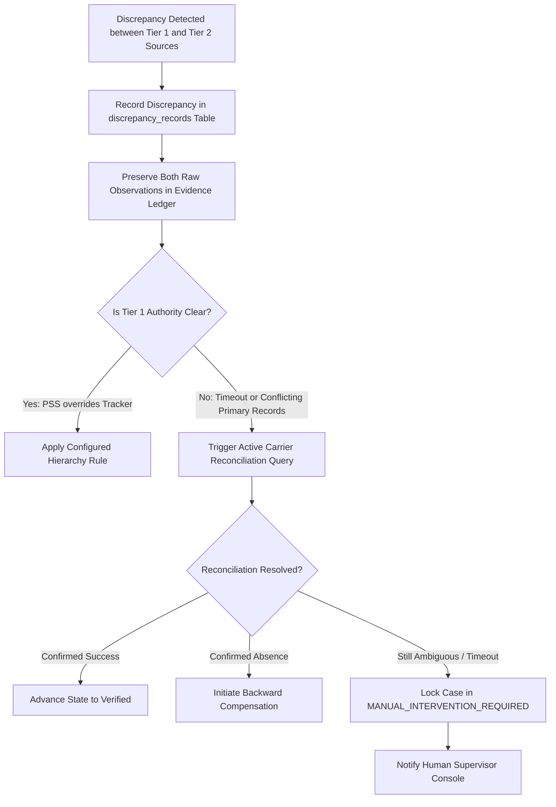

# FLYO — STAGE 3 EXTERNAL DATA AUTHORITY & RECONCILIATION MATRIX
## Authoritative Sources of Truth, Discrepancy Resolution & Anti-Hallucination Governance

**Date:** November 2026  
**Integration Lead:** Principal Enterprise Architect & Aviation Data Governance Lead  
**Scope:** Flyo Integration Gateway & Decision Engine  
**Status:** AUTHORITATIVE SPECIFICATION

---

## 1. Authoritative Source of Truth per Data Domain

A critical architectural failure mode in aviation software occurs when secondary data sources (such as flight radar aggregators or ML models) overwrite authoritative system-of-record states (such as airline PSS or e-ticket servers). 

Flyo enforces strict hierarchy rules: **the system of record is the sole authority for its domain**.

| Data Category | Authoritative Source of Truth (Tier 1) | Secondary / Advisory Sources (Tier 2/3) | Prohibited Overwrite Rules |
|---------------|----------------------------------------|------------------------------------------|----------------------------|
| **Flight Operational Status** (Cancelled, Delayed, Diverted) | **Airline OCC / AODB / Direct AIDX Feeds** | FlightRadar24, Aviationstack, FAA OIS, Weather | ML delay predictions can **NEVER** declare a flight cancelled. Only observed telemetry or airline OCC alerts can alter state. |
| **Passenger PNR & Booking State** | **Airline PSS / GDS** (Amadeus Altéa, Sabre, Navitaire) | TMC Back-Office, Email Scrapes, CRM | Flight status APIs can **NEVER** alter PNR segments or passenger coupon states. |
| **Electronic Ticket (e-Ticket) Status** | **Carrier Electronic Ticketing Server** (IATA Resolution 722 / Coupon Status) | PNR remarks, GDS itinerary lines | A confirmed PNR is **NOT** a ticketed booking. State machine cannot transition to `DONE` without coupon verification (`OPEN` / `OK`). |
| **Payment & Treasury Authorization** | **Issuing Bank / Payment Gateway** (Stripe Issuing, Corporate Bank) | Merchant checkout message, DOM text | Local demo logs can **NEVER** fabricate card settlement. VCC status must be verified against issuing ledger. |
| **Hotel Accommodation State** | **Hotel Central Reservation System (CRS)** (Partner Hotel Direct API) | Emergency Voucher Generator | Digital vouchers must be confirmed by hotel front-desk or reservation broker before marking guaranteed. |
| **Passenger Communications** | **Meta WhatsApp Cloud Delivery Webhook** | Outbound HTTP POST 200 response | HTTP 200 from Meta only proves *receipt*. Handset delivery requires `delivered` webhook; passenger view requires `read` webhook. |

---

## 2. Multi-Source Observation Model

Every external observation ingested by Flyo preserves a tamper-evident audit envelope:
1. `provider`: Source identifier (e.g. `amadeus`, `aviationstack`, `stripe`).
2. `providerRecordId`: Upstream external transaction or reference ID.
3. `observationTimestamp`: Upstream event generation time.
4. `retrievalTimestamp`: Exact time Flyo ingested the observation.
5. `dataFreshnessSeconds`: Elapsed time between upstream generation and local ingestion.
6. `confidenceStatus`: High / Medium / Low / Degraded.
7. `originalProviderStatus`: Raw upstream string before normalization.
8. `normalizedFlyoStatus`: Standardized canonical state machine enumeration.

---

## 3. Discrepancy Recording & Fail-Closed Reconciliation

When external systems disagree (e.g. Flight Tracker indicates flight is flying, but Carrier PSS issues a cancellation re-accommodation order):

### The Strict Non-Negotiable Rule:
**Never silently force a booking, ticket, or payment state to `SUCCESS`**.
If network disconnects or timeouts prevent authoritative verification:
- The saga enters `WAITING_FOR_EXTERNAL_RESULT`.
- If active carrier query fails to find the reservation, the case halts and escalates to `MANUAL_INTERVENTION_REQUIRED`.
- Automated rebooking is aborted to prevent duplicate financial settlement or duplicate passenger ticketing.
