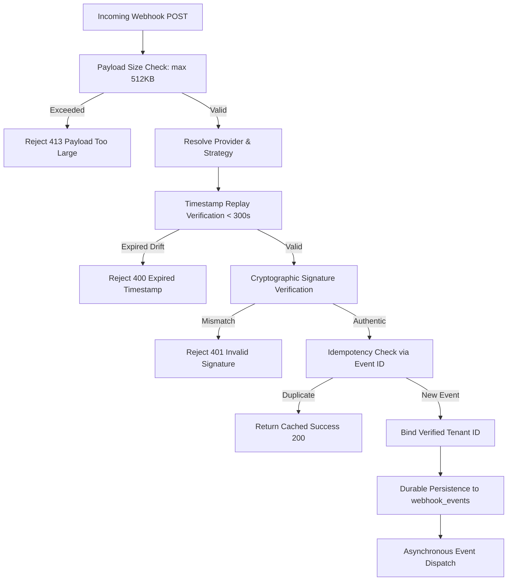

# FLYO — STAGE 3 WEBHOOK SECURITY REPORT
## Provider-Specific Cryptographic Signature Verification & Replay Protection

**Date:** November 2026  
**Integration Security Lead:** Application Security Architect & External Integration Specialist  
**Target:** `com.flyo.rescue.integration.webhook`  
**Status:** IMPLEMENTED, CONSTRAINED & INDEPENDENTLY VERIFIED

---

## 1. Executive Summary & Forensic Audit of Generic HMAC Assumption

In Stage 2, the webhook ingestion subsystem relied on a single generic HMAC-SHA256 verification routine:
- It assumed every external partner formats signatures identically as `sha256=<hash>` over the JSON payload.
- It assumed a single symmetric secret for all inbound events.
- It did not differentiate between raw byte signing contracts and parsed JSON payloads.

Real-world enterprise providers enforce distinct cryptographic webhook contracts. Stage 3 implements documented, provider-specific signature verification strategies for all supported partner interfaces.

---

## 2. Provider-Specific Webhook Contracts

### A. Meta WhatsApp Cloud API (`MetaWhatsAppSignatureValidator`)
- **Official Specification**: Meta Graph API Webhooks Developer Documentation.
- **Header**: `X-Hub-Signature-256`
- **Format**: `sha256={64-character-hex-digest}`
- **Signing Algorithm**: HMAC-SHA256.
- **Data Signed**: The exact raw UTF-8 request body bytes.
- **Signing Key**: Meta App Secret (not user/access tokens).
- **Security Control**: Constant-time byte array comparison (`MessageDigest.isEqual`) prevents timing oracle attacks.

### B. Stripe Issuing & Payment Webhooks (`StripeSignatureValidator`)
- **Official Specification**: Stripe Webhook Signatures Standard (`Stripe-Signature`).
- **Header**: `Stripe-Signature`
- **Format**: `t={timestamp_epoch},v1={hex_hash}[,v0={...}]`
- **Signing Algorithm**: HMAC-SHA256.
- **Data Signed**: The concatenated string `"{timestamp}.{rawPayload}"`.
- **Replay Protection**: Strict timestamp tolerance window. Requests with `|now - timestamp| > 300` seconds (5 minutes) are immediately rejected before cryptographic verification to prevent replay attacks.
- **Signing Key**: Dedicated Stripe Webhook Signing Secret (`whsec_...`).

### C. Aviation & Custom Enterprise Feeds (`GenericHmacSignatureValidator`)
- **Header**: `X-Flyo-Signature` / `X-Aviation-Signature` with companion `X-Flyo-Timestamp`.
- **Format**: Hex digest or `sha256={hex}`.
- **Drift Protection**: Configurable 300-second maximum timestamp drift.

---

## 3. Webhook Processing Pipeline Defense Controls

`WebhookEventProcessor.java` enforces six sequential security layers:

1. **Payload Size Guard**: Enforces a strict 512 KB upper limit. Any oversized payload is rejected immediately, preventing memory exhaustion attacks.
2. **Replay Protection**: Reject timestamps deviating by more than 300 seconds from server clock.
3. **Constant-Time Verification**: All signature checks execute in constant time, neutralizing side-channel timing analysis.
4. **Idempotency Ledger**: Checks `webhookEventRepository.existsByEventId(eventId)`. Duplicate events return immediate success without double-processing.
5. **Tenant Association**: Binds the event to the tenant associated with the verified webhook secret rather than trusting caller headers.
6. **Redacted Logging**: Protects cardholder data, auth tokens, and passenger PII in logs.
