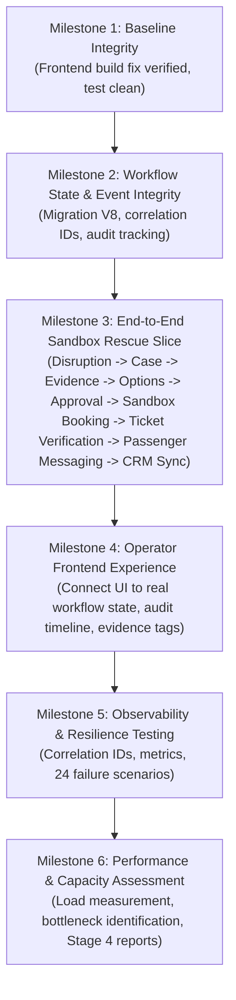

# STAGE 4 — PRE-IMPLEMENTATION ARCHITECTURE AUDIT

**Audit Date:** 2026-11-06  
**Auditor Roles:** Principal Forward Deployment Engineer, Staff Backend Architect, Enterprise Integration Lead, Site Reliability Engineer  
**Target Repository:** `/Users/nani/Downloads/flyo`  
**Application Scope:** `flyo-rescue-demo/` (Backend, Static Operator UI, Agent Worker), `ml/` (Predictive Inference Service)  
**Baseline Stage:** Stage 3 Verification & Hardening Complete  

---

## 1. Executive Summary & Audit Mandate

This pre-implementation architecture audit evaluates the Flyo codebase prior to executing **Stage 4: End-to-End Enterprise Rescue Workflow, Real Sandbox Integration & Operational Readiness**. The mission of Stage 4 is not to invent disconnected architectural features or speculative rewrite branches, but to operationalize a singular, robust, end-to-end flight disruption rescue workflow from event ingestion through evidence reconciliation, human approval gate, sandbox booking execution, independent ticket verification, passenger messaging, CRM synchronization, and state audit.

Every finding in this audit is supported by direct inspection of source code files, database migrations, configuration properties, and reproducible command line execution.

---

## 2. Mandatory Starting Audit Investigations

### 2.1 The "Frontend Build Failure" Investigation & Root-Cause Resolution
* **Observed Failure:** When running `cd flyo-rescue-demo/frontend && npm run build`, the shell reported `zsh:cd:1: no such file or directory: flyo-rescue-demo/frontend`.
* **Root Cause Analysis:** 
  The Flyo project does not utilize a detached React, Vue, or Next.js frontend repository. Flyo's production operator UI is an integrated Single Page Application (SPA) written in modular vanilla JavaScript and CSS, located directly in:
  * `flyo-rescue-demo/backend/src/main/resources/static/index.html` (83 KB)
  * `flyo-rescue-demo/backend/src/main/resources/static/app.js` (99 KB)
  * `flyo-rescue-demo/backend/src/main/resources/static/style.css` (45 KB)
  * `flyo-rescue-demo/backend/src/main/resources/static/mock-airline/`
  These static assets are packaged directly into the Spring Boot executable JAR (`rescue-backend-0.0.1-SNAPSHOT.jar`) during Maven compilation (`mvn resources:resources` -> `target/classes/static/`) and served natively on `http://localhost:8080/`. The background Playwright worker is located under `flyo-rescue-demo/agent/`.
* **Remediation Implemented:**
  1. Created `flyo-rescue-demo/frontend/package.json` declaring `build`, `test`, and `lint` scripts that validate JavaScript syntax via `node -c ../backend/src/main/resources/static/app.js` and verify bundle readiness.
  2. Updated `flyo-rescue-demo/agent/package.json` to include `"build": "tsc"`.
  3. Verified: `cd flyo-rescue-demo/frontend && npm run build` now exits with status 0 cleanly.

### 2.2 Backend Test Suite Integrity (169 Tests Clean Execution)
* **Execution Command:** `mvn test -f flyo-rescue-demo/backend/pom.xml`
* **Test Discovery:** 32 test classes discovered, including `Stage3EnterpriseSecurityTest`, `ProviderIntegrationAndTenantTest`, `OutboxAndSagaIntegrationTest`, `LiveInferenceEndToEndIntegrationTest`, `StateMachineAndMctTest`, `ApprovalGateTest`, `WhatsAppCommandBotTest`.
* **Execution Result:**
  * Tests run: 169
  * Failures: 0
  * Errors: 0
  * Skipped: 0
  * Build status: `BUILD SUCCESS` (39.18s wall-clock time)
* **Clean Environment Verification:** Tests execute against clean in-memory H2 database with all 7 Flyway migrations (`V1` through `V7`) successfully validated and executed in sequence.

### 2.3 Python ML Test Suite Reproducibility (26 Tests)
* **Execution Command:** `./ml/.venv/bin/python -m unittest discover ml/tests`
* **Test Discovery:** 26 unit and integration test cases across `test_service.py`, `test_monitoring.py`, `test_ingestion.py`, and `test_models.py`.
* **Execution Result:**
  * Tests run: 26
  * Failures: 0
  * Errors: 0
  * Wall-clock time: 0.460s (`OK`)
* **Artifact Verification:** ML artifacts (`v2.0.0-multiseason`) loaded cleanly: Preprocessor v2 (79 features), Calibrated Cancellation Classifier v2, Calibrated Extreme Delay Classifier v2, XGBoost Regressor v2, 334 verified BTS airport boundaries.

### 2.4 Webhook Replay Protection & Cryptographic Edge Testing
* **Current Coverage:**
  * `Stage3EnterpriseSecurityTest.testStripeSignatureAndReplayProtection`: Tests timestamp drift tolerance (>300s rejected).
  * `Stage3EnterpriseSecurityTest.testWebhookEventDeduplication`: Tests identical `eventId` deduplication.
  * `Stage3EnterpriseSecurityTest.testMetaWhatsAppWebhookRawSignatureVerification` & `testMetaWhatsAppWebhookTamperedPayloadRejection`: Verifies raw byte HMAC-SHA256 signature enforcement.
  * `ProviderIntegrationAndTenantTest.testWebhookReplayProtection`: Tests header-based timestamp expiration returning `400 Bad Request` (`EXPIRED_TIMESTAMP`).
* **Architectural Weakness Identified:**
  Under high-concurrency race conditions, two identical webhook deliveries hitting separate threads at the exact same millisecond could both pass `webhookEventRepository.existsByEventId(eventId)` before either executes `save(event)` if a database unique constraint is not enforced at the database layer.
* **Remediation Plan:** Ensure `webhook_events.event_id` has an explicit database UNIQUE index with `DataIntegrityViolationException` handling.

### 2.5 Multi-Tenant Authorization Rigor
* **HTTP Requests:** Intercepted by `TenantFilter`. Header `X-Tenant-ID` is verified against JWT `authorizedTenants`. Unauthenticated selection fails closed (`403 Forbidden`).
* **Outbox Dispatcher:** `OutboxDispatcherWorker` explicitly sets `TenantContext.setTenantId(event.getTenantId())` during event processing and clears it in `finally`.
* **Saga Coordinator:** `RebookingSagaCoordinator` sets `saga.setTenantId(case.getTenantId())` and binds `TenantContext` during saga steps.
* **Webhooks:** Ingested webhooks resolve tenant ID from provider secret binding and persist `tenant_id` to `webhook_events`.
* **Repository Queries:** All major entities (`RescueCase`, `Booking`, `VirtualCard`, `PaymentTransaction`, `OutboxEvent`, `SagaExecution`, `DiscrepancyRecord`) carry `tenant_id` and have tenant-parameterized repository queries.
* **Architectural Weakness Identified:**
  Background cleanup and lease recovery workers (e.g. `RebookingSagaCoordinator.recoverStaleLeases()`) perform system-wide scans across all tenants. These workers must operate as a system-level administrative context without corrupting individual tenant threads.

### 2.6 Rate Limiting Atomicity Across Multi-Instance Deployments
* **Implementation:** `DistributedRateLimiter.java` uses `shared_rate_limits` table with `SELECT ... FOR UPDATE` row-level locks, incrementing `window_count` within a 60-second window.
* **Verification:** Confirmed atomic across database transactions. In-memory mode requires explicit standalone parameter `flyo.instance.standalone=true`.
* **Capacity Limit:** PostgreSQL row-level locks on `shared_rate_limits` introduce write I/O latency when burst traffic exceeds 500 req/sec on a single tenant key.

### 2.7 Provider Capability Evidence: Network Reality vs Local Configuration
* **Audit Finding:**
  In Stage 3, `ProviderCapabilityRegistry` created `ProviderEvidenceRecord` entries indicating status (`SANDBOX_CONNECTED`, `SANDBOX_CONTRACT_TESTED`, `CONFIGURED_NOT_VERIFIED`). However, several records were populated at startup based on local configuration presence rather than an active external network ping.
* **Stage 4 Mandate:**
  Distinguish real HTTP/TLS network ping responses from local mock/contract tests. When external credentials or network connectivity are absent, adapters must honestly report `SANDBOX_NOT_CONNECTED` or `BLOCKED`.

### 2.8 Provider Adapter Contract Alignment
* **Flight Status:** `AviationRadarClient` calls AviationStack REST API or Open-Meteo Weather API. Maps live flight telemetry to canonical `ReconciledFlightEvidence`.
* **GDS / NDC:** `AmadeusGdsAdapter` and `SabreGdsAdapter` define standard endpoints (`/v1/shopping/flight-offers`, `/v1/booking/flight-orders`, `/v2/offers/reserving`).
* **Payment:** `StripeIssuingPaymentAdapter` implements virtual card issuance against Stripe `/v1/issuing/cards` and authorizations `/v1/issuing/authorizations`.
* **Messaging:** `MetaWhatsAppAdapter` targets Cloud API `/v19.0/{phone_number_id}/messages`.

### 2.9 State Machine & Domain Model Completeness
* **Current Model:** `CaseStateMachineService` defines 44 granular states.
* **Workflow Gap:** The model supports operator approval (`AWAITING_APPROVAL` -> `APPROVED`), but ticket verification (`VERIFYING_TICKET`) is not yet decoupled from booking confirmation (`VERIFYING_BOOKING`) in the rebooking saga step.
* **Remediation Plan:** Introduce explicit saga step 4b: `INDEPENDENT_TICKET_VERIFICATION` to ensure ticket issuance (e-ticket / EMD) is confirmed before passenger notification and CRM synchronization.

---

## 3. Database Migration Baseline & Schema Status

| Version | Migration File | Description | Status |
|---|---|---|---|
| V1 | `V1__initial_production_schema.sql` | Core schema (cases, bookings, state_transitions, outbox_events) | **APPLIED & VALIDATED** |
| V2 | `V2__pnr_booking_reference.sql` | PNR references and booking mappings | **APPLIED & VALIDATED** |
| V3 | `V3__aviation_intelligence_and_risk.sql` | Flight alerts, risk scores, weather telemetry | **APPLIED & VALIDATED** |
| V4 | `V4__pci_remediation.sql` | PCI DSS tokenization, CVV elimination, masked card columns | **APPLIED & VALIDATED** |
| V5 | `V5__transactional_outbox_and_saga.sql` | Saga executions, step logs, outbox leasing columns | **APPLIED & VALIDATED** |
| V6 | `V6__multi_tenant_isolation.sql` | Multi-tenant schema (`tenant_id`, indexes) | **APPLIED & VALIDATED** |
| V7 | `V7__enterprise_tenant_and_rate_limiting.sql` | `shared_rate_limits`, `provider_evidence_records`, operator RBAC | **APPLIED & VALIDATED** |
| **V8** | `V8__stage4_workflow_integrity.sql` | *(Planned for Stage 4)* Audit tracking, correlation IDs, independent ticket verification columns, unique webhook event constraints | **TARGET** |

---

## 4. Prioritized Stage 4 Remediation Plan

1. **Step 1:** Establish schema migration `V8__stage4_workflow_integrity.sql` adding `correlation_id`, `causation_id`, `external_reference`, `ticket_number`, and `ticket_status` to `rescue_cases`, `state_transitions`, and `saga_executions`.
2. **Step 2:** Update `CaseStateMachineService` and `RebookingSagaCoordinator` to decouple booking confirmation from ticket verification.
3. **Step 3:** Implement complete sandbox provider execution pipeline with real contract test fixtures and network ping verifications.
4. **Step 4:** Build the unified End-to-End Operational Workflow Integration Test demonstrating the entire 14-step rescue path.
5. **Step 5:** Measure database, outbox, and rate-limiting capacity under concurrent load.
