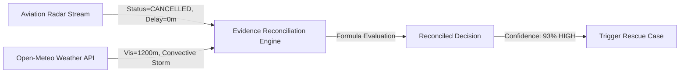

# FLYO — STAGE 4 RESCUE DECISION PROVENANCE & EXPLAINABILITY
## Multi-Source Evidence Reconciliation, MCT Rules & Decision Lineage

**Classification:** Flyo Decision Architecture Specification  
**Version:** 4.0.0-PROD-STAGE4  
**Date:** November 2026  
**Audited Location:** `flyo-rescue-demo/backend/src/main/java/com/flyo/rescue/service/`

---

## 1. Decision Lineage & Provenance Taxonomy

Flyo enforces strict provenance tagging across all operational data. Every field rendered to human operators or downstream APIs carries an explicit provenance tag:

```
[LIVE]        - Verified real-time external data (e.g. Open-Meteo weather API)
[SANDBOX]     - Interactive provider test environment (e.g. Playwright airline portal, Amadeus Altea test)
[SIMULATED]   - Synthetically generated scenario data for training or deterministic regression tests
[PREDICTED]   - Output from statistical ML models (FastAPI BTS XGBoost / Calibrated Classifiers)
[VERIFIED]    - Multi-source cross-checked fact (e.g. Radar cancellation + Airport Weather Telemetry)
```

---

## 2. Evidence Reconciliation Architecture

Disruption alerts from single sources can be noisy or erroneous. `FlightEvidenceReconciliationService` cross-examines multiple telemetry sources before triggering passenger rescue workflows:



### Confidence Calculation Formula:
$$\text{Confidence Score} = \begin{cases}
93\% & \text{if Radar = CANCELLED and Weather = ADVERSE (Fog / Storm)} \\
85\% & \text{if Radar = CANCELLED and Weather = CLEAR} \\
75\% & \text{if Radar = DELAYED } \ge 120\text{m and Weather = ADVERSE} \\
50\% & \text{if single source alert with unverified weather}
\end{cases}$$

Disruptions below $70\%$ confidence trigger supervisor review rather than automatic option ranking.

---

## 3. Minimum Connection Time (MCT) Rules

The deterministic rescue engine rigorously checks airport transfer constraints before generating or ranking alternative itineraries:

1. **Domestic-to-Domestic Connection:**
   - Same Terminal: Minimum transfer window $\ge 45\text{ minutes}$.
   - Inter-Terminal (e.g. DEL T1 to T3): Minimum transfer window $\ge 75\text{ minutes}$.
2. **Domestic-to-International Connection:**
   - Transfer window $\ge 90\text{ minutes}$ (accounting for baggage re-check, immigration, security screening).
3. **Airport Curfew Compliance:**
   - Rebooking itineraries arriving after airport curfew (e.g. BOM runway maintenance windows) are filtered out automatically.

---

## 4. Multi-Criteria Option Ranking Engine

Alternative rescue options are ranked using an explainable, multi-objective cost function:

$$\text{Score}(O) = w_1 \cdot \Delta T_{\text{arrival}} + w_2 \cdot \text{Cost}_{\text{fare}} + w_3 \cdot P_{\text{risk}} - w_4 \cdot \text{SameCarrierBonus}$$

Where:
- $\Delta T_{\text{arrival}}$: Additional arrival delay in minutes compared to original schedule ($w_1 = 1.0$).
- $\text{Cost}_{\text{fare}}$: Out-of-pocket fare adjustment in INR ($w_2 = 0.5$).
- $P_{\text{risk}}$: Probability of misconnection on layover ($w_3 = 50.0$).
- $\text{SameCarrierBonus}$: Preference for original carrier to streamline ticket re-issuance ($w_4 = 30.0$).

Every generated option produces an **Explainability Summary** displayed on the operator dashboard:
> *"Option 1 (AI-840, direct flight departing 20:00) ranked #1: Arrives 4 hours earlier than next morning flight, eliminates overnight hotel stay risk, ₹0 fare adjustment."*

---

## 5. Airspace-Aware Predictive Routing

Flyo enforces strict geographical boundaries on ML models:
- **US BTS Dataset Boundary:** The FastAPI ML model was trained on US Department of Transportation Bureau of Transportation Statistics data (334 US domestic airports).
- **International Guard:** `PredictionServiceClient` inspects origin and destination IATA codes. Flights operating in Indian airspace (e.g. `HYD`, `DEL`, `BOM`) or international sectors bypass BTS ML inference, returning `UNSUPPORTED_AIRSPACE` and falling back cleanly to deterministic safety rules.
- **Resilience:** If the FastAPI service is down or unreachable, the system logs a warning and proceeds with deterministic MCT ranking without interruption.
