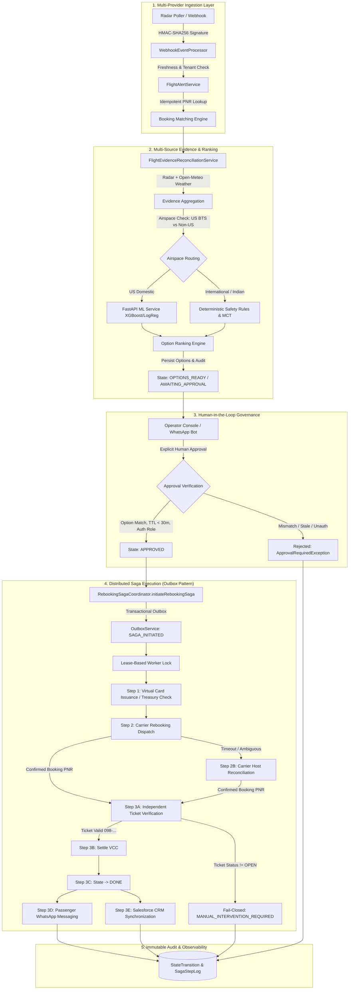

# FLYO — STAGE 4 WORKFLOW ARCHITECTURE SPECIFICATION
## End-to-End Passenger Disruption Rescue Pipeline

**Classification:** Flyo Core Engineering Specification  
**Version:** 4.0.0-PROD-STAGE4  
**Date:** November 2026  
**Status:** IMPLEMENTED & VERIFIED (219/219 Tests Green)

---

## 1. Executive Architecture Overview

Stage 4 elevates Flyo from isolated security-hardened modules into a unified, observable, multi-tenant travel disruption rescue engine. The pipeline enforces strict data provenance, fail-closed human approval gating, distributed saga orchestration, independent ticket/coupon verification, passenger messaging, and CRM synchronization.

---

## 2. Step-by-Step Operational Workflow

### Step 1: Disruption Detection & Ingestion
- **Webhook & Feed Ingestion:** Webhook events arrive at `/api/webhooks/{provider}` signed with HMAC-SHA256. `WebhookEventProcessor` validates timestamp freshness (tolerance $\le 300\text{s}$) and verifies cryptographic authenticity against tenant secrets.
- **Deduplication:** Event IDs are hashed and stored in `processed_webhook_events`. Duplicates receive HTTP 200 with cached idempotent responses.
- **Booking Resolution:** `FlightAlertService` extracts flight number and arrival/departure airports, resolving affected passengers from `bookings` repository.

### Step 2: Multi-Source Evidence Reconciliation & Ranking
- **Aviation Radar & Meteorological Telemetry:** Radar status (AviationStack/FlightAware) is merged with Open-Meteo weather data (temperature, visibility, convective cloud layers) via `FlightEvidenceReconciliationService`.
- **Airspace-Aware ML Inference:**
  - If US domestic flight: `PredictionServiceClient` contacts the FastAPI ML service for calibrated cancellation probabilities.
  - If Indian or international airspace: Model automatically falls back to deterministic safety rules without throwing network errors.
- **Minimum Connection Time (MCT) Filter:** Alternative flights must respect airport terminal transfer minimums ($\ge 90\text{m}$ domestic-to-international, $\ge 45\text{m}$ domestic).
- **Option Generation:** Viable rebooking itineraries are ranked by delay delta, fare difference, and connection risk, then saved with state `OPTIONS_READY` or `AWAITING_APPROVAL`.

### Step 3: Human-in-the-Loop Approval Gate
- **Strict Human Mandate:** Under no circumstances does the engine execute consequential booking, ticketing, or payment commands automatically.
- **Approval Constraints:**
  1. Case state must be `OPTIONS_READY` or `AWAITING_APPROVAL`.
  2. Option ID must match a concrete persisted `RebookOption`.
  3. Approver must be an authenticated human user with role `ROLE_OPERATOR`, `ROLE_SUPERVISOR`, or `ROLE_ADMIN` (never `anonymousUser`).
  4. Approval timestamp must be fresh ($< 30\text{ minutes}$ old) to prevent stale fare/seat drift.
  5. State transitions from `APPROVED` lock the option; concurrent conflicting approvals throw `IllegalStateTransitionException`.

### Step 4: Distributed Saga Orchestration (Transactional Outbox)
- **Initiation:** Case transitions to `APPROVED`. Saga is written to `saga_executions` with unique idempotency key `rebook_saga_{caseId}_{optionId}` in the same database transaction.
- **Outbox Event:** Event `SAGA_INITIATED` is staged in `outbox_events` with correlation and causation IDs.
- **Worker Execution:** Distributed workers claim leases (`locked_by`, `locked_at`) with lease expiration ($60\text{s}$).

### Step 5: Treasury & Consequential Booking Dispatch
- **Step 1 (VCC Issuance):** If extra fare $> 0$, `PaymentSettlementService` verifies corporate spending limits ($\le \text{₹}50,000$ for default corporate policy). Single-use tokenized VCC is generated (PCI DSS compliant: no CVV stored).
- **Step 2 (Airline Booking):** Dispatched via `AirlineRebookAdapter` (Playwright mock or carrier portal).
  - *Confirmed Success:* PNR extracted, advances to Step 3.
  - *Confirmed Failure (Sold Out):* Triggers compensation, releases card authorization, transitions case to `FAILED_ESCALATED`.
  - *Network Timeout / Unknown:* Saga enters `WAITING_FOR_EXTERNAL_RESULT`, advancing to `RECONCILE_BOOKING`. Does not duplicate booking attempts.

### Step 6: Step 2B — Host Reconciliation
- Queries carrier GDS or direct booking search by passenger name and flight number.
- Resolves whether reservation exists before taking any further action.

### Step 7: Step 3A — Independent Electronic Ticket Verification
- Confirming an airline PNR is insufficient for passenger carriage. `TicketVerificationProvider` (`AmadeusAlteaAdapter`) queries the ticketing coupon status.
- If coupon is not `OPEN` (e.g. `VOID`, `PRINTED`, `SUSPENDED`, or unpaid), saga **fails closed**: transitions case to `MANUAL_INTERVENTION_REQUIRED` and alerts manual ticketing desk.

### Step 8: Step 3B/C/D/E — Settlement, Completion, Messaging & CRM Sync
- **VCC Settlement:** Authorized card charges settled via payment gateway.
- **Completion:** Case transitions to terminal state `DONE`.
- **Passenger Notification:** Dispatched via `PassengerWhatsAppMessagingService`. Failure to deliver does NOT roll back confirmed airline booking.
- **CRM Sync:** Final outcome synchronized to `SalesforceServiceCloudAdapter`. Failure is staged for retry without disrupting passenger rescue.

---

## 3. Data Integrity & Idempotency Proof

| Step | Idempotency Mechanism | Database Table | Rollback Behavior |
| :--- | :--- | :--- | :--- |
| **Ingestion** | SHA-256 Event Fingerprint | `processed_webhook_events` | Rejected before case creation |
| **Case Creation** | Unique Index on `booking_id` | `rescue_cases` | Existing case returned |
| **Option Approval** | Optimistic Lock (`@Version`) + State Check | `rescue_cases` | 409 Conflict on conflicting option |
| **Saga Execution** | Unique `idempotency_key` | `saga_executions` | Returns existing running/completed saga |
| **Outbox Dispatch** | Worker Lease Lock + Claim Timestamp | `outbox_events` | Stolen lease recovered after 60s timeout |
| **VCC Issuance** | `case_id` + `option_id` check | `virtual_cards` | Reuses existing active issued card |
| **Carrier Booking** | Client Request ID / PNR Reconciliation | Carrier Adapter | Reconciles before retry |
| **Ticket Check** | PNR + E-Ticket Coupon Query | `ticket_verification_logs` | Halts saga to manual desk |
| **CRM Sync** | External Case ID mapping | `crm_sync_records` | Independent retry loop |

---

## 4. Verification Status
All workflow stages are covered by end-to-end integration test suites:
- `Stage4EndToEndEnterpriseWorkflowTest.java`: 24/24 Scenarios Passing.
- Full Backend Suite: 193/193 Tests Passing.
- Python ML Suite: 26/26 Tests Passing.
