# FLYO STAGE 5 — DEPLOYMENT PIPELINE AND OPERATIONS MANUAL

**Document ID:** `FLYO-STG5-OPS-012`  
**Classification:** Enterprise Deployment Architecture & Operational Runbook  
**Application:** Flyo Rescue System (`flyo-rescue-demo`)  
**Date:** November 2026  
**Auditor:** Principal Reliability Architect & Devops/Platform Engineer  

---

## 1. Executive Summary

This manual specifies the production-grade deployment pipeline, operational observability, secret management, database lifecycle, and zero-downtime deployment architecture for Flyo. The system operates under a **fail-closed, continuous-verification** paradigm designed for high-consequence airline operational environments where unverified deployments or ambiguous flight rebookings are unacceptable.

---

## 2. The 10-Stage Enterprise CI/CD Pipeline

The deployment pipeline is structured into 10 deterministic gates. A failure at any stage halts the pipeline immediately and prevents promotion.

```mermaid
flowchart LR
    S1["1. Code Verification & AST Lint"] --> S2["2. Secret & Vulnerability Scan"]
    S2 --> S3["3. Backend & ML Unit Suites"]
    S3 --> S4["4. Contract & Provider Tests"]
    S4 --> S5["5. Container & Dist Bundling"]
    S5 --> S6["6. DB Migration Dry-Run"]
    S6 --> S7["7. Staging / Sandbox Smoke"]
    S7 --> S8["8. Canary Rollout (10%)"]
    S8 --> S9["9. Full Blue-Green Cutover"]
    S9 --> S10["10. Post-Deploy Telemetry & Health"]
```



### Stage Details

1. **Stage 1: Code Verification & AST Linting**
   - Frontend: `npm run lint` and `build.mjs` verifying JavaScript AST syntax via Node.js native `vm.Script`.
   - Backend: Maven compilation (`mvn clean compile -DskipTests`) ensuring 100% type-checking compliance.
   - Python: Flake8/Black syntax linting on ML flight delay models.

2. **Stage 2: Secret & Vulnerability Scanning**
   - Scans commits for private keys, AWS tokens, JWTs, Stripe keys, and unencrypted credentials.
   - Snyk / OWASP Dependency-Check auditing of Java JARs and Python wheels.

3. **Stage 3: Fast Unit Test Suites**
   - Backend: JUnit 5 unit tests ([surefire](file:///Users/nani/Downloads/flyo/flyo-rescue-demo/backend/pom.xml)) for domain logic, state machines, and calculators.
   - Python: 26 ML unit tests evaluating BTS on-time feature extraction, model calibration, and inference schemas.
   - Duration target: < 60 seconds.

4. **Stage 4: Integration & Provider Contract Tests**
   - Amadeus GDS Sandbox client contract tests ([AmadeusGdsSandboxClientTest.java](file:///Users/nani/Downloads/flyo/flyo-rescue-demo/backend/src/test/java/com/flyo/rescue/AmadeusGdsSandboxClientTest.java)).
   - Webhook HMAC signature verification tests (Meta WhatsApp & Stripe).
   - Multi-tenant isolation adversarial tests ([Stage5EnterpriseVerificationAndProviderIntegrationTest.java](file:///Users/nani/Downloads/flyo/flyo-rescue-demo/backend/src/test/java/com/flyo/rescue/Stage5EnterpriseVerificationAndProviderIntegrationTest.java)).

5. **Stage 5: Container & Asset Bundling**
   - Multi-stage Docker build producing a minimal, distroless Java 17 container image.
   - Frontend production build emitting SHA-256 hashed assets into `dist/`.

6. **Stage 6: Database Migration Dry-Run (Flyway)**
   - Executes Flyway migration dry-runs against a mirrored staging schema to verify schema diffs, backward compatibility, and index creation without long table locks.

7. **Stage 7: Staging / Sandbox Smoke Verification**
   - Deploys container to isolated staging environment.
   - Executes end-to-end smoke tests validating liveness, readiness, and synthetic case ingestion.

8. **Stage 8: Canary Rollout (10% Traffic)**
   - Routes 10% of ingress traffic to canary instances.
   - Monitors HTTP error rates, saga abort rates, and latency percentiles (P95/P99) for 15 minutes.

9. **Stage 9: Blue-Green Cutover**
   - Smooth traffic transition to 100% green deployment once canary metrics meet SLAs.
   - Old blue deployment retained for 60 minutes to enable instantaneous one-click rollback if necessary.

10. **Stage 10: Post-Deploy Telemetry & Health Verification**
    - Continuous validation of outbox processing lag, saga worker heartbeats, and provider rate-limit margins.

---

## 3. Liveness and Readiness Probes

Flyo exposes enterprise Spring Boot Actuator endpoints mapped for Kubernetes and container orchestration:

| Probe | Endpoint | Evaluation Logic | Target SLA |
|---|---|---|---|
| **Liveness** | `/actuator/health/liveness` | Checks if JVM is running and internal worker threads are unblocked. Fails if JVM deadlocks. | < 50ms |
| **Readiness** | `/actuator/health/readiness` | Validates PostgreSQL database connectivity, Flyway migration state, and saga worker heartbeat. Fails if DB is unreachable. | < 200ms |
| **Outbox Health** | `/actuator/health` | Custom `OutboxHealthIndicator` reports `DEGRADED` if pending outbox messages exceed 500 or oldest un-dispatched message is > 5 minutes old. | < 100ms |

---

## 4. Graceful Shutdown Configuration

To guarantee that no in-flight saga rebooking, passenger communication, or database transaction is abruptly severed during rolling updates, Flyo configures graceful shutdown in [application.properties](file:///Users/nani/Downloads/flyo/flyo-rescue-demo/backend/src/main/resources/application.properties):

```properties
server.shutdown=graceful
spring.lifecycle.timeout-per-shutdown-phase=30s
```

### Shutdown Sequence
1. Ingress router removes the terminating instance from active load balancer pool.
2. HTTP server stops accepting new inbound connections (returns 503 to unrouted requests).
3. In-flight HTTP requests are granted up to 30 seconds to conclude.
4. Background saga workers stop polling for new work items.
5. In-progress saga steps complete their current phase or release their distributed leases cleanly.
6. HikariCP database connection pool drains active transactions and disconnects.
7. JVM exits with code 0.

---

## 5. Secret Injection & Configuration Management

Flyo rejects hardcoded secrets across all environments. Secrets are dynamically injected via environment variables sourced from Kubernetes Secrets or HashiCorp Vault:

| Secret Key | Purpose | Injection Mechanism |
|---|---|---|
| `JWT_SECRET` | HMAC-SHA256 signing secret for operator authentication | Vault Secret (`flyo/jwt-secret`) |
| `SPRING_DATASOURCE_PASSWORD` | PostgreSQL master database password | Vault Secret (`flyo/db-credentials`) |
| `AMADEUS_API_KEY` / `AMADEUS_API_SECRET` | GDS OAuth2 credentials | Vault Secret (`flyo/amadeus`) |
| `WHATSAPP_ACCESS_TOKEN` / `APP_SECRET` | Meta WhatsApp Cloud API credentials | Vault Secret (`flyo/whatsapp`) |
| `SALESFORCE_CLIENT_SECRET` | CRM OAuth2 credentials | Vault Secret (`flyo/salesforce`) |
| `STRIPE_SECRET_KEY` / `STRIPE_WEBHOOK_SECRET` | Treasury & Virtual Card credentials | Vault Secret (`flyo/stripe`) |

### Fail-Closed Validation
[ProductionSecurityValidator.java](file:///Users/nani/Downloads/flyo/flyo-rescue-demo/backend/src/main/java/com/flyo/rescue/config/ProductionSecurityValidator.java) executes on `ApplicationReadyEvent` in the `prod` profile. It inspects all mandatory secrets and terminates the application immediately if any secret is missing or contains default/insecure placeholder strings.

---

## 6. Database Migrations (Flyway Lifecycle)

Flyo employs Flyway for idempotent, reproducible, version-controlled database schema migrations.

### Version History
- `V1__init_schema.sql`: Core tables (`disruption_cases`, `passengers`, `flight_segments`).
- `V2__saga_and_outbox.sql`: Outbox pattern tables, saga instances, and distributed worker locks.
- `V3__operator_accounts.sql`: Operator accounts, BCrypt passwords, role permissions.
- `V4__flight_radar_weather.sql`: Telemetry tables, radar states, airport METAR caches.
- `V5__multi_tenancy.sql`: Tenant identifiers, partition foreign keys, tenant SLAs.
- `V6__webhook_events.sql`: Webhook idempotency keys, raw payload auditing.
- `V7__payment_settlement.sql`: Payment transactions, 12-state payment lifecycle, card masking.
- `V8__stage5_hardening.sql`: Provider metadata, audit correlation IDs, ambiguous saga states.

### Zero-Downtime Migration Rules
1. **Never drop columns or rename tables** in the same release that updates application code.
2. New columns must be created `NULLABLE` or with default values.
3. Code changes are deployed first to read from both or write to both (expand-and-contract pattern).
4. Deprecated columns are dropped in a subsequent release.

---

## 7. Backup and Disaster Recovery (DR)

### Backup Strategy
- **Continuous Archiving:** PostgreSQL Write-Ahead Logging (WAL-G) streams transactions continuously to encrypted cloud object storage (S3/GCS).
- **Daily Base Backups:** Automated full database snapshots taken daily at 02:00 UTC.
- **Recovery Point Objective (RPO):** < 5 minutes (via continuous WAL streaming).
- **Recovery Time Objective (RTO):** < 30 minutes to restore a fully verified, running PostgreSQL instance.
- **Disaster Recovery Drill:** Quarterly automated restore drills into an isolated environment to verify backup integrity and validate Flyway schema consistency.

---

## 8. Environment Profiles Matrix

| Profile | Target Environment | Database | External Integrations | Human Approval Gate | Mock Tools Enabled |
|---|---|---|---|---|---|
| `dev` | Local developer workstation | H2 In-Memory | Local mock controllers (`/mock-airline/**`) | Optional | Yes (`/h2-console`, mock portal) |
| `test` | Automated CI test runner | H2 In-Memory | Mockito / WireMock contract mocks | Enforced | Disabled |
| `sandbox` | Partner integration testing | PostgreSQL | Real external sandboxes (Amadeus Test API, Meta WhatsApp sandbox) | 100% Enforced | Disabled |
| `pilot` | Client pilot with travel partner | Managed PostgreSQL | Real partner credentials, controlled booking volume | 100% Enforced | Disabled |
| `prod` | Commercial enterprise production | High-Availability PostgreSQL | Real production GDS/PSS, WhatsApp Cloud API, Stripe | Enforced by Policy | Strictly Disabled |

---

*Report signed by Principal Reliability Architect & Devops/Platform Engineer, November 2026.*
