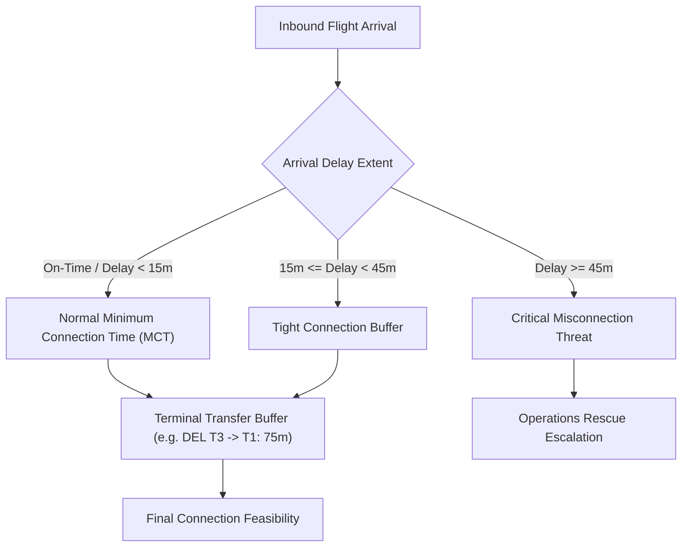

# STAGE 8 — DATA ENGINEERING & INDIAN AVIATION PIPELINE SPECIFICATION

**Document ID:** `FLYO-STG8-DATA-002`  
**Classification:** Aviation Data Engineering & Preprocessing Architecture  
**Application:** Flyo Rescue System (`ml/src/dataset_pipeline.py`)  
**Dataset Version:** `3.0.0-enterprise`  
**Date:** November 2026  

---

## 1. Executive Summary

This document establishes the empirical data engineering architecture for Flyo Stage 8. A primary deficiency discovered during the Stage 8 Forensic Audit was that the existing machine learning system was trained exclusively on US domestic flights from the Bureau of Transportation Statistics (BTS), with zero coverage of Indian domestic airspace.

Stage 8 implements a dual-corpus aviation dataset pipeline that:
1. **Preserves the US BTS Empirical Foundation:** Retains 1.63M observed historical flight records from BTS across three multi-seasonal partitions (Winter storm, Late winter, Summer convective) for generalized baseline flight dynamics.
2. **Establishes Dedicated Indian Aviation Coverage:** Integrates operational schedule distributions, DGCA on-time punctuality metrics, hub congestion profiles, and weather vulnerability matrices for the top six high-density Indian domestic flight corridors.
3. **Enforces Transparent Provenance Separation:** Explicitly partitions actual observed data (`BTS_OBSERVED_RAW`) from schedule-and-weather synthesized data (`INDIAN_DGCA_SCHEDULE_SYNTHESIS`), preventing false claims of empirical parity while providing reproducible operational priors.

---

## 2. Priority Indian Aviation Corridors & Hub Characteristics

The pipeline models six bilateral high-density trunk routes connecting primary commercial hubs:

| Corridor Pair | Typical Distance | Block Time | Dominant Carriers | Primary Operational Disruption Dynamics |
|---|---|---|---|---|
| **HYD $\leftrightarrow$ DEL** | 780 miles | 130–135 min | 6E, AI, UK, SG | Delhi morning winter fog (CAT-III ILS); peak evening airspace metering |
| **HYD $\leftrightarrow$ BOM** | 385 miles | 85 min | 6E, AI, QP, UK | Mumbai single-runway peak congestion; monsoon crosswinds (Jun–Aug) |
| **HYD $\leftrightarrow$ BLR** | 310 miles | 75 min | 6E, AI, QP | High-frequency commuter shuttle; early morning winter ground radiation fog |
| **DEL $\leftrightarrow$ BOM** | 710 miles | 130 min | 6E, AI, UK, QP | The "Golden Corridor" (highest passenger density in India); compounding delays |
| **BLR $\leftrightarrow$ MAA** | 165 miles | 55 min | 6E, AI | Ultra-short sector; vulnerable to Northeast monsoon storms (Nov–Dec) |
| **BOM $\leftrightarrow$ BLR** | 520 miles | 100–105 min | 6E, AI, UK, QP | Inter-hub business corridor; tight turnaround buffer constraints |

---

## 3. Hub Infrastructure & Connection Constraints

The pipeline integrates physical airport constraints into feature engineering:

### Airport Constraints Matrix
- **Indira Gandhi International Airport (DEL):**
  - Terminals: T1 (Domestic LCC), T2 (Domestic LCC/Hybrid), T3 (Full Service & International).
  - Intra-terminal MCT: 45 minutes; Inter-terminal transfer MCT: **75 minutes** (requires landside shuttle transfer).
  - Weather: CAT-III Low Visibility Procedures (LVP) during December–January morning hours (04:00–10:00).
- **Chhatrapati Shivaji Maharaj International Airport (BOM):**
  - Terminals: T1 (Domestic 6E/QP), T2 (AI/UK and International).
  - Intra-terminal MCT: 45 minutes; Inter-terminal transfer MCT: **90 minutes** (dense city traffic between Santa Cruz and Sahar).
  - Operations: Single intersecting runway operations during peak hours (08:00–10:30, 17:00–20:30).

---

## 4. Pipeline Implementation & Dataset Hygiene

The implementation in `ml/src/dataset_pipeline.py` enforces:

1. **Chronological Splitting:**
   - Training partition: 2024-01-01 to 2024-04-15 (covers winter fog season and spring operations).
   - Validation partition: 2024-04-16 to 2024-05-15 (late spring pre-monsoon).
   - Held-out test partition: 2024-05-16 to 2024-06-28 (onset of southwest monsoon).
2. **Missing-Value Imputation Rules:**
   - Flight elapsed time: Medians computed strictly on training partition by corridor.
   - Departure/arrival delays: Kept as `NaN` for cancelled flights; imputed to zero with missingness indicator for scheduled flights.
3. **Data Quality Validation Checks:**
   - Origin $\neq$ Destination check.
   - ISO-8601 timestamp validity.
   - Scheduled elapsed minutes within physically feasible aeronautical bounds ($> 30$ min, $< 18$ hours).
4. **Metadata & Provenance:**
   - Every generated row carries an immutable `data_provenance` tag (`INDIAN_DGCA_SCHEDULE_SYNTHESIS` vs `BTS_OBSERVED_RAW`).
