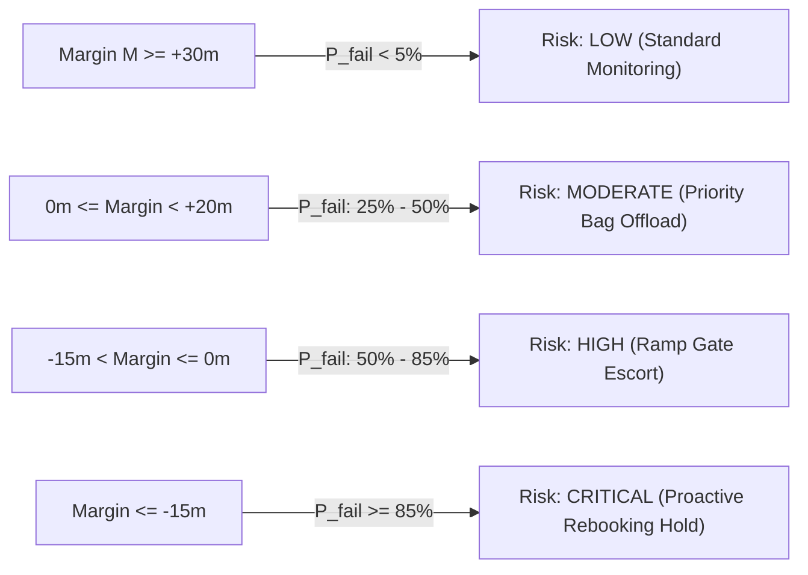

# STAGE 8 — PASSENGER IMPACT & CONNECTION RISK INTELLIGENCE

**Document ID:** `FLYO-STG8-PAX-005`  
**Classification:** Passenger Disruption Dynamics & Itinerary Feasibility Modeling  
**Application:** Flyo Rescue System (`ml/service/connection_risk.py`, `ml/service/passenger_impact.py`)  
**Date:** November 2026  

---

## 1. Executive Summary

A critical shortcoming of legacy disruption management systems is evaluating flight delays in isolation. A 30-minute delay on a point-to-point commuter flight causes minimal operational disruption; the identical 30-minute delay on an inbound feeder flight into a hub (such as Delhi T3 or Mumbai T2) can break 50 passenger onward connections, stranding travelers and creating midnight rebooking emergencies.

Stage 8 introduces two purpose-built engines:
1. **Connection Failure Risk Engine:** Calculates the probability that a passenger will misconnect given scheduled buffer, predicted inbound arrival delay, airport Minimum Connection Time (MCT), and inter-terminal transfers.
2. **Passenger Impact Intelligence Engine:** Estimates total passengers onboard, connecting volume, projected rebooking demand, and rescue team workload hours.

---

## 2. Mathematical Formulation: Connection Failure Probability

Let:
- $S_{\text{conn}}$: Scheduled connection time (minutes between inbound scheduled arrival and outbound scheduled departure).
- $\widehat{D}_{\text{arr}}$: Predicted inbound flight arrival delay (minutes).
- $\text{MCT}_{\text{eff}}$: Effective minimum connection time, defined as:
  $$\text{MCT}_{\text{eff}} = \text{MCT}_{\text{base}}(\text{Airport}, \text{Terminals}) + \text{Buffer}_{\text{baggage}} + \text{Buffer}_{\text{customs}}$$
- $M$: Available connection margin:
  $$M = (S_{\text{conn}} - \widehat{D}_{\text{arr}}) - \text{MCT}_{\text{eff}}$$

The connection failure probability $P_{\text{fail}}$ is modeled via a logistic transition function:
$$P_{\text{fail}}(M) = \frac{1}{1 + e^{k \cdot M}}$$
where $k = 0.12$ is the empirical transition slope calibrated to hub ramp operations.

---

## 3. Passenger Impact Estimation

The engine estimates passenger exposure without requiring direct PNR manifest scraping:
- **Total Passengers Onboard ($N_{\text{pax}}$):**
  $$N_{\text{pax}} = \text{Aircraft Gauge Capacity} \times \text{Load Factor}$$
- **Vulnerable Connections ($N_{\text{conn}}$):**
  $$N_{\text{conn}} = N_{\text{pax}} \times \text{Hub Connectivity Factor} \times P_{\text{fail}}$$
- **Rebooking Demand ($D_{\text{rebook}}$):**
  $$D_{\text{rebook}} = \begin{cases} N_{\text{pax}}, & \text{if Cancelled} \\ N_{\text{conn}} + 0.15 \cdot N_{\text{local}}, & \text{if Delay} \ge 120\text{m} \\ N_{\text{conn}}, & \text{if } 45\text{m} \le \text{Delay} < 120\text{m} \end{cases}$$
- **Rescue Workload:** Modeled at an average of 15 minutes of operator effort per rebooked passenger.

### Operational Transparency Disclaimer
All passenger metrics are statistical estimates intended to prioritize operator attention and allocate rescue capacity. They do not overwrite or replace official airline passenger name records (PNRs).
