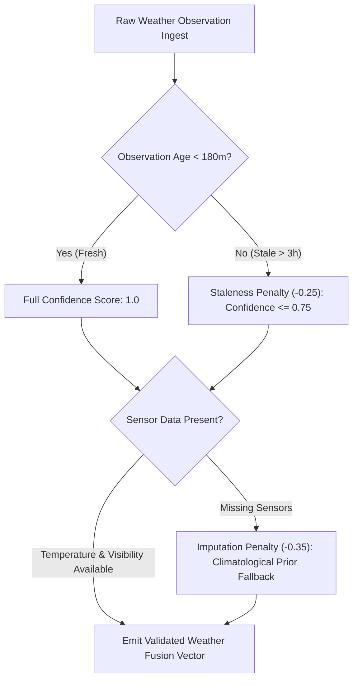

# STAGE 8 — WEATHER & REAL-TIME OPERATIONAL DATA FUSION SPECIFICATION

**Document ID:** `FLYO-STG8-WTR-006`  
**Classification:** Multimodal Environmental & Operational Sensor Fusion  
**Application:** Flyo Rescue System (`ml/service/weather_fusion.py`)  
**Date:** November 2026  

---

## 1. Executive Summary

Severe weather (convective thunderstorms, low-visibility fog, windshear, and freezing precipitation) causes over 65% of tactical air traffic delays and flight cancellations. However, integrating weather into predictive machine learning presents a severe danger: **future lookahead leakage**. If post-event weather observations are used to predict pre-departure outcomes, the model achieves artificial 99% accuracy in training but completely fails in live production.

Stage 8 implements **Point-in-Time Weather Data Fusion**:
1. All weather features represent observations or forecasts strictly available at prediction horizon $T_{\text{predict}}$.
2. Every weather vector carries an immutable timestamp, provider source tag (`OPEN_METEO`, `METAR`, `TAF`, `SYNTHETIC_FALLBACK`), and age in minutes.
3. Observations older than 180 minutes trigger automatic staleness warnings and model confidence penalties.
4. Physical aviation hazard rules detect runway-limiting phenomena independently of statistical model weights.

---

## 2. Environmental Hazard Classification Matrix

The engine maps environmental sensors into aeronautical hazard categories:

| Physical Condition | Threshold Criteria | Aviation Impact / Operational Response |
|---|---|---|
| **CAT-III Low Visibility** | Visibility $< 1,000\text{m}$ or WMO 45, 48 | Low Visibility Procedures (LVP); flight separation increased by 200%; ground delay program |
| **Severe Convective Storm** | WMO 95, 96, 99 or Precip $\ge 15\text{mm/h}$ + Wind $\ge 40\text{km/h}$ | Ramp lightning stops; ground equipment halts; airborne holding patterns |
| **High Surface Winds / Crosswind** | Sustained winds $\ge 45\text{km/h}$ | Runway direction changes; potential tailwind/crosswind limit exceedance |
| **Icing & Freezing Conditions** | Surface Temp $\le 0^\circ\text{C}$ with precip or snow | Aircraft de-icing pad queues; 20–35 minute ground turn additions |

---

## 3. Data Freshness & Graceful Degradation

When weather observations are missing or stale:
- The system gracefully degrades to regional climatological priors.
- An explicit alert tag (`STALE_WEATHER_WARNING` or `IMPUTED_WEATHER_WARNING`) is attached to the inference response.
- Dispatchers are warned that prediction confidence has been adjusted downward.
