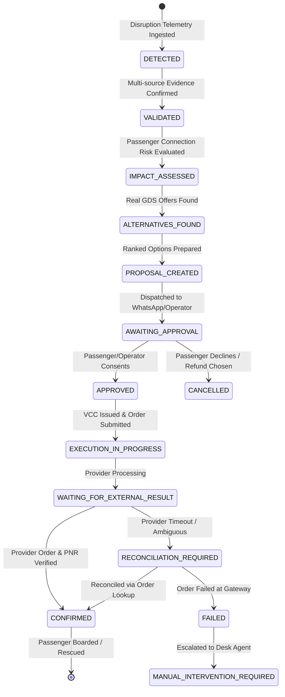

# FLYO RESCUE — STAGE 9: RESCUE WORKFLOW & STATE MACHINE

## 1. Lifecycle State Machine
Every passenger disruption case in Flyo Rescue transitions through a durable database-backed state machine.

---

## 2. State Transition Safeguards

1. **Transactional Outbox**: All state transitions generate immutable audit events in the `audit_logs` table within the same ACID database transaction.
2. **Idempotency Keys**: Rebooking requests carry deterministic keys formatted as `rebook-{caseId}-{optionId}-{timestamp}` to prevent duplicate provider charges.
3. **No Autonomous Financial Execution on Pure ML**: An ML disruption probability score *never* executes rebooking or card issuance without passing policy approval gates or verified disruption signals.
4. **Ambiguous Outcomes Fail-Safe**: When an external GDS or Payment provider times out, the system enters `WAITING_FOR_EXTERNAL_RESULT` or `RECONCILIATION_REQUIRED`. It never assumes success or blindly retries.
