# Flyo Rescue Agent — End-to-End Technical Sequence Specification

## 1. System Architecture & Participants

The autonomous passenger flight recovery pipeline connects nine core system participants in a strict, transactionally auditable sequence:

1. **Passenger (WhatsApp)**: The affected air traveler interacting via official WhatsApp Business chat.
2. **Meta Cloud API / Webhooks**: The Meta WhatsApp Graph API v20.0 message dispatcher and inbound webhook ingestion gateway.
3. **Cancellation Ingress Service**: Authoritative disruption ingestion engine processing carrier alerts and aviation radar feeds.
4. **Passenger Rescue Engine**: Central workflow coordinator managing passenger sessions, itinerary retrieval, alternative ranking, and rebooking.
5. **Case State Machine**: Authoritative lifecycle enforcement engine enforcing permitted state transitions, concurrency locks, and audit trails.
6. **Carrier Discovery & NDC APIs**: Direct GDS/NDC interfaces for live PNR lookup, flight discovery, seat availability, and ticketing validation.
7. **Passenger OTP Security**: Cryptographic security provider handling single-use 6-digit confirmation codes, SHA-256 hash storage, 10-minute expiry, and 30-minute lockout.
8. **Payment & VCC Settlement**: Treasury engine managing agency credit limits, single-use Virtual Corporate Cards (VCC), authorization, capture, and void/reversal.
9. **Playwright / Airline Portal**: Headless browser automation worker executing authoritative rebooking transactions on permitted airline partner portals.

---

## 2. Chronological Sequence Diagram

```mermaid
sequenceDiagram
    autonumber
    actor Pax as Passenger (WhatsApp)
    participant Meta as Meta Cloud API / Webhooks
    participant Ingress as Cancellation Ingress Service
    participant Engine as Passenger Rescue Engine
    participant SM as Case State Machine
    participant Provider as Carrier Discovery & NDC APIs
    participant Security as Passenger OTP Security
    participant Treasury as Payment & VCC Settlement
    participant Rebook as Playwright / Airline Portal

    Note over Ingress,SM: Step 1: Flight Disruption Detected
    Ingress->>SM: DETECTED -> PASSENGER_NOTIFIED -> AWAITING_PASSENGER_DECISION
    Ingress->>Meta: Proactive WhatsApp Alert ([RESCUE MY TRIP] / [ABANDON RESCUE])
    Meta->>Pax: Interactive Notification Delivered

    alt Passenger Clicks [ABANDON RESCUE]
        Pax->>Meta: Taps [ABANDON RESCUE]
        Meta->>Engine: Signed Webhook: ABANDON_RESCUE
        Engine->>SM: Transition: PASSENGER_DECLINED
        Engine->>Security: Invalidate any active OTP challenges
        Engine->>Meta: Dispatch Confirmation: Rescue closed. Original booking preserved.
        Meta->>Pax: "You have chosen not to proceed with Flyo Rescue. Original booking preserved."
    else Passenger Clicks [RESCUE MY TRIP]
        Pax->>Meta: Taps [RESCUE MY TRIP]
        Meta->>Engine: Signed Webhook: RESCUE_MY_TRIP
        Engine->>Meta: Step 2: Immediate acknowledgment dispatched
        Meta->>Pax: "Your rescue request has been received. Retrieving itinerary & searching alternatives..."
        Engine->>SM: Transition: FETCHING_ITINERARY -> SEARCHING_ALTERNATIVES
        Engine->>Provider: Step 3: Fetch full PNR, onward international segments, hotel risks
        Provider-->>Engine: Original booking segments & downstream connection profile
        Engine->>Provider: Step 4: Search candidate alternatives on carrier network
        Provider-->>Engine: Live flight schedules, seat inventory, and published fare rules
        Engine->>Engine: Calculate published MCT + Flyo buffer and execute deterministic ranking
        alt No Viable Alternatives Available
            Engine->>SM: Transition: NO_OPTIONS_AVAILABLE -> ESCALATED
            Engine->>Meta: "No viable flights found within connection safety buffer. Handing over to human travel desk."
        else Viable Alternatives Found
            Engine->>SM: Transition: OPTIONS_READY -> AWAITING_OPTION_SELECTION
            Engine->>Meta: Step 5: Dispatches ranked flight options with interactive buttons
            Meta->>Pax: Displays options (Option 1: FL101 ₹0 | Option 2: FL301 +₹4,200 | Option 3: FL401 +₹1,500)

            Pax->>Meta: Step 6: Selects Option (e.g. SELECT_OPTION_O1 or SELECT_OPTION_O2)
            Meta->>Engine: Signed Webhook: SELECT_OPTION_{optionId}
            Engine->>SM: Transition: OPTION_SELECTED -> REVALIDATING_OPTION
            Engine->>Provider: Revalidate live carrier inventory and fare rules
            alt Option Expired (Seats Sold Out)
                Provider-->>Engine: Inventory unavailable
                Engine->>SM: Transition: OPTION_EXPIRED -> REFRESHING_ALTERNATIVES
                Engine->>Provider: Refresh candidate alternatives (closed-loop)
            else Fare Changed by Airline
                Provider-->>Engine: Updated fare rules (e.g. ₹4,200 -> ₹5,500)
                Engine->>SM: Transition: FARE_CHANGED
                Engine->>Meta: Display updated fare & require fresh passenger consent
            else Inventory & Fare Confirmed Unchanged
                Provider-->>Engine: Inventory confirmed & fare guaranteed
                Engine->>SM: Transition: AWAITING_PASSENGER_CONFIRMATION -> AWAITING_PASSENGER_OTP
                Engine->>Security: Step 7: Arms single-use OTP challenge (bound to Case, Phone, Option, Fare, Currency)
                Security-->>Engine: 6-digit confirmation code generated (SHA-256 hash stored, 10m expiry)
                Engine->>Meta: Dispatches Itinerary Preview & Confirmation OTP prompt
                Meta->>Pax: "Review alternative flight. Reply with verification code to authorize rebooking"

                loop OTP Entry & Verification
                    Pax->>Meta: Submits 6-digit OTP in WhatsApp chat
                    Meta->>Engine: Signed Webhook: Inbound 6-digit message
                    Engine->>Security: Validate constant-time hash, expiry, attempt counter, binding
                    alt Invalid Code (< 5 attempts)
                        Security-->>Engine: Validation FAILED (Attempt decremented)
                        Engine->>SM: Transition: OTP_FAILED -> AWAITING_PASSENGER_OTP
                        Engine->>Meta: "Incorrect verification code. Please retry (X attempts remaining)."
                    else Expired (> 10 minutes)
                        Security-->>Engine: Validation EXPIRED
                        Engine->>SM: Transition: OTP_EXPIRED -> AWAITING_PASSENGER_OTP
                        Engine->>Security: Regenerate fresh OTP challenge
                        Engine->>Meta: "Verification code expired. New code generated. Please retry."
                    else 5 Failed Attempts
                        Security-->>Engine: Brute-force LOCKOUT triggered (30-minute security lockout)
                        Engine->>SM: Transition: LOCKED_OUT -> ESCALATED
                        Engine->>Meta: "Too many failed attempts. Account locked for 30 minutes. Handing over to travel desk."
                    else Valid OTP
                        Security-->>Engine: Validation SUCCESS (Challenge consumed, replay blocked)
                        Engine->>SM: Transition: AWAITING_PASSENGER_OTP -> PASSENGER_VERIFIED
                    end
                end

                alt Path A: Zero Additional Fare (₹0)
                    Note over Engine,Treasury: PATH A: Payment gateway & VCC issuance completely bypassed
                    Engine->>SM: Transition: PASSENGER_VERIFIED -> REBOOKING
                    Engine->>Rebook: Dispatch authorized zero-fare rebooking to carrier provider
                else Path B: Positive Additional Fare (> ₹0)
                    Engine->>SM: Transition: PASSENGER_VERIFIED -> VERIFYING_AGENCY_APPROVAL
                    Engine->>Treasury: Check corporate policy & agency spending limits (₹50k/₹100k)
                    alt Spending Limit Exceeded
                        Treasury-->>Engine: Limit exceeded
                        Engine->>SM: Transition: AGENCY_APPROVAL_REQUIRED -> MANUAL_APPROVAL_PENDING
                        Engine->>Meta: "Additional fare exceeds automated corporate limit. Awaiting agency approval."
                    else Approved within Spending Limit
                        Treasury-->>Engine: Spending approved
                        Engine->>Treasury: Prepare single-use Virtual Corporate Card (VCC)
                        Treasury-->>Engine: VCC armed & locked to approved amount, currency, and MCC 3000
                        Engine->>SM: Transition: VERIFYING_AGENCY_APPROVAL -> PAYMENT_INSTRUMENT_READY -> REBOOKING
                        Engine->>Rebook: Dispatch payment-authorized rebooking with VCC credentials
                    end
                end

                Rebook-->>Engine: Booking execution response returned

                alt Outcome A: Confirmed Success
                    Engine->>SM: Transition: REBOOKING -> VERIFYING_BOOKING
                    Engine->>Provider: Step 8: Authoritatively verify reservation on airline host
                    Provider-->>Engine: Reservation confirmed (New PNR verified)
                    Engine->>SM: Transition: VERIFYING_BOOKING -> VERIFYING_TICKET
                    Engine->>Provider: Confirm electronic ticket (e-ticket) issuance and coupon validation
                    Provider-->>Engine: Electronic ticket ISSUED & VALIDATED
                    opt If Path B (> ₹0 positive fare)
                        Engine->>SM: Transition: PAYMENT_AUTH_PENDING -> PAYMENT_AUTHORIZED -> PAYMENT_CAPTURED
                        Engine->>Treasury: Capture settled payment with card issuer
                    end
                    Engine->>SM: Transition: VERIFYING_TICKET -> DONE (RESCUED)
                    Engine->>Meta: Step 9: Dispatches Final WhatsApp Confirmation (PNR, Ticket, Baggage)
                    Meta->>Pax: Verified e-ticket, itinerary link, and baggage guidance delivered
                else Outcome B: Definitive Failure (e.g. inventory sold out / rejected)
                    opt If Path B (VCC Issued)
                        Engine->>Treasury: Void uncaptured VCC authorization / refund captured payment (PAYMENT_VOIDED)
                    end
                    Engine->>SM: Transition: REBOOKING -> BOOKING_FAILED -> ESCALATED
                    Engine->>Meta: Action Notice: Rebooking failed, escalated to travel desk specialist
                else Outcome C: Unknown Outcome / Timeout
                    Engine->>SM: Transition: REBOOKING -> PAYMENT_RECONCILIATION_REQUIRED -> RECONCILING
                    Engine->>Provider: Query carrier host using idempotency key (caseId)
                    alt Carrier confirms booking created
                        Provider-->>Engine: Reservation found with verified PNR
                        Engine->>SM: Transition: RECONCILING -> VERIFYING_BOOKING -> VERIFYING_TICKET -> DONE
                        Engine->>Meta: Dispatches Final WhatsApp Confirmation (PNR, Ticket, Baggage)
                    else Carrier confirms no booking created
                        Provider-->>Engine: No reservation found
                        opt If Path B (VCC Issued)
                            Engine->>Treasury: Void uncaptured VCC authorization (PAYMENT_VOIDED)
                        end
                        Engine->>SM: Transition: RECONCILING -> BOOKING_FAILED -> ESCALATED
                        Engine->>Meta: Notice: Rebooking timed out and safely voided. Escalated to travel desk.
                    else Carrier outcome remains ambiguous
                        Engine->>SM: Transition: PAYMENT_OUTCOME_UNKNOWN -> FAILED_ESCALATED
                        Engine->>Meta: Notice: Transaction status ambiguous. Flagged for manual treasury audit.
                    end
                end
            end
        end
    end
```

---

## 3. Detailed Step-by-Step Technical Execution

### Phase 1: Ingress and Proactive Passenger Engagement
1. **Disruption Ingress**: Carrier or radar client publishes a verified cancellation event. Ingress validates signature, flight number, date, and PNR association.
2. **Deduplication**: Composite key check (`bookingId + flight + type`) ensures duplicate alerts are dropped idempotently.
3. **State Machine Dispatch**: Transition from `DETECTED` to `PASSENGER_NOTIFIED` and `AWAITING_PASSENGER_DECISION`.
4. **Outbound Interactive Alert**: Meta WhatsApp Client sends an interactive message with buttons `RESCUE_MY_TRIP` and `ABANDON_RESCUE`.

### Phase 2: Passenger Decision Handling
- **Abandon Path**:
  - Passenger taps `[ ABANDON RESCUE ]`.
  - Webhook verified via HMAC-SHA256 against `flyo.whatsapp.app-secret`.
  - Transition to `PASSENGER_DECLINED`.
  - Active OTP challenges invalidated. Original ticket and onward connections preserved without auto-refund.
  - Passenger receives confirmation of closure.
- **Rescue Path**:
  - Passenger taps `[ RESCUE MY TRIP ]`.
  - Webhook parsed, case ownership validated.
  - Immediate acknowledgment sent: *"Flyo is retrieving your itinerary and searching for available alternatives..."*
  - Transition to `FETCHING_ITINERARY`.

### Phase 3: Itinerary Retrieval & Downstream Connection Risk Analysis
1. Engine calls GDS/NDC provider with original booking PNR.
2. Full itinerary details retrieved: origin, destination, intermediate stops, cabin class, baggage allowances, onward international segments, and hotel reservations.
3. Downstream connection risk analysis flags risks (e.g. tight layovers at DEL or international connection to Toronto YYZ).

### Phase 4: Alternative Discovery & Deterministic Ranking
1. Transition to `SEARCHING_ALTERNATIVES`.
2. Provider queried for candidate flights within the target recovery window.
3. For each candidate, published airport MCT (Minimum Connecting Time) and Flyo safety buffer are evaluated independently.
4. Deterministic multi-factor scoring evaluates: arrival guarantee, connection feasibility, total duration, stops, baggage compatibility, and fare difference.
5. If no candidates satisfy safety constraints: transition to `NO_OPTIONS_AVAILABLE` -> `ESCALATED`.
6. If viable candidates found: transition to `OPTIONS_READY` -> `AWAITING_OPTION_SELECTION`.
7. Ranked options dispatched via WhatsApp interactive list/buttons.

### Phase 5: Option Selection, Revalidation & Consent OTP
1. Passenger taps button (e.g., `SELECT_OPTION_O1`).
2. Webhook verified; transition to `OPTION_SELECTED` -> `REVALIDATING_OPTION`.
3. Live carrier revalidation checks seat inventory and fare rules:
   - **Option Expired**: Seats sold out; transition to `OPTION_EXPIRED` -> `REFRESHING_ALTERNATIVES` (auto-refresh loop).
   - **Fare Changed**: Carrier updated fare rules; transition to `FARE_CHANGED`, show new cost, invalidate previous consent, and prompt fresh acceptance.
   - **Confirmed Unchanged**: Transition to `AWAITING_PASSENGER_CONFIRMATION` -> `AWAITING_PASSENGER_OTP`.
4. Security engine generates a cryptographically secure 6-digit confirmation code.
5. SHA-256 hash stored with strict binding to `(caseId, passengerPhone, optionId, amount, currency, expiresAt = now + 10m)`.
6. Preview and OTP prompt sent to passenger.

### Phase 6: OTP Verification & Brute-Force Defense
1. Passenger replies with 6-digit code in WhatsApp.
2. Inbound webhook verified; security engine executes constant-time hash comparison:
   - **Invalid Code (< 5 attempts)**: Transition `OTP_FAILED` -> `AWAITING_PASSENGER_OTP`. Attempt counter decremented. User prompted to retry.
   - **Expired Code (> 10 minutes)**: Transition `OTP_EXPIRED` -> `AWAITING_PASSENGER_OTP`. Fresh OTP generated. User prompted to retry.
   - **5 Failed Attempts**: Transition `LOCKED_OUT` -> `ESCALATED`. 30-minute security lockout activated.
   - **Valid Code**: Challenge consumed; single-use flag set to prevent replay attacks. Transition to `PASSENGER_VERIFIED`.

### Phase 7: Zero-Fare vs Positive-Fare Payment Decision
- **Path A: Zero Additional Fare (₹0)**:
  - Extra fare difference is ₹0 (e.g., complimentary airline rebooking or involuntary waiver).
  - VCC issuance and payment gateway processing are **completely bypassed**.
  - Transition directly: `PASSENGER_VERIFIED` -> `REBOOKING`.
- **Path B: Positive Additional Fare (> ₹0)**:
  - Transition: `PASSENGER_VERIFIED` -> `VERIFYING_AGENCY_APPROVAL`.
  - Treasury checks agency authorized spending limit (configurable: ₹50,000 / ₹100,000 / custom).
  - If limit exceeded: transition to `AGENCY_APPROVAL_REQUIRED` -> `MANUAL_APPROVAL_PENDING` for operator review (strictly classified as an authorization event, **never** as a payment failure).
  - If approved: transition to `PAYMENT_INSTRUMENT_READY`. Single-use Virtual Corporate Card (VCC) prepared, locked to exact fare, case, and MCC 3000 (Airlines).
  - Transition: `PAYMENT_INSTRUMENT_READY` -> `REBOOKING`.

### Phase 8: Rebooking Execution & Three Distinct Outcomes
Rebooking job dispatched to Playwright browser worker or NDC booking API with case idempotency key.

- **Outcome A: Confirmed Success**:
  1. Provider returns confirmed response with new PNR.
  2. Transition to `VERIFYING_BOOKING`: independently verify reservation on carrier host.
  3. Transition to `VERIFYING_TICKET`: independently verify e-ticket issuance and coupon coupons (`ISSUED & VALIDATED`).
  4. If Path B: Transition `PAYMENT_AUTH_PENDING` -> `PAYMENT_AUTHORIZED` -> `PAYMENT_CAPTURED`. Reconcile settlement with card issuer.
  5. Core booking record updated to `Rescued`.
  6. Transition to `DONE (RESCUED)`.
  7. Final WhatsApp confirmation dispatched to passenger with verified PNR, route, e-ticket link, and baggage transfer notes.

- **Outcome B: Definitive Failure (e.g., Seat Sold / Carrier Rejection)**:
  1. Carrier confirms booking was rejected and no ticket was created.
  2. If Path B: Treasury voids uncaptured VCC authorization or refunds captured payment (`PAYMENT_VOIDED`).
  3. Transition to `BOOKING_FAILED` -> `ESCALATED`.
  4. Notice sent to passenger and travel desk specialist alerted.

- **Outcome C: Unknown Outcome / Timeout (e.g., 504 Gateway Timeout / Network Drop)**:
  1. Transition to `PAYMENT_RECONCILIATION_REQUIRED` -> `RECONCILING`.
  2. Query carrier host using original idempotency key (`caseId`).
  3. Decision:
     - **Carrier confirms booking created**: Retrieve PNR, resume to `VERIFYING_BOOKING` -> `VERIFYING_TICKET` -> `DONE`.
     - **Carrier confirms no booking created**: Void VCC authorization (`PAYMENT_VOIDED`), transition to `BOOKING_FAILED` -> `ESCALATED`.
     - **Carrier outcome remains ambiguous**: Transition to `PAYMENT_OUTCOME_UNKNOWN` -> `FAILED_ESCALATED`. Prevent blind retries; alert treasury & agency operations.
