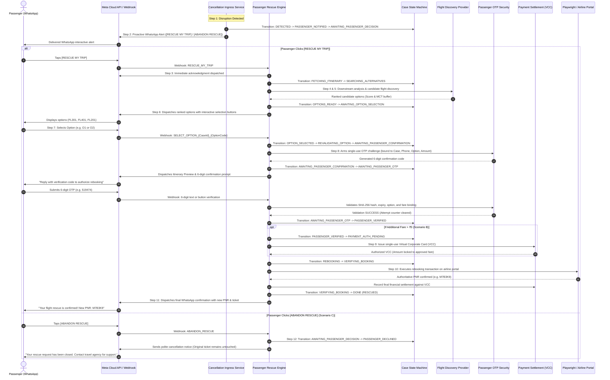

# Flyo Rescue Agent — WhatsApp-First Autonomous Flight Recovery Workflow

## 1. Executive Summary

Flyo Rescue Agent provides an autonomous, passenger-driven disruption recovery pipeline operated entirely over the official Meta WhatsApp Cloud API. Whenever an authoritative flight cancellation or disruption event occurs, Flyo bypasses call center queues and immediately engages the affected traveler on their verified WhatsApp channel with two clear choices:

1. `[ RESCUE MY TRIP ]`
2. `[ ABANDON RESCUE ]`

The entire recovery process—from itinerary connection risk analysis, alternative flight discovery, deterministic option ranking, passenger selection, mandatory confirmation OTP verification, treasury virtual card payment authorization, to carrier rebooking and confirmed PNR issuance—runs autonomously within seconds without manual agency intervention.

---

## 2. Master Architectural Workflow

---

## 3. Detailed Step-by-Step Recovery Lifecycle

### Step 1 — Authoritative Flight Cancellation Detection
- Authoritative disruption ingress (FlightRadar24, Cirium, Amadeus/Sabre webhook, or Operations Console).
- Resolves affected booking, traveler profile, and verified WhatsApp phone.
- Case initialized idempotently in state `DETECTED`.

### Step 2 — Proactive WhatsApp Alert
- Immediately dispatches a personalized notification through Meta WhatsApp Cloud API:
  > *"Hello {{passenger_name}},\nWe are sorry to inform you that your flight {{flight_number}} from {{origin}} to {{destination}} scheduled for {{departure_time}} has been cancelled.\n\nDon't worry. Flyo Rescue Agent can help you find alternative flights and recover your journey.\n\nWhat would you like to do?"*
- Two interactive buttons attached:
  - `[ RESCUE MY TRIP ]` (payload: `RESCUE_MY_TRIP_{caseId}`)
  - `[ ABANDON RESCUE ]` (payload: `ABANDON_RESCUE_{caseId}`)
- State transitions: `DETECTED` &rarr; `PASSENGER_NOTIFIED` &rarr; `AWAITING_PASSENGER_DECISION`.

### Step 3 — Passenger Initiates Recovery
- Passenger taps `[ RESCUE MY TRIP ]` or replies `RESCUE`.
- Immediate reassuring acknowledgment sent:
  > *"Your rescue request has been received. Flyo is reviewing your itinerary and searching for available alternative flights. We'll show you the best available options shortly."*
- State transitions: `AWAITING_PASSENGER_DECISION` &rarr; `FETCHING_ITINERARY`.

### Step 4 — Itinerary Retrieval & Downstream Impact Analysis
- Analyzes subsequent segments, international onward connections, minimum connect times (MCT), and non-refundable hotel reservations.
- State transitions: `FETCHING_ITINERARY` &rarr; `SEARCHING_ALTERNATIVES`.

### Step 5 — Alternative Flight Search & Deterministic Ranking
- Searches candidate replacement flights across airline inventory adapters.
- Evaluates routes using the deterministic scoring formula:
  $$\text{Score} = (\Delta\text{MCT buffer} \times 1.0) - (\text{Extra Fare} \times 0.05) - (\text{Layovers} \times 50) + \text{Connection Bonus}$$
- Ranks candidate options deterministically and transitions: `SEARCHING_ALTERNATIVES` &rarr; `OPTIONS_READY` &rarr; `AWAITING_OPTION_SELECTION`.

### Step 6 — Interactive Options Display on WhatsApp
- Dispatches ranked options directly to passenger WhatsApp with clear flight numbers, routing, departure/arrival schedules, buffer margins, and fare difference (`₹0` or `+₹4,200`).
- Provides quick-tap selection buttons: `[ Select FL301 ]`, `[ Select FL201 ]`, and `[ ABANDON RESCUE ]`.

### Step 7 — Option Selection & Pre-Validation
- Passenger taps their preferred flight or replies `OPTION 1`.
- Flyo revalidates seat availability and confirms the fare quote with flight providers.
- State transitions: `AWAITING_OPTION_SELECTION` &rarr; `OPTION_SELECTED` &rarr; `REVALIDATING_OPTION` &rarr; `AWAITING_PASSENGER_CONFIRMATION`.

### Step 8 — Mandatory Passenger Confirmation OTP
- **Scenario A (Zero Fare Difference, ₹0):**
  - Confirms selected flight requires zero additional fare.
  - Generates cryptographically secure single-use 6-digit OTP challenge.
  - Dispatches preview and verification prompt: *"Your selected alternative flight requires no additional payment. To confirm your selection and proceed with rebooking, please enter your verification code: 519474"*.
- **Scenario B (Positive Fare Difference, e.g. +₹4,200):**
  - States exact additional fare: `+₹4,200`.
  - Dispatches preview and explicit authorization prompt: *"Your selected flight requires an additional payment of ₹4,200. To confirm your selected flight and authorize Flyo to proceed with the approved recovery process, enter the verification code sent to your verified contact: 832104"*.
- State transitions: `AWAITING_PASSENGER_CONFIRMATION` &rarr; `AWAITING_PASSENGER_OTP`.

### Step 9 — Treasury Payment Authorization
- Passenger enters OTP; Flyo verifies the SHA-256 hash, phone match, and bound fare.
- State transitions: `AWAITING_PASSENGER_OTP` &rarr; `PASSENGER_VERIFIED`.
- If fare difference > 0, transitions to `PAYMENT_AUTH_PENDING` and issues a single-use Corporate Virtual Credit Card (VCC) locked to MCC 3000 (Airlines) for the exact authorized amount.

### Step 10 — Rebooking Execution via Airline Adapter
- Dispatches rebooking transaction to the airline adapter (Playwright browser automation or GDS API).
- State transitions: `PAYMENT_AUTH_PENDING` / `PASSENGER_VERIFIED` &rarr; `REBOOKING` &rarr; `VERIFYING_BOOKING`.

### Step 11 — Confirmed PNR Verification & WhatsApp Success Dispatch
- Independently queries airline reservation system to verify newly created PNR.
- Updates booking record status to `Rescued`.
- State transitions: `VERIFYING_BOOKING` &rarr; `DONE`.
- Dispatches final confirmation to passenger WhatsApp:
  > *"Your flight rescue is confirmed! Your alternative flight has been successfully booked.\n• Passenger: {{name}}\n• New Flight: {{flight}}\n• Route: {{route}}\n• New PNR: {{pnr}}\n• Additional Payment: {{fare}}\nThank you for choosing Flyo."*
- Appends complete immutable trace to Audit Ledger.

### Step 12 — Abandon Rescue Handling
- If passenger taps `[ ABANDON RESCUE ]` or replies `ABANDON`:
  - Case immediately transitions to `PASSENGER_DECLINED`.
  - Sets `passengerDecision = "ABANDON_RESCUE"`.
  - Does NOT cancel existing ticket or initiate refunds.
  - Sends polite closing message on WhatsApp.
  - Alerts travel agency operations desk.

---

## 4. Mandatory Security Architecture & Verification Contract

| Security Control | Implementation Standard |
| :--- | :--- |
| **Hash-Only Storage** | Plaintext OTPs are never stored in PostgreSQL or audit logs; only salted `SHA-256` digests are persisted in `passenger_otp_challenges`. |
| **Strict Context Binding** | Every challenge is cryptographically bound to `(caseId, passengerPhone, selectedOptionId, amount, currency)`. Modifying any field invalidates the challenge. |
| **Fare Change Invalidation** | If candidate option fare fluctuates before OTP entry, the pending challenge is revoked and transitions to `FARE_CHANGED`. |
| **Expiry & Rate Limits** | Challenges expire strictly after **5 minutes**. A resend cooldown of **60 seconds** prevents SMS/WhatsApp flood attacks. |
| **Brute-Force Lockout** | Failed submissions decrement `attempts_remaining` (starting at 5). On 5 consecutive failures, the phone is locked out for 15 minutes and the case transitions to `ESCALATED`. |
| **Payment vs Passenger OTP Separation** | The passenger OTP confirms *passenger consent* to the itinerary and fare difference. Flyo **never** solicits CVVs, credit card numbers, or banking 3D-Secure bank OTPs through WhatsApp. |

---

## 5. Dynamic Passenger Support

Flyo's recovery engine contains **zero hardcoded references** to specific passengers, routes, or booking IDs:
- Passenger name, phone, route, onward connections, and carrier are resolved dynamically from `BookingRepository`.
- All WhatsApp notifications, buttons, and state records reflect the authentic passenger identity.
- Multi-passenger concurrency tests prove simultaneous independent recovery sessions operate with 100% data isolation.
