# Flyo Rescue Agent — WhatsApp-First Autonomous Flight Recovery Workflow

## 1. Executive Summary

Flyo Rescue Agent provides an autonomous, passenger-driven disruption recovery pipeline operated over the official Meta WhatsApp Cloud API. Whenever an authoritative flight cancellation or disruption event occurs, Flyo bypasses call center queues and immediately engages the affected traveler on their verified WhatsApp channel with two primary actions:

1. `[ RESCUE MY TRIP ]`
2. `[ ABANDON RESCUE ]`

The entire recovery process—itinerary connection risk analysis, alternative flight discovery, deterministic option ranking, passenger selection, live availability and fare revalidation, mandatory confirmation OTP verification, explicit branching between zero-fare and positive-fare payment paths, corporate virtual card preparation (`PAYMENT_INSTRUMENT_READY`), carrier rebooking with 3-outcome reconciliation (Confirmed Success, Confirmed Failure, Unknown Timeout), payment authorization and capture, and authoritative PNR and e-ticket verification—runs autonomously in real time.

---

## 2. Corrected Master Architecture Flowchart

```mermaid
flowchart TD
    A["Flight Disruption Detected<br/>(Authoritative Carrier Webhook / Aviation Radar Ingress)"] --> B["WhatsApp Interactive Notification<br/>[ RESCUE MY TRIP ] | [ ABANDON RESCUE ]"]
    
    %% Abandon Rescue Branch
    B -->|ABANDON RESCUE| C["PASSENGER_DECLINED<br/>Close Rescue Case<br/>Preserve Original Ticket (No Auto-Refund)<br/>Alert Agency Operations Desk"]
    
    %% Rescue My Trip Branch
    B -->|RESCUE MY TRIP| D["Validate Passenger Ownership<br/>Transition to FETCHING_ITINERARY<br/>Immediate Acknowledgment Dispatched<br/>Fetch Complete PNR & All Itinerary Segments<br/>Analyze Downstream Connection & Hotel Risks"]
    
    D --> E["Transition to SEARCHING_ALTERNATIVES<br/>Search Candidate Flights on Carrier Network<br/>Calculate Published MCT & Flyo Safety Buffer<br/>Deterministic Multi-Factor Option Ranking"]
    
    E --> F{"Alternative Flights<br/>Available?"}
    F -->|No Alternatives| G["NO_OPTIONS_AVAILABLE &rarr; ESCALATED<br/>Hand over to Human Travel Desk Specialist"]
    F -->|Viable Options Found| H["Transition to OPTIONS_READY &rarr; AWAITING_OPTION_SELECTION<br/>Send Ranked Options on WhatsApp<br/>• Option 1: FL101 (Direct) +₹0 (Recommended)<br/>• Option 2: FL301 (1 Stop) +₹4,200<br/>• Option 3: FL401 (Direct) +₹1,500"]
    
    H --> I["Passenger Selects Flight Option<br/>(e.g., SELECT_OPTION_O1 or SELECT_OPTION_O2)"]
    
    I --> J["OPTION_SELECTED &rarr; REVALIDATING_OPTION<br/>Revalidate Live Carrier Seat Availability & Fare Rules<br/>Recalculate Downstream Connection Feasibility"]
    
    J --> K{"Availability or<br/>Fare Changed?"}
    K -->|Expired| L["OPTION_EXPIRED &rarr; REFRESHING_ALTERNATIVES<br/>Closed-Loop Inventory Refresh & Return to Search"]
    K -->|Fare Changed| M["FARE_CHANGED &rarr; Display Updated Cost<br/>Invalidate Previous Consent & Require Fresh OTP"]
    K -->|Confirmed Unchanged| N["AWAITING_PASSENGER_CONFIRMATION &rarr; AWAITING_PASSENGER_OTP<br/>Present Final Itinerary Preview & Exact Cost<br/>Generate Single-Use 6-Digit Confirmation OTP<br/>(Bound to Case + Phone + Option + Fare + Currency, 10m Expiry)"]
    
    L --> E
    M --> J
    
    N --> O["AWAITING_PASSENGER_OTP<br/>Passenger Enters 6-Digit Consent Code in WhatsApp"]
    
    O --> P{"Verify Passenger OTP"}
    P -->|Invalid Code &lt; 5 Attempts| Q["OTP_FAILED &rarr; AWAITING_PASSENGER_OTP<br/>Decrement Attempt Counter & Prompt Retry"]
    P -->|Expired &gt; 10 min| R["OTP_EXPIRED &rarr; AWAITING_PASSENGER_OTP<br/>Regenerate Fresh Challenge & Prompt Retry"]
    P -->|5 Failed Attempts| S["LOCKED_OUT &rarr; ESCALATED<br/>30-Minute Security Lockout<br/>Alert Agency Operations Desk"]
    P -->|Valid OTP| T["PASSENGER_VERIFIED<br/>Passenger Consent Authoritatively Locked<br/>Invalidate Challenge to Prevent Replay"]
    
    Q --> O
    R --> O
    
    T --> U{"Check Additional Fare<br/>Difference"}
    
    %% PATH A: Zero Additional Fare
    U -->|₹0 Additional Fare| V["PATH A: NO PAYMENT REQUIRED<br/>• Skip VCC Issuance Entirely<br/>• Skip Payment Gateway Processing<br/>• Apply Agency Booking Authorization Policy<br/>• Transition: PASSENGER_VERIFIED &rarr; REBOOKING"]
    
    %% PATH B: Positive Additional Fare
    U -->|Positive Fare Difference| W["PATH B: PAYMENT REQUIRED<br/>Transition: PASSENGER_VERIFIED &rarr; VERIFYING_AGENCY_APPROVAL<br/>Check Corporate Policy & Agency Spending Limits (e.g. ₹50k / ₹100k)"]
    
    W --> X{"Within Agency<br/>Limit?"}
    X -->|Exceeded| Y["AGENCY_APPROVAL_REQUIRED &rarr; MANUAL_APPROVAL_PENDING<br/>Agency Policy Exception Review (Not a Payment Failure)<br/>Await Operator Budget Approval in Console"]
    X -->|Approved| Z["PAYMENT_INSTRUMENT_READY<br/>Issue Single-Use Corporate Virtual Card (VCC)<br/>Locked to Case, Option, Approved Fare & MCC 3000"]
    
    Z --> AB["REBOOKING<br/>Dispatch Rebooking Subprocess with VCC Credentials"]
    V --> AC["AUTHORIZED REBOOKING<br/>Airline NDC API / Playwright Partner Portal Engine"]
    AB --> AC
    
    AC --> AD{"Rebooking Provider<br/>Execution Outcome"}
    
    %% Outcome A: Confirmed Success
    AD -->|Outcome A: Confirmed Success| AH["VERIFYING_BOOKING<br/>Independently Verify Reservation on Airline Host System"]
    AH --> AI["VERIFYING_TICKET<br/>Confirm Electronic Ticket (e-Ticket) Issuance & Coupon Validation"]
    AI --> AP{"Path B Positive Fare?"}
    AP -->|Yes| AQ["PAYMENT_AUTH_PENDING &rarr; PAYMENT_AUTHORIZED &rarr; PAYMENT_CAPTURED<br/>Record Settlement & Capture with Card Issuer"]
    AP -->|No - Path A| AR["DONE (RESCUED)<br/>Update Core Booking Record to 'Rescued'"]
    AQ --> AR
    
    AR --> AK["FINAL WHATSAPP CONFIRMATION<br/>Verified Itinerary + Confirmed Airline PNR<br/>e-Ticket Status (ISSUED & VALIDATED)<br/>Secure Itinerary Link + Baggage Transfer Guidance<br/>(Boarding Pass Opens at Carrier Check-In 24h Prior)"]
    
    %% Outcome B: Confirmed Failure
    AD -->|Outcome B: Definitive Failure| BF["Definitive Booking Failure<br/>(e.g., Confirmed Sold Out / Carrier Rejection)"]
    BF --> BG{"Path B VCC Issued?"}
    BG -->|Yes| BH["PAYMENT_VOIDED / PAYMENT_REFUNDED<br/>Void Uncaptured VCC Authorization or Refund Captured Payment"]
    BG -->|No| BI["BOOKING_FAILED &rarr; ESCALATED<br/>Alert Operations Console & Notify Passenger"]
    BH --> BI
    
    %% Outcome C: Unknown / Timeout
    AD -->|Outcome C: Unknown Outcome / Timeout| TO["PAYMENT_RECONCILIATION_REQUIRED &rarr; RECONCILING<br/>Query Carrier Host using Idempotency Key (caseId)"]
    TO --> TR{"Carrier Host<br/>Inquiry Result"}
    TR -->|Booking Exists| AH
    TR -->|No Booking Found| BH
    TR -->|Still Unknown / Ambiguous| TS["PAYMENT_OUTCOME_UNKNOWN &rarr; FAILED_ESCALATED<br/>Retain Recoverable Case (No Blind Retries)<br/>Alert Agency Operations Desk for Manual Resolution"]
```

---

## 3. End-to-End Sequence Diagram

```mermaid
sequenceDiagram
    autonumber
    actor Pax as Passenger (WhatsApp)
    participant Meta as Meta Cloud API / Webhooks
    participant Ingress as Cancellation Ingress Service
    participant Engine as Passenger Rescue Engine
    participant SM as Case State Machine
    participant Provider as Carrier Discovery & NDC APIs
    participant Security as Passenger OTP Security
    participant Treasury as Payment & VCC Settlement
    participant Rebook as Playwright / Airline Portal

    Note over Ingress,SM: Step 1: Flight Disruption Detected
    Ingress->>SM: DETECTED -> PASSENGER_NOTIFIED -> AWAITING_PASSENGER_DECISION
    Ingress->>Meta: Proactive WhatsApp Alert ([RESCUE MY TRIP] / [ABANDON RESCUE])
    Meta->>Pax: Interactive Notification Delivered

    alt Passenger Clicks [ABANDON RESCUE]
        Pax->>Meta: Taps [ABANDON RESCUE]
        Meta->>Engine: Signed Webhook: ABANDON_RESCUE
        Engine->>SM: Transition: PASSENGER_DECLINED
        Engine->>Security: Invalidate any active OTP challenges
        Engine->>Meta: Dispatch Confirmation: Rescue closed. Original booking preserved.
        Meta->>Pax: "You have chosen not to proceed with Flyo Rescue. Original booking preserved."
    else Passenger Clicks [RESCUE MY TRIP]
        Pax->>Meta: Taps [RESCUE MY TRIP]
        Meta->>Engine: Signed Webhook: RESCUE_MY_TRIP
        Engine->>Meta: Step 2: Immediate acknowledgment dispatched
        Meta->>Pax: "Your rescue request has been received. Retrieving itinerary & searching alternatives..."
        Engine->>SM: Transition: FETCHING_ITINERARY -> SEARCHING_ALTERNATIVES
        Engine->>Provider: Step 3: Fetch full PNR, onward international segments, hotel risks
        Provider-->>Engine: Original booking segments & downstream connection profile
        Engine->>Provider: Step 4: Search candidate alternatives on carrier network
        Provider-->>Engine: Live flight schedules, seat inventory, and published fare rules
        Engine->>Engine: Calculate published MCT + Flyo buffer and execute deterministic ranking
        alt No Viable Alternatives Available
            Engine->>SM: Transition: NO_OPTIONS_AVAILABLE -> ESCALATED
            Engine->>Meta: "No viable flights found within connection safety buffer. Handing over to human travel desk."
        else Viable Alternatives Found
            Engine->>SM: Transition: OPTIONS_READY -> AWAITING_OPTION_SELECTION
            Engine->>Meta: Step 5: Dispatches ranked flight options with interactive buttons
            Meta->>Pax: Displays options (Option 1: FL101 ₹0 | Option 2: FL301 +₹4,200 | Option 3: FL401 +₹1,500)

            Pax->>Meta: Step 6: Selects Option (e.g. SELECT_OPTION_O1 or SELECT_OPTION_O2)
            Meta->>Engine: Signed Webhook: SELECT_OPTION_{optionId}
            Engine->>SM: Transition: OPTION_SELECTED -> REVALIDATING_OPTION
            Engine->>Provider: Revalidate live carrier inventory and fare rules
            alt Option Expired (Seats Sold Out)
                Provider-->>Engine: Inventory unavailable
                Engine->>SM: Transition: OPTION_EXPIRED -> REFRESHING_ALTERNATIVES
                Engine->>Provider: Refresh candidate alternatives (closed-loop)
            else Fare Changed by Airline
                Provider-->>Engine: Updated fare rules (e.g. ₹4,200 -> ₹5,500)
                Engine->>SM: Transition: FARE_CHANGED
                Engine->>Meta: Display updated fare & require fresh passenger consent
            else Inventory & Fare Confirmed Unchanged
                Provider-->>Engine: Inventory confirmed & fare guaranteed
                Engine->>SM: Transition: AWAITING_PASSENGER_CONFIRMATION -> AWAITING_PASSENGER_OTP
                Engine->>Security: Step 7: Arms single-use OTP challenge (bound to Case, Phone, Option, Fare, Currency)
                Security-->>Engine: 6-digit confirmation code generated (SHA-256 hash stored, 10m expiry)
                Engine->>Meta: Dispatches Itinerary Preview & Confirmation OTP prompt
                Meta->>Pax: "Review alternative flight. Reply with verification code to authorize rebooking"

                loop OTP Entry & Verification
                    Pax->>Meta: Submits 6-digit OTP in WhatsApp chat
                    Meta->>Engine: Signed Webhook: Inbound 6-digit message
                    Engine->>Security: Validate constant-time hash, expiry, attempt counter, binding
                    alt Invalid Code (< 5 attempts)
                        Security-->>Engine: Validation FAILED (Attempt decremented)
                        Engine->>SM: Transition: OTP_FAILED -> AWAITING_PASSENGER_OTP
                        Engine->>Meta: "Incorrect verification code. Please retry (X attempts remaining)."
                    else Expired (> 10 minutes)
                        Security-->>Engine: Validation EXPIRED
                        Engine->>SM: Transition: OTP_EXPIRED -> AWAITING_PASSENGER_OTP
                        Engine->>Security: Regenerate fresh OTP challenge
                        Engine->>Meta: "Verification code expired. New code generated. Please retry."
                    else 5 Failed Attempts
                        Security-->>Engine: Brute-force LOCKOUT triggered (30-minute security lockout)
                        Engine->>SM: Transition: LOCKED_OUT -> ESCALATED
                        Engine->>Meta: "Too many failed attempts. Account locked for 30 minutes. Handing over to travel desk."
                    else Valid OTP
                        Security-->>Engine: Validation SUCCESS (Challenge consumed, replay blocked)
                        Engine->>SM: Transition: AWAITING_PASSENGER_OTP -> PASSENGER_VERIFIED
                    end
                end

                alt Path A: Zero Additional Fare (₹0)
                    Note over Engine,Treasury: PATH A: Payment gateway & VCC issuance completely bypassed
                    Engine->>SM: Transition: PASSENGER_VERIFIED -> REBOOKING
                    Engine->>Rebook: Dispatch authorized zero-fare rebooking to carrier provider
                else Path B: Positive Additional Fare (> ₹0)
                    Engine->>SM: Transition: PASSENGER_VERIFIED -> VERIFYING_AGENCY_APPROVAL
                    Engine->>Treasury: Check corporate policy & agency spending limits (₹50k/₹100k)
                    alt Spending Limit Exceeded
                        Treasury-->>Engine: Limit exceeded
                        Engine->>SM: Transition: AGENCY_APPROVAL_REQUIRED -> MANUAL_APPROVAL_PENDING
                        Engine->>Meta: "Additional fare exceeds automated corporate limit. Awaiting agency approval."
                    else Approved within Spending Limit
                        Treasury-->>Engine: Spending approved
                        Engine->>Treasury: Prepare single-use Virtual Corporate Card (VCC)
                        Treasury-->>Engine: VCC armed & locked to approved amount, currency, and MCC 3000
                        Engine->>SM: Transition: VERIFYING_AGENCY_APPROVAL -> PAYMENT_INSTRUMENT_READY -> REBOOKING
                        Engine->>Rebook: Dispatch payment-authorized rebooking with VCC credentials
                    end
                end

                Rebook-->>Engine: Booking execution response returned

                alt Outcome A: Confirmed Success
                    Engine->>SM: Transition: REBOOKING -> VERIFYING_BOOKING
                    Engine->>Provider: Step 8: Authoritatively verify reservation on airline host
                    Provider-->>Engine: Reservation confirmed (New PNR verified)
                    Engine->>SM: Transition: VERIFYING_BOOKING -> VERIFYING_TICKET
                    Engine->>Provider: Confirm electronic ticket (e-ticket) issuance and coupon validation
                    Provider-->>Engine: Electronic ticket ISSUED & VALIDATED
                    opt If Path B (> ₹0 positive fare)
                        Engine->>SM: Transition: PAYMENT_AUTH_PENDING -> PAYMENT_AUTHORIZED -> PAYMENT_CAPTURED
                        Engine->>Treasury: Capture settled payment with card issuer
                    end
                    Engine->>SM: Transition: VERIFYING_TICKET -> DONE (RESCUED)
                    Engine->>Meta: Step 9: Dispatches Final WhatsApp Confirmation (PNR, Ticket, Baggage)
                    Meta->>Pax: Verified e-ticket, itinerary link, and baggage guidance delivered
                else Outcome B: Definitive Failure (e.g. inventory sold out / rejected)
                    opt If Path B (VCC Issued)
                        Engine->>Treasury: Void uncaptured VCC authorization / refund captured payment (PAYMENT_VOIDED)
                    end
                    Engine->>SM: Transition: REBOOKING -> BOOKING_FAILED -> ESCALATED
                    Engine->>Meta: Action Notice: Rebooking failed, escalated to travel desk specialist
                else Outcome C: Unknown Outcome / Timeout
                    Engine->>SM: Transition: REBOOKING -> PAYMENT_RECONCILIATION_REQUIRED -> RECONCILING
                    Engine->>Provider: Query carrier host using idempotency key (caseId)
                    alt Carrier confirms booking created
                        Provider-->>Engine: Reservation found with verified PNR
                        Engine->>SM: Transition: RECONCILING -> VERIFYING_BOOKING -> VERIFYING_TICKET -> DONE
                        Engine->>Meta: Dispatches Final WhatsApp Confirmation (PNR, Ticket, Baggage)
                    else Carrier confirms no booking created
                        Provider-->>Engine: No reservation found
                        opt If Path B (VCC Issued)
                            Engine->>Treasury: Void uncaptured VCC authorization (PAYMENT_VOIDED)
                        end
                        Engine->>SM: Transition: RECONCILING -> BOOKING_FAILED -> ESCALATED
                        Engine->>Meta: Notice: Rebooking timed out and safely voided. Escalated to travel desk.
                    else Carrier outcome remains ambiguous
                        Engine->>SM: Transition: PAYMENT_OUTCOME_UNKNOWN -> FAILED_ESCALATED
                        Engine->>Meta: Notice: Transaction status ambiguous. Flagged for manual treasury audit.
                    end
                end
            end
        end
    end
```

---

## 4. Lifecycle States & Exceptional Matrix

### Core Lifecycle States
1. `DETECTED` — Initial disruption alert received from aviation radar or airline webhook.
2. `PASSENGER_NOTIFIED` — Proactive WhatsApp notification generated and dispatched.
3. `AWAITING_PASSENGER_DECISION` — Awaiting passenger choice: `[ RESCUE MY TRIP ]` vs `[ ABANDON RESCUE ]`.
4. `FETCHING_ITINERARY` — Retrieving full PNR, onward connecting flights, and hotel bookings.
5. `SEARCHING_ALTERNATIVES` — Searching carrier networks for viable candidate flights.
6. `OPTIONS_READY` — Multi-factor deterministic ranking complete; options evaluated.
7. `AWAITING_OPTION_SELECTION` — Options dispatched to passenger; awaiting selection.
8. `OPTION_SELECTED` — Passenger selected preferred flight option.
9. `REVALIDATING_OPTION` — Revalidating live seat inventory, fare rules, and connection buffer with carrier.
10. `AWAITING_PASSENGER_CONFIRMATION` — Final itinerary and exact cost preview presented.
11. `AWAITING_PASSENGER_OTP` — 6-digit consent OTP dispatched; awaiting passenger entry.
12. `PASSENGER_VERIFIED` — Passenger OTP verified; consent authoritatively bound to case and amount.
13. `VERIFYING_AGENCY_APPROVAL` — (Path B only) Verifying agency spending limits and policy compliance.
14. `PAYMENT_INSTRUMENT_READY` — (Path B only) Single-use corporate virtual card (VCC) prepared and locked prior to booking.
15. `REBOOKING` — Dispatched automated rebooking transaction to provider or browser automation.
16. `PAYMENT_AUTH_PENDING` — (Path B only) Authorizing payment transaction with card issuer.
17. `PAYMENT_AUTHORIZED` — (Path B only) Payment transaction authorized by issuer.
18. `PAYMENT_CAPTURED` — (Path B only) Payment captured and settled with card issuer.
19. `VERIFYING_BOOKING` — Authoritatively verifying reservation on carrier host system.
20. `VERIFYING_TICKET` — Verifying electronic ticket issuance and coupon validation.
21. `DONE` — Autonomous recovery fully complete; confirmed e-ticket dispatched to passenger.

### Exceptional States & Closed-Loop Recovery
- `PASSENGER_DECLINED` — Passenger chose `[ ABANDON RESCUE ]`. Recovery closed without ticket cancellation.
- `NO_OPTIONS_AVAILABLE` — No viable replacement flight candidates found within connection threshold.
- `ITINERARY_FETCH_FAILED` — Unable to retrieve PNR or downstream itinerary from GDS.
- `OPTION_EXPIRED` — Selected flight option seats sold out prior to confirmation; transitions to `REFRESHING_ALTERNATIVES` &rarr; `SEARCHING_ALTERNATIVES` &rarr; `OPTIONS_READY` &rarr; `AWAITING_OPTION_SELECTION`.
- `REFRESHING_ALTERNATIVES` — Live seat and fare refresh underway following option expiration.
- `FARE_CHANGED` — Airline updated fare rules during selection; recalculates full cost and returns to `REVALIDATING_OPTION` &rarr; `AWAITING_PASSENGER_CONFIRMATION` for fresh passenger OTP consent.
- `OTP_FAILED` — Invalid OTP submitted; transitions to `OTP_FAILED` then returns to `AWAITING_PASSENGER_OTP` for retry (< 5 attempts).
- `OTP_EXPIRED` — Confirmation OTP expired (10-minute window elapsed); auto-regenerates challenge and returns to `AWAITING_PASSENGER_OTP`.
- `LOCKED_OUT` — 5 consecutive invalid OTP attempts reached; phone locked for 30 minutes, routes to `MANUAL_INTERVENTION_REQUIRED` &rarr; `ESCALATED`.
- `AGENCY_APPROVAL_REQUIRED` — Extra fare exceeds agency automated limit; routes to `MANUAL_APPROVAL_PENDING` for travel manager review (never classified as a payment failure).
- `MANUAL_APPROVAL_PENDING` — Pending manual review in Travel Operations Portal.
- `PAYMENT_FAILED` — Card issuer decline during authorization/capture.
- `PAYMENT_RECONCILIATION_REQUIRED` — Timeout / unknown outcome on booking provider; routes to `RECONCILING`.
- `RECONCILING` — Querying carrier host with idempotency key (`caseId`) to determine actual outcome before retrying or voiding card.
- `BOOKING_FAILED` — Airline portal or GDS rejected rebooking transaction; card authorization voided.
- `FAILED_ESCALATED` — Terminal failure requiring human intervention.
- `MANUAL_INTERVENTION_REQUIRED` — Suspended for travel desk specialist review.
- `ESCALATED` — Active case handed over to human travel operations console.

---

## 5. Security & Payment Invariants

1. **Compulsory Passenger Consent OTP**: Every recovery journey (both zero-fare and positive-fare) requires verified passenger OTP confirmation.
2. **Strict Zero-Fare Boundary**: If an alternative flight has `extraCost == 0`, the platform **never** generates a corporate virtual card or calls payment processors.
3. **Payment Authentication Isolation**: Passenger WhatsApp chat only collects consent confirmation. Bank OTPs, 3D Secure credentials, CVVs, and raw card numbers are **never** requested or processed via WhatsApp.
4. **Payment State Separation**: VCC issuance only reaches `PAYMENT_INSTRUMENT_READY`. Actual `PAYMENT_CAPTURED` must come from the payment provider/settlement.
5. **Idempotent Ingress**: Duplicate flight radar alerts or repeated webhook callbacks are deduplicated using composite keys (`bookingId + flight + type`).
6. **No Blind Retries on Unknown Outcome**: If an airline portal times out after a corporate card was prepared, the case transitions to `PAYMENT_RECONCILIATION_REQUIRED` and `RECONCILING` to query the host before any retry.
7. **Agency Governance Separation**: Fare differences exceeding spending caps route to `AGENCY_APPROVAL_REQUIRED` and `MANUAL_APPROVAL_PENDING` rather than corrupting the payment failure logs.
