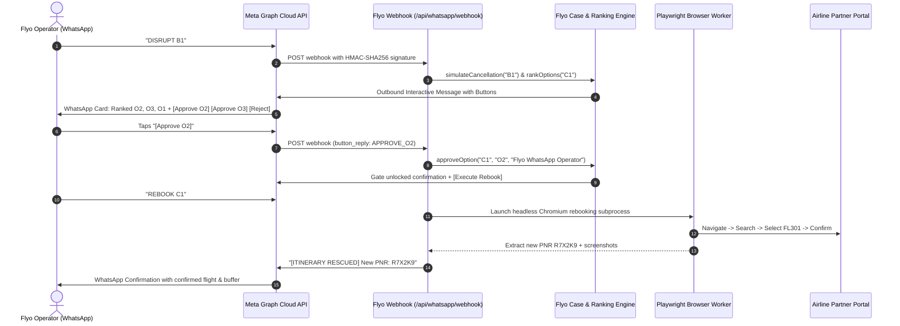

# Flyo Rescue Agent — Autonomous Flight Disruption Recovery Platform

> **Production Disruption Recovery Engine &middot; Flyo Operations**  
> Local MVP Architecture & Verification Suite

---

## 1. Executive Summary

Flyo Rescue Agent is an autonomous disruption recovery platform built for flight operations. When an airline unexpectedly cancels or delays a flight, Flyo instantly detects the disruption, deterministically evaluates onward connection safety and downstream accommodation risks, ranks recovery options using rigid connection buffer rules, requires explicit **Flyo Operator** approval, automates partner portal rebooking via headless browser automation (Playwright), and generates simulated instant passenger WhatsApp notifications with an append-only audit trail.

### The Hero Story
- **Passenger:** Ananya Sharma (PNR: `HYD123`)
- **Disruption:** Flight `AI-839` (`HYD → DEL`, tonight 21:00) cancelled
- **Downstream Impact:** Misses onward flight `DEL → Toronto (YYZ)` tomorrow at 09:30, plus non-refundable Delhi hotel night is forfeited
- **Flyo Resolution:** Ranks Option O2 (`FL301` via Mumbai arriving at 01:40 with 7h 50m buffer) as Rank 1 (+₹4,200), awaits operator sign-off, executes automated rebooking on the airline portal to issue PNR `R7X2K9`, and notifies Ananya Sharma.

---

## 2. Core Architectural Philosophy: Why Code (Not LLM) Decides Money & Booking

In enterprise flight operations, financial liability and passenger safety cannot tolerate non-deterministic hallucination:

1. **Deterministic Connection Buffer Engine:**
   - LLMs can hallucinate timezone math, flight durations, or airport terminal transit times.
   - Flyo computes connection buffers strictly in Java: any flight option with `< 120 minutes` before an international connection is strictly disqualified from Rank 1.
2. **Strict Financial & Approval Gate (HTTP 403):**
   - Financial transactions (+₹4,200 fare difference) and ticket reissues are gated behind explicit human sign-off (`Flyo Operator`).
   - Any rebooking attempt before sign-off returns **HTTP 403 Forbidden**.
3. **Strict Idempotency:**
   - Composite idempotency key (`caseId + optionId`). Re-invoking rebooking returns the identical confirmed PNR without triggering duplicate airline reservations or billing.
4. **Resilient Failure Mode & Zero Fake Success:**
   - If the carrier gateway times out or fails, Playwright retries up to 3 times. If all attempts fail, the system transitions to `FAILED_ESCALATED`, sets `newPnr = null`, captures an error screenshot (`case-C1-failure.png`), and displays manual airline desk intervention guidance. It never fakes a success or invents a PNR.

---

## 3. Quickstart & Local Run

### Prerequisites
- Java 17+ (e.g. OpenJDK 17)
- Node.js 22+ (supports native TypeScript stripping)
- Maven 3.8+

### 1-Command Startup

From the `flyo-rescue-demo` directory:

```bash
# 1. Install agent dependencies (one-time)
cd agent && npm install && npx playwright install chromium && cd ..

# 2. Build and launch the Spring Boot backend
cd backend
JAVA_HOME=/opt/homebrew/opt/openjdk@17 PATH="/opt/homebrew/opt/openjdk@17/bin:$PATH" mvn package -DskipTests
JAVA_HOME=/opt/homebrew/opt/openjdk@17 /opt/homebrew/opt/openjdk@17/bin/java -jar target/rescue-backend-0.0.1-SNAPSHOT.jar
```

The Flyo Rescue Console is now live at:
**`http://localhost:8080`**

---

## 4. 2-Minute Live Demo Walkthrough

1. **Open Dashboard (`http://localhost:8080`)**:
   - Observe Today's Live Bookings table with 5 active passenger itineraries.
   - Ananya Sharma (`B1`, `HYD123`) is pinned at the top with critical onward flight `DEL → Toronto (YYZ) 09:30`.
2. **Simulate Cancellation**:
   - Click **"Simulate Cancellation"** on B1.
   - Active Disruption Case `C1` appears in state `DETECTED`.
   - Automated impact is calculated: Missed Toronto flight + Delhi hotel financial risk.
3. **Review Ranked Options**:
   - Ranking engine computes 3 options:
     - **Option O2 (Rank 1):** `FL301` via BOM (+₹4,200) &mdash; 470m buffer (&ge; 120m), arrives 01:40, **saves Toronto**.
     - **Option O3 (Rank 2):** `FL401` direct tomorrow (+₹1,500) &mdash; departs after Toronto flight, misses connection.
     - **Option O1 (Rank 3):** `FL201` direct tomorrow (₹0) &mdash; 85m buffer (< 120m), disqualified despite being cheapest.
4. **Approval Gate**:
   - Rebook without approval &rarr; blocked with **HTTP 403 Forbidden**.
   - Click **"Approve Option"** on Option O2. State moves to `AWAITING_APPROVAL` with actor `Flyo Operator`.
5. **Browser Rebooking (Playwright)**:
   - Click **"Execute Rebooking (Playwright)"**.
   - Playwright headless browser drives through Mock Airline Portal (`/search` &rarr; `/select` &rarr; `/confirm`), captures 4 audit screenshots, extracts confirmed PNR **`R7X2K9`**, and sets state to `DONE`.
   - Clicking Rebook again returns instantaneously with the identical PNR (Idempotent).
6. **Simulated WhatsApp & Audit Trail**:
   - Review the WhatsApp panel: shows draft created at ranking, followed by sent message with confirmed PNR `R7X2K9`.
   - Review Chronological Audit Trail: records every event with timestamps and actor identities.
7. **Simulate Failure Mode**:
   - Click **"[Break Mock Portal]"** in header.
   - Simulate and rebook on a broken portal: Playwright retries 3 times, transitions to `FAILED_ESCALATED`, sets `newPnr = null`, captures `case-C1-failure.png`, and displays emergency airline phone desk guidance (`1800-209-4555`).

---

## 5. Final Acceptance Verification Checklist

All 10 verification steps executed and verified:

| # | Acceptance Requirement | Test Command / Endpoint | Result |
|---|------------------------|-------------------------|--------|
| **1** | Backend starts with 1 command, dashboard at `localhost:8080` | `curl -s http://localhost:8080/api/bookings` | **PASS** |
| **2** | Simulate on B1 creates C1 with correct impact | `curl -s -X POST "http://localhost:8080/api/cases/simulate?bookingId=B1&type=CANCELLED"` | **PASS** |
| **3** | Options ranked O2, O3, O1 with cost, times, reasons | `curl -s http://localhost:8080/api/cases/C1/options` | **PASS** |
| **4** | Rebook before approval returns 403 Forbidden | `curl -s -o /dev/null -w "%{http_code}" -X POST http://localhost:8080/api/cases/C1/rebook` (returns `403`) | **PASS** |
| **5** | Approve O2, rebook returns `R7X2K9`, screenshots saved | `curl -s -X POST http://localhost:8080/api/cases/C1/approve -H "Content-Type: application/json" -d '{"optionId":"O2"}'` &rarr; `rebook` | **PASS** |
| **6** | Rebook again returns same PNR, no duplicate booking | Second call to `POST /api/cases/C1/rebook` returns existing `R7X2K9` in < 10ms | **PASS** |
| **7** | WhatsApp panel shows simulated draft & sent message | `curl -s http://localhost:8080/api/cases/C1/messages` | **PASS** |
| **8** | Audit trail shows chronological steps with timestamps | `curl -s http://localhost:8080/api/cases/C1/audit` | **PASS** |
| **9** | Break Portal ON: 3 retries, `FAILED_ESCALATED`, null PNR, screenshot + manual guidance | `POST /mock-airline/toggle-break?broken=true` &rarr; `rebook` | **PASS** |
| **10**| Reject path: sets `ESCALATED`, no rebooking occurs | `curl -s -X POST http://localhost:8080/api/cases/C1/reject` | **PASS** |

---

## 6. Real Meta WhatsApp Cloud API Integration (Full Platform Control)

The platform is integrated with the official **Meta WhatsApp Cloud API (WhatsApp Business Platform)**, allowing complete operations control from your phone.

### Architecture Overview



### Complete WhatsApp Command Reference

Send any of these commands to your connected Flyo WhatsApp Business number:

| Command | Action Performed | Example Response / Action |
|---|---|---|
| `HELP` / `MENU` | Shows complete operations command cheatsheet | Formatted operational menu with quick action guides |
| `STATUS` / `LIST` | Queries today's active flights & disruption status | 5 monitored flights with PNRs and international connection alerts |
| `DISRUPT B1` | Simulates cancellation on flight AI-839 (Ananya Sharma) | Computes impact, ranks O2/O3/O1, replies with interactive buttons |
| `OPTIONS C1` | Displays deterministic ranking math & buffer times | Details on arrival times, +₹ fare difference, and connection safety |
| `APPROVE O2` | Approves Option O2 and unlocks automated rebooking gate | Records actor `Flyo WhatsApp Operator`, unlocks HTTP 403 gate |
| `REJECT C1` | Rejects case and escalates to manual desk | Sets state `ESCALATED`, blocks automated rebooking |
| `REBOOK C1` | Dispatches Playwright worker to mock airline portal | Executes browser flow, issues PNR `R7X2K9`, sends passenger alert |
| `AUTO RESCUE B1` | Runs entire autonomous macro end-to-end | Detects &rarr; Ranks &rarr; Auto-approves O2 &rarr; Rebooks &rarr; Returns PNR |
| `BREAK PORTAL` | Simulates airline 500 reservation gateway outage | Toggles carrier failure mode from chat; subsequent rebook retries 3x |
| `RESTORE PORTAL` | Restores normal airline reservation gateway | Restores mock portal to operational state |

---

## 7. Connecting to Live Meta WhatsApp in 3 Steps

To link this local backend to your live Meta WhatsApp Business Account:

### 1. Expose Local Port 8080 via Tunnel
```bash
# Using ngrok
ngrok http 8080

# Or using Cloudflare Tunnel
cloudflared tunnel --url http://localhost:8080
```
Copy your public HTTPS URL (e.g. `https://your-domain.ngrok-free.app`).

### 2. Configure Meta Developer Console
1. Go to [developers.facebook.com](https://developers.facebook.com) &rarr; **My Apps** &rarr; Select your WhatsApp App.
2. Under **WhatsApp** &rarr; **Configuration**:
   - **Callback URL:** `https://your-domain.ngrok-free.app/api/whatsapp/webhook`
   - **Verify Token:** `flyo_whatsapp_verify_token_2026` (or the token configured in `application.properties`)
3. Click **Verify and Save**.
4. Under **Webhook fields**, click **Manage** and subscribe to **`messages`**.

### 3. Set Your Credentials in `application.properties`
```properties
# Meta WhatsApp Cloud API Configuration
whatsapp.meta.enabled=true
whatsapp.meta.phone-number-id=YOUR_PHONE_NUMBER_ID
whatsapp.meta.access-token=YOUR_SYSTEM_USER_OR_PERMANENT_ACCESS_TOKEN
whatsapp.meta.verify-token=flyo_whatsapp_verify_token_2026
whatsapp.meta.app-secret=YOUR_META_APP_SECRET
whatsapp.meta.operator-phone=YOUR_WHATSAPP_PHONE_NUMBER
```
*(If credentials are kept as mock defaults, the platform automatically runs in Mock Mode, processing webhooks and logging responses locally so all tests pass cleanly without external network calls).*

---

## 8. Test Suite & Zero-Regression Verification

The complete Spring Boot test suite includes **22 automated integration tests** covering:
- 10/10 Core MVP Acceptance Checks (Ranking, Approval Gate, Idempotency, Playwright Rebooking, Audit Trail, Failure Retries)
- Meta Webhook Challenge verification & HMAC-SHA256 signature security
- Interactive WhatsApp Bot commands (`STATUS`, `DISRUPT`, `APPROVE`, `REBOOK`, `AUTO RESCUE`, `BREAK PORTAL`, `HELP`)
- Whitelist authorization check for operator phone numbers

```bash
cd backend
JAVA_HOME=/opt/homebrew/opt/openjdk@17 PATH="/opt/homebrew/opt/openjdk@17/bin:$PATH" mvn test
# Tests run: 22, Failures: 0, Errors: 0, Skipped: 0
```
